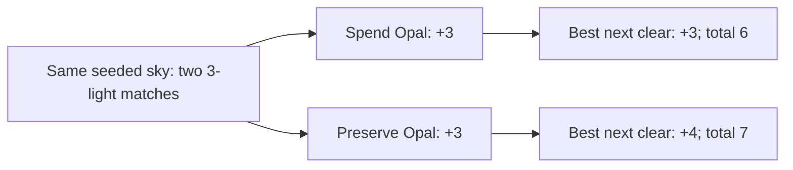

# Opal planning opportunities: bounded production-Core study

**Partially verified — keep the current rules.** Preserving an existing Opal can repay a smaller first clear, but that advantage is uncommon in these sampled trajectories. A universal preference for saving Orbs is not supported. Next: test whether a player recognizes an equal-reward allocation choice and a preservation counterexample, with the real timing and visual cues. No rules, saves, app routes or assets changed in this study.

[Preregistered scope and decision](../../design/OPAL_CHOICE_STUDY.md) · [summary](summary.json) · [source/tool hashes](source.json) · [replayable examples](examples.json)

## What was measured

Production Core from main `06ce514` runs unchanged. Later main `4aab6a7` adopts `announcedCycleV2` and refines native tracing. This report remains bound to `06ce514`; it does not validate the newer timing or input. The sampler is untimed, so the shorter cadence is outside its model. Each policy plays 64 seeds for at most 24 showers, taking one visible-board action after each settled shower. The policies maximize immediate light; one breaks score ties by consuming fewer Opals. Their later histories diverge and keep separate denominators. This is untimed analysis, not Store scheduling, finger speed or human behavior.

At each Opal state, candidates comprise ordinary tap groups, full diagonal family components, and bounded connected five-star subsets. Core validates and commits all actions. Identical selected sets are deduplicated. Complete here means only this candidate family, not every possible partial set or whole-round optimum. The cap is 256 intermediate subsets per component expansion and 512 actions per state; **no sampled Opal state hit a cap**.

A candidate must consume fewer existing Orbs than the largest-reward baseline to qualify for these preservation metrics. The best second clear includes both ordinary matches and full traced components; restricting it to taps could create misleading apparent benefits. Whole components suffice for maximizing a single clear's value because every matched star is worth positive light. The first and second clears are actually committed in independent Core copies. Immediate comparisons use only the current board; after-shower comparisons deliver the same committed incoming shower and are labeled oracle results because its columns are hidden from players.

## Results

The denominator below is an uncapped Opal state with a legal clear. Counts describe states, not independent people, rounds or probabilities in ordinary play. Equal-first and smaller-first categories can overlap within a state and must not be added as a unique total.

| Seed range / trajectory | Opal decisions | Shared-family Orb states | Smaller-first immediate gain | Equal-first immediate gain | After-shower oracle gain | Wait oracle gain |
| --- | ---: | ---: | ---: | ---: | ---: | ---: |
| 0–63, largest immediate | 402 | 41 | 10 (2.5%) | 2 | 27 | 14 |
| 0–63, preserve on ties | 427 | 44 | 9 (2.1%) | 3 | 28 | 15 |
| 64–127, largest immediate | 388 | 50 | 4 (1.0%) | 0 | 24 | 9 |
| 64–127, preserve on ties | 411 | 56 | 3 (0.7%) | 0 | 24 | 8 |

An additional 69/70 discovery and 79/80 held-out Opal states had no legal clear, in policy order. All four cohorts had zero lower-consumption alternatives that avoided an overflow suffered by the baseline on the next committed shower. This does not measure choosing between families that spend the same number of Orbs or longer-term safety.

Preserve-on-ties collected 4,519 versus 4,477 total light in discovery, and 4,481 versus 4,484 in held-out games. Four of 64 rounds ended in each cohort; the other sixty are censored at 24 showers. These aggregates do not establish a superior full-round strategy. The modest discovery difference did not repeat in held-out data.

## A concrete planning choice and its counterexample

The first equal-reward example is seed 10, shower 12. Both first taps collect three light. Spending the Orb leaves a best next clear worth three; clearing the other group while preserving it leaves a best next clear worth four. No future arrival is required for the one-light advantage. The complete source state/actions are in examples.json.

This is a Core outcome diagram, not a native screenshot or human test. Another retained example (seed 7, shower 17) takes five then three instead of seven then zero. The retained negative example (seed 0, shower 8) preserves Opal with a six-light first clear while the baseline takes eight; the preserved branch remains behind both immediately and after the announced shower. That is a counterexample to blanket preservation, not proof that every preservation move in that state is bad. Examples are the first encountered in each category, not maximum gains selected afterward.

## Verification and limits

The 0–63 run repeated byte-for-byte: SHA256 `e7b9df8f84f689b3f53eae15286b5bfd38c9e9ae18908fd383b9f4a90c1fd104`. The held-out range was named after discovery and before execution, with no rule or method tuning. Self-checks passed for connected-set topology and cap refusal, colored trace anchors, duplicate outcomes, known fixture consumption, source-state immutability and Core JSON replay. Input hashes remained unchanged throughout each run. Swift 6.4 / Xcode 27.1 compiled the standalone checker with `-O -DDEBUG`; raw reports/progress/compiler output remain under ignored artifacts/opal-choices. The early smoke compile collided with Core's existing Outcome type; renaming the study type resolved it before accepted runs.

States within a seed are correlated. The two policies and one-action budget are selected models, not measured player habits. Five-star/full-component candidates omit intermediate six-plus subsets. DFS walks prove legality, not an efficient finger route; some long walks may be impractical before the next shower. Oracle gains are not a recommendation to anticipate hidden columns. Immediate light excludes motor effort, readability, risk beyond this horizon and emotional reward. Human comprehension, pressure response, enjoyment and replay preference remain unmeasured.

The decision is to retain the approved generation and test the legibility of these contrasting examples. Any placement or frequency refinement should be a separate bounded comparison with save/version compatibility preserved; no new progression or power system follows from these results.

## Rule-informed simulated learner

An existing simulated playtester received two abstract boards, the rules, shower phase and visible color forecast before predicting actions. It did not inspect source or outcomes during that prediction. This tests explicit rule reasoning, not discovery through the native interface, gesture feasibility, enjoyment or human comprehension.

For seed 10 / shower 12, it chose the three-light Amber tap that preserves Opal, followed by the four-light Aqua tap after gravity, correctly predicting seven rather than six total light. It identified growth values, orthogonal taps and gravity around Dusk as likely reading difficulties.

For seed 0 / shower 8, it chose the eight-light Mint trace spending Opal, favoring certain space before the storm. It also identified a seven-light preserving trace, a better alternative than the retained six-light negative example. The report therefore treats that retained example only as one losing preserving move; it cannot establish that every preserving move loses. Confidence in immediate arithmetic was higher than confidence about unknown arrival columns or real timing.

Next native comparison must use the newer main cadence and trace input, retain ordinary full animation, and record whether the player notices and can execute the two-clear opportunity before another shower. No placement, frequency or reward tuning is justified by this abstract exercise alone.

## Newer-main compatibility rerun

Reconciled with main `4aab6a7` in local study commit `5df3d8f`, then reran seeds 0–63 with the unchanged tool. A recursive comparison found only savedCadence values changing from announcedCycleV1 to announcedCycleV2; every other JSON value, including scores, counts, source boards and outcomes, matched. `swift test` passed all 90 checks. [Rerun provenance](main-v2-rerun.json) records input/report hashes. Hygiene and whitespace checks passed. This establishes compatibility of the untimed analysis, not native timing, animation or input acceptance; app sources/resources were unchanged by this study.
