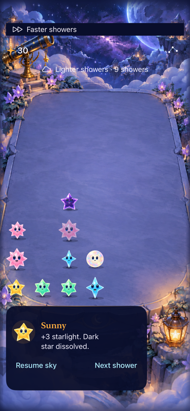
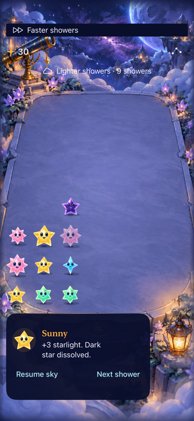

# Can the native game realize Opal's two-clear choice?

**Result: Partially verified — native outcomes and clock boundary passed; human recognition remains unmeasured.** Owner: current implementer.

The untimed study exposes an equal-first-reward choice at seed 10, shower 12: Amber then Aqua collects seven light, while Aqua then Amber collects six. Verify that contrast through ordinary native taps and full presentation before making a timing or comprehension claim. No new mechanic, runtime route or app identity is proposed.

## Acceptance before implementation

- Reproduce the study board from a bounded seeded Core history, with no invented board/RNG/counters. Keep its named fixture Debug-only behind the existing explicit reset argument.
- Both first clears collect three light. Amber-first retains one Opal and produces a four-light Aqua follow-up; Aqua-first spends Opal and produces a three-light Amber follow-up. Native and Core checks agree, and previews do not advance on clears.
- Verify the native two-clear contrast paused with normal effects. Separately check interaction while automatic showers run; record intervening arrivals rather than pretending tool latency models a player's speed.
- Inspect captures for Opal and grown-star distinction, unobstructed native targets and phase wording. Preserve existing settings/background, maximum-text and held-touch checks.
- Run Core tests, focused hosted/native tests, Debug/Release builds and hygiene. Human comprehension/enjoyment, actual VoiceOver and physical-device feel remain separate evidence; no rule tuning follows automatically.

## Initial observations

The main-based app built and restored the study's validated schema-4 archive in the private iPhone 17e / iOS 27.0 simulator. It displayed 27 light and the expected board. The manual bridge intermittently failed to activate a tap before a second attempt, so that session is not evidence of reliable timing or one-tap input. A separate XCTest run passed both existing Opal activation and five-second held-touch/ordinary-tap checks (2 passed, zero failed/skipped), result `test_sim_2026-10-18T00-09-22-373Z_pid85535_48d9fd25.xcresult`. This narrows the observed problem but does not establish its cause. A reproducible native two-clear check is the next action.

## Verified comparison

 

**Runtime evidence:** Debug normal Starfall app, private iPhone 17e / iOS 27.0 (24A434), Xcode 27.1 (27A9275), arm64 unsigned. Captures show the board after the first clear, both at 30 total light. Left: Opal is preserved for Aqua; right: Opal is spent. Screenshots were proportionally resized to 390 pixels wide with sips; originals remain in the xcresult. Calm effects was false and system Reduce Motion/VoiceOver preferences were off. This run did not record or inspect animation frame sequences, actual VoiceOver or a physical device.

The fixture replays eight legal ordinary taps across twelve committed showers from seed 10. A standalone canonical JSON comparison confirmed equality with every field of the newer-main study snapshot, including board, preview, RNG, counters and cadence. It exists only under DEBUG and the pre-existing explicit fixture/reset arguments. Production rules, save schema, assets, project membership and release routing are unchanged.

| Check | Result and source |
| --- | --- |
| Core | `swift test`: 91 passed, zero failures. New regression checks both orders, 34 versus 33 final light, Orb counts, stable incoming/turn count and valid JSON round-trip. `/tmp/starfall-opal-planning-core.log`. An initial compile used the wrong property name cadence; corrected to the existing cadenceID before accepted runs. |
| Native two-clear comparison | One test, both branches passed; zero failures/skips. `test_sim_2026-10-18T00-11-29-637Z_pid85535_15bd4ef3.xcresult`. Each first tap scores three; Amber-first retains one Orb and a four-light Aqua follow-up, Aqua-first leaves no Orb and a three-light Amber follow-up. |
| Hosted deadline and native siblings | Three passed, zero failures/skips: exact Core equality after one due faster shower, native storm count/settings/background restoration, largest-text trace/menu. `test_sim_2026-10-18T00-12-48-188Z_pid85535_ae1a9b26.xcresult`. The manual clock advances 1.7 then 30 seconds during the pending first clear; settlement delivers one shower, not catch-up, and the four-light follow-up remains valid. This is a clock-boundary check, not a human reaction-time result. |
| Build | Debug test builds passed; Release build passed without warnings/errors, `build_sim_2026-10-18T00-13-56-668Z_pid85535_5f2d7fa8.log`. The existing Core source glob includes the fixture in Debug; the entire fixture file is excluded by its DEBUG guard in Release. No new source/resource membership required. |
| Visual inspection | Both attached native screenshots inspected: round Opal, distinct grown Aqua/Amber, front stars and controls remain visible. Phase density and faster timing remain separately worded. Still images do not establish motion quality. |
| Hygiene | `python3 scripts/ci-hygiene.py` and `git diff --check` passed. |

The two-clear run predates only the additional hosted test and documentation, which do not alter its app/Core source. All runs use main `7afadb5`'s product tree plus the recorded fixture/test edits; its product tree equals the prior local study tip `a60d42f`. Source hashes and dirty paths are in source.json. Result bundles/logs live under the XcodeBuildMCP Starfall workspace, not in the repository.

## Decision and next action

Keep current rules. This is an executable native planning example, not evidence that ordinary players notice the one-light benefit or prefer the storm rhythm. Use it as a brief comprehension comparison, then observe ordinary automatic play on the current single app. Record first choices before explaining the benefit, whether a player predicts the next clear, and whether the storm changes that choice. Do not add spawn frequency, reward or pressure changes until that observation identifies a specific problem. The manual bridge's missed activations remain unexplained; passing XCTest narrows the observation but does not prove the bridge caused it.
