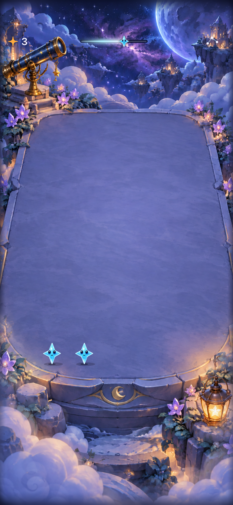
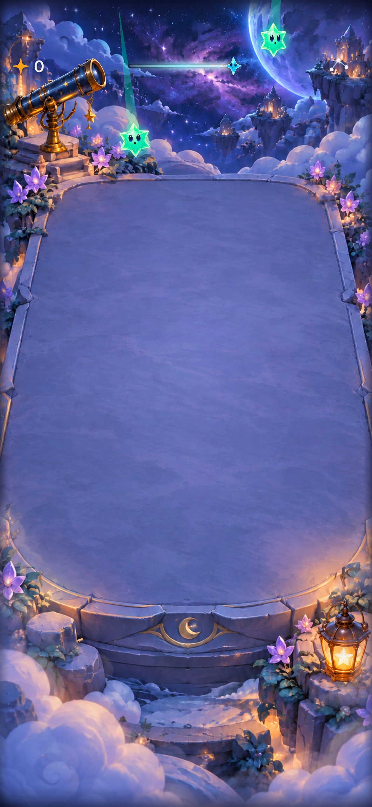

# Opening cascade and three-second showers

**Result:** Partially verified · **Owner:** current implementer · **Date:** 2026-10-17

New skies begin empty, with four closely spaced animated showers, then continue at three seconds by default. Clearing is available between settled opening waves, before the cascade finishes. Existing wave sizes, seeded generation and falling artwork are unchanged. Old saves and First Light retain their previous cadence.

**Decision:** Integrate the user-selected opening directly, without a pilot route. Human enjoyment and physical-phone pacing remain unverified; this is implementation and native acceptance evidence.

**Next action:** Review opening and crowded-board feel on a physical phone. Sparse seeds remain a specific tuning question.

## Behavior and acceptance

| Criterion | Result / boundary |
| --- | --- |
| Empty opening, immediate spectacle | First shower starts 0.25 seconds after Start. Four existing waves arrive at 1.8-second spacing, then the selected regular pace applies. The default seed delivers 13 stars in approximately 6.7 seconds including settling. |
| Clearing during the opening | Hosted and native tap checks pass before wave four. Each in-flight batch stays atomic; taps are accepted after that batch settles, while the rest of the intro is still scheduled. A clear does not reset the next deadline. |
| Full falling effects | Scene, flight, stagger, contact, rebound and clear animation code are unchanged. Explicit normal-motion native clear test passes with Calm and system Reduce Motion verified off. A 30 fps recording shows staggered flight, trails, contact and rebound in inspected frames. Short input windows are intentional; no animation was shortened to obtain a pass. |
| Existing wave sizes and deterministic generation | 200 seeds compared against the same generator with the historical cadence. Incoming previews and boards match, including a first-wave clear and save round trips. Idle opening arrivals range 6–18, mean 11.35; default seed 5 uses sizes 3, 2, 5, 3. No guarantee of 12+ arrivals for every seed. |
| Save/replay compatibility | Optional saved cadence marker enables the intro only for new-version skies. Missing marker retains the old clock, including historical empty skies. Missing saved balance retains Steady, independently of the new default. Mid-intro restore resumes from committed wave count, paused; replay retains the cadence version. New sky enables the new opening while retaining the selected balance; an old saved Steady choice remains four seconds until changed to Brisk. |
| First Light | Keeps its fixed seed, four-second pace, target and generation; core/hosted checks pass. Native win, overflow, restore, replay and return-to-survival checks pass. |
| Interruption and rapid input | Hosted checks cover stale timer/animation completions, background, settings, motion changes, restart and one pending shower. Native intro rapid taps/settings, background/relaunch/overflow and automatic pause/replay/settings checks pass. No catch-up queue. |
| Accessibility | Actual VoiceOver paused growth speech passes on iOS 27. Full VoiceOver opening play remains unverified. Largest-text settings/dismissal and actual system Reduce Motion manual play checks pass; system motion preference is restored afterward. |

**Native capture — seed 5, Debug, iPhone 17e / iOS 27.0 Simulator.** Exported from `testOpeningCascadeAllowsNativeClearBeforeLastWave` in the first native run. The test asserts a successful clear before wave four; this image shows the resulting score and continued sky. It is not evidence of animation smoothness. The menu help wording was updated after this first build; core/store/scene behavior matches the final source.

**Normal-motion recording frame — same simulator/seed, 30 fps.** From the verified full-motion run, about 30.5 seconds into the recording after Settings setup. The source differs from the final app only by temporary event logging in the scene; those diagnostics were removed. Neighboring frames show the stars reaching the board with contact light and rebound. A sampled recording does not establish physical-device smoothness or player preference.

## Verification context

**Source:** Base commit `b0de3ffab7f6c96d2e1c5e63708452fb84135a48` plus this workstream's changes in `Sources/StarfallCore/FallingSky.swift`, `StarfallBalance.swift`, `App/FallingSkyStore.swift`, `FallingSkyMenu.swift`, their core/hosted/UI tests and documentation. No project, resource membership, dependencies or geometry changes. This is working-tree evidence, not a clean published-commit acceptance claim.

**Environment:** Xcode 27.1 (`27A9275`); iPhone 17e, iOS 27.0 Simulator, ID `4103C352-DFC2-493E-A224-DE4CE3D50889`; arm64. Simulator tests/builds use signing disabled. No physical device installation or play performed.

| Check | Command / procedure | Result |
| --- | --- | --- |
| Core | `swift test` | 63 tests pass. |
| Hosted | `xcodebuild … -only-testing:StarfallAppTests/FallingSkyStoreTests test` | All 20 pass, including new opening/input/restore/interruption checks and historical-clock regressions. |
| Native first run | Opening tap, background/relaunch/overflow, balance and actual VoiceOver feedback | Opening, background and VoiceOver pass. Balance initially failed an obsolete exact-wave-one assertion; see correction below. |
| Native follow-up | Automatic rain/pause/growth/clear/replay/settings; balance controls | All six selected UI checks pass, including First Light win/loss, largest text and system Reduce Motion; all 20 hosted checks also pass. |
| Debug simulator build | Included in hosted/native test builds | Pass; final menu source included in follow-up build. Final uninstrumented normal-motion opening test passes (43.669 seconds), with a successful native clear before wave four. |
| Release simulator build | `xcodebuild -project Starfall.xcodeproj -scheme Starfall -configuration Release -sdk iphonesimulator -destination 'generic/platform=iOS Simulator' -derivedDataPath /tmp/StarfallOpeningRelease ARCHS=arm64 ONLY_ACTIVE_ARCH=YES CODE_SIGNING_ALLOWED=NO build` | Pass. |
| Hygiene | `python3 scripts/ci-hygiene.py`; `git diff --check` | Pass. |
| Recording / visual | Native acceptance recording and inspected XCTest screenshots | Capture retained under ignored `artifacts/opening-cascade/verified-full-motion-opening.mp4`; sampled normal-motion frames inspected separately from quiet-mode checks. Screenshots inspected for board/control readability. No geometry change; native clear tap checks the existing mapping. |
| Device / human preference | Opening, recovery and crowded-board feel on a physical phone | Not run. |

Common native invocation: `xcodebuild -project Starfall.xcodeproj -scheme Starfall -configuration Debug -destination 'platform=iOS Simulator,id=4103C352-DFC2-493E-A224-DE4CE3D50889' -derivedDataPath /tmp/StarfallOpeningDerived ARCHS=arm64 ONLY_ACTIVE_ARCH=YES CODE_SIGNING_ALLOWED=NO`, followed by selected `-only-testing` identifiers and `test`. Raw logs/results are under ignored artifacts and `/tmp/StarfallOpeningDerived/Logs/Test/`. Final normal-motion result: `Test-Starfall-2026.10.17_16-12-46--0400.xcresult` (see raw log for authoritative result path).

## Corrections and remaining limits

The first native build attempted x86_64 and could not resolve StarfallCore; explicitly selecting arm64 fixed the invocation without changing project settings. Initial core fixture equality failures were corrected by constructing the historical reference with its saved Steady pace and without the new cadence marker; board/RNG assertions remain intact. Existing hosted clock tests deliberately retain a legacy saved round, alongside new fresh-sky tests.

The faster opening can advance more than once while a UI test navigates to Pause. The old balance test expected wave one after settings dismissal. It now compares the entire board accessibility snapshot captured after pausing, retaining the actual preservation assertion without assuming a particular wave number. The follow-up passes; no retries or animation suppression were added.

The first recordings were quiet-mode recordings: tapping the Calm label had not turned the switch off. A temporary scene diagnostic confirmed renderer Calm on with system Reduce Motion off. The native setup now taps the switch thumb and waits for its actual off value, as well as disabling/restoring system Reduce Motion. The repeated test passes with all three motion flags off and visible falling stars. Temporary diagnostic logging and an unsuccessful exploratory preference-observer change were removed; renderer and view sources are unchanged. The full-motion recording used only temporary diagnostic logging; a final uninstrumented normal-motion opening run also passes.

Human pacing, sparse-seed interest and physical-device input-window comfort remain open. See [the engineering follow-up](../../ENGINEERING.md#opening-cadence-acceptance--october-17-2026). Full simultaneous clearing against unlanded stars is outside this change: it would require a separate presentation/input ownership design, rather than unlocking the already-committed destination cells during flight.

Documentation image and local link paths were checked; a rendered Markdown preview was not inspected. Source fingerprints and raw command output are retained under ignored `artifacts/opening-cascade/`.
