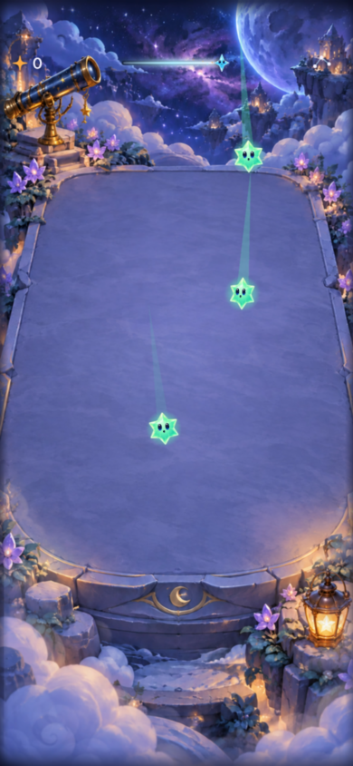
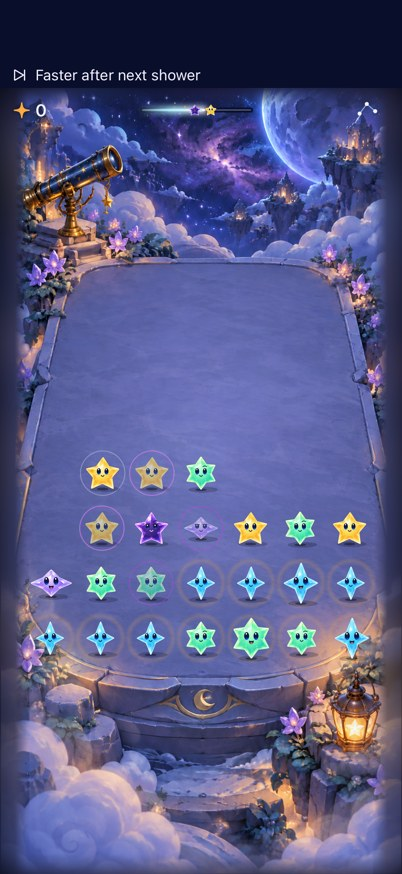
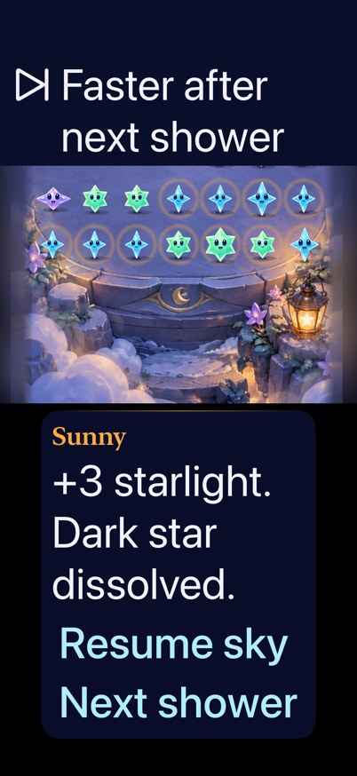

# Simulator acceptance supports a bounded pacing comparison

**Result:** Partially verified · **Owner:** task 6 · **Date:** October 17, 2026

The combined `5e56d5a` rules/store/flow checks pass: 72 Core tests, 102 hosted tests, selected native opening, tracing, lifecycle and terminal checks, and simulator builds. Separate `b42eba3` presentation checks pass: seven hosted checks and six native flows covering calibrated forecast placement, B phase cues, Settings, normal/reduced motion, largest text, active coexistence and a largest-text clear. Selected screenshots and temporal video samples were inspected. No runtime fixes were made.

**Limits:** Initial attachment/finalization stalls and test-budget/setup failures remain visible below. Continuous animation smoothness, accelerated-opening trace comfort, human preference, actual VoiceOver and physical-device behavior remain unverified. B is unadopted.

**Next action:** The user comparison owner can use the reproducible final simulator candidate with [the user-only protocol](../../design/PACING_PLAYTEST.md). Preserve these limits; a passing build or automated player is not enjoyment evidence.

## Outcomes against acceptance

| Criterion | Observed result | Limit |
| --- | --- | --- |
| Rule/save/replay contracts | Pass: 72 Core tests | Core evidence, not native behavior |
| Production route / comparison isolation | Pass by source/export inspection | Normal app has no B selector; canonical fixture stays in test targets; explicit export only |
| Opening with full motion, clear before fourth wave, rapid input | Native pass | Seed 5; sampled video review below |
| Selected five from six, short/outside cancellation, restore and largest-text trace | Native pass | Deterministic fixture; no human comfort claim |
| Automatic rain, pause, clear, replay, Settings | Native pass | Existing normal-app flow |
| Background, paused restore, automatic overflow, fresh entry | Native pass | Existing normal-app flow |
| Largest-text Welcome/Entry/back; system Reduce Motion entry/replay | Native pass | Actual VoiceOver not run |
| Intentional trace across automatic deadline | Native pass on corrected check | `f95b24f` test overlay; initial setup failure retained below |
| First Light win/full ending/relaunch | Native pass on focused rerun | 131.778 seconds; initial 120-second timeout retained below |
| Combined hosted checks | Pass: all 102 | Recovery log contains complete hosted results; aggregate result bundle did not finalize |
| B cue boundaries, stable frames, Settings dismissal, normal and reduced motion | Pass on `5e56d5a` | A isolation also passes; largest-text body completed but its Settings teardown exceeded 120 s |
| Final forecast, active cue coexistence, largest-text native clear | Pass on `b42eba3` | Seven hosted and six native presentation checks; separate final-source evidence below |
| Native seeds 0/11, sustained dense-board decision quality, intentional traced clear during accelerated opening | Unverified | Seed 5 / deterministic trace fixtures sampled natively; model and hosted opening checks do not establish native comfort |
| Actual VoiceOver / physical device / human preference | Not run | VoiceOver is an RC gate; device/installation and human comparison remain separate |

## Verification context

Runtime App/Core/project sources in the clean starting checkout `55cdbd4` are identical to `5e56d5a`; its later difference is integration evidence only. Worktree: `/Users/lbeezr/.codex/worktrees/pacing-acceptance/Starfall`, branch `codex/pacing-acceptance`. Native-test overlay commits `53c3cf3` and `f95b24f` add a held-trace check and a focused bounded ending-test allowance; no runtime source changes. The initial recovery binary contains the earlier dirty version of the new trace test. Corrected test results must be recorded separately.

Environment: Xcode 27.1 (`27A9275`), arm64; private iPhone 17e simulator **Starfall Pacing Acceptance**, iOS 27.0 (`24A434`), UUID `1B3A9585-6D5B-4199-88E0-AF5D8982EEF8`. No other simulator was reset. Normal/export install identity is `com.starfall.prototype` on this simulator only; no phone/updater action. DerivedData: `/tmp/Pacing6Normal`, `/tmp/Pacing6Release`, `/tmp/Pacing6Export`.

- `swift test` — 72 passed, `/tmp/pacing6-core.log`.
- `python3 scripts/ci-hygiene.py` and `git diff --check` — pass.
- Normal Release: `xcodebuild -project Starfall.xcodeproj -scheme Starfall -configuration Release -sdk iphonesimulator -destination 'generic/platform=iOS Simulator' -derivedDataPath /tmp/Pacing6Release ARCHS=arm64 ONLY_ACTIVE_ARCH=YES CODE_SIGNING_ALLOWED=NO build` — pass, `/tmp/pacing6-release.log`.
- Export: `python3 tools/mechanics/prepare-pacing-candidate.py --source 5e56d5ae63e2bf34667e5d46013c0d643a33ecfe --output /tmp/starfall-pacing-acceptance-export` — pass. Ten Core/Store/scene/flow/fixture files byte-identical; canonical fixture SHA-256 `873a78ded0501fcc4bb14123a92b93d634a10015aa16a97083eaa07b7d0e51e0`. Debug generic-simulator `build-for-testing` using `/tmp/Pacing6Export` — pass, `/tmp/pacing6-export-build.log`.

The recovery runner stopped progressing after all 102 hosted results were emitted. After about one minute of finalization without output, SIGINT did not finish it and SIGTERM stopped the owned process. `/tmp/pacing6-recovery.xcresult` has no final Info.plist and cannot export attachments; individual log results remain available. This aggregate run is not a pass. No second simulator recovery was attempted.

Raw logs/result bundles and recorded video remain machine-local temporary output; they are not published artifacts. [verification.json](verification.json) retains exact commands, result levels, source/test overlays and local output paths. Normal recovery logs contain nine passed native cases, one setup failure and one timeout; the two corrected checks pass separately. This establishes eleven selected normal-app cases, not the entire UI suite.

## Failed checks and bounded recovery

The first normal Debug hosted command selected all `StarfallAppTests` with signing disabled. The app displayed Welcome, but no XCTest results arrived in roughly three minutes. The owned run was interrupted, the private simulator alone shut down/rebooted once, and the run switched to explicit ad-hoc simulator signing (the verified Store handoff's signing configuration). This is one recovery, not a passing initial result. Root cause of the attachment stall is unproven.

The first deadline check queried `experiment.pause` immediately after opening Settings. XCTest found a disabled background Resume and enabled menu Resume and stopped before the gesture. The corrected setup resumes directly from the visible guide, moves through five stars before holding across rain, and keeps the score/committed-shower assertions. This avoids relying on transient sheet-tree uniqueness. It does not establish that the accessibility exposure of every modal transition is correct; actual VoiceOver remains open.

The two-round First Light flow reached its win and full-sky screenshots but exceeded the command's 120-second allowance near final relaunch. Its existing up-to-50-action win path plus up-to-40-action loss path and relaunch now receive a specific 240-second allowance. All waits and assertions are unchanged; no blanket retry is enabled.

## Bounded normal-motion observation

 

**Native video frames, runtime `5e56d5a`, Debug, iPhone 17e / iOS 27.0, system Reduce Motion and Calm off.** Exact-time samples at 178.9 and 179.2 seconds in `/tmp/pacing6-normal-native.mp4`, recorded during the opening UI check. Reviewed surrounding samples at 178.0/178.3/178.6 seconds show the empty board, countdown and first entry from above. These show flight/trails/landing progression and preserve the board art; they do not prove continuous smoothness, all later animations or human enjoyment. The UI assertion independently verifies an accepted clear before wave four.

## Corrected normal-app native checks

Clean test overlay `f95b24f` (runtime unchanged from `5e56d5a`) passes the corrected held-trace and complete First Light win/replay/full/restore/new-entry tests: 2 tests, zero failures, valid `/tmp/pacing6-corrected.xcresult`. Exact durations: trace 18.712 s, ending 131.778 s. Log `/tmp/pacing6-corrected.log`; exported captures `/tmp/pacing6-corrected-attachments/`. Inspected the deadline aftermath and full-sky ending screenshots: score remains zero after held-trace rain, the dense fixture is readable, and the ending actions are visible without truncation. No runtime fix was made.

## Separate forecast presentation follow-up

Runtime/export `b42eba357515793c834fec7d9125907ca106a22f` is tested separately. Own checkout merge `fdfd53494909665fd7f77aea5a4f683d80163e37` has identical App/Core/project contents; only the scoped test/evidence overlay differs. No Core, Store, canonical fixture or ceremony difference exists between `5e56d5a` and `b42eba3`. Earlier rule/scheduler results remain source-bound to unchanged files; earlier screenshots do not verify this new HUD/View/theme.

Normal Debug build-for-testing, normal Release and exported Debug build-for-testing pass (`/tmp/pacing6-final-{build,release,export-build}.log`). On private **Starfall Pacing Forecast Acceptance**, iPhone 17 / iOS 27.0 (`24A434`), UUID `F4BA0D73-6491-4171-A29B-93ABC79EB4FF`, seven hosted geometry/placement tests and one native forecast/menu/background/largest-text test pass with a finalized `/tmp/pacing6-final-forecast.xcresult`. Native time 37.115 s. No full unaffected suite was repeated. The export is `/tmp/starfall-pacing-final-acceptance-export`; manifest pins `b42eba3` and the same canonical fixture hash.

**Scaled native capture — `b42eba3`, normal Debug, iPhone 17 / iOS 27.0.** Inspected the full capture before making this small JPEG derivative. The native check verifies calibrated placement and a nonempty committed-forecast accessibility value, then Settings removal, restored position after background/resume, and largest-text header fallback. Physical camera fit is not established by Simulator. B's reserved slot may correctly select the conservative header fallback; its coexistence checks are separate below.

## Initial-source B cue results and their limits

Export `5e56d5a` passes A isolation (41.175 s), B normal motion (93.135 s) and B system Reduce Motion (88.140 s). These checks include exact phase/warning labels, one real cue, normal-size cell-frame stability, an actual clear, Settings hiding/dismissal, and phase exit. The largest-text body reached both warning/breathing screenshots, Settings dismissal and phase exit, but timed out at 120 s during native Settings restoration. It is **partial, not a passed test**. The later final-source largest-text run with a justified B-flow budget passed completely in 102.443 s; it does not rewrite the earlier result.

After the timeout, the initial-source cue runner emitted the remaining test passes but again stalled finalizing its aggregate bundle. It was stopped with SIGTERM after more than a minute without progress; no further simulator recovery occurred. `/tmp/pacing6-cues.xcresult` is not a finalized result bundle. Readback of the private 17e's `com.apple.Accessibility ReduceMotionEnabled` was `0`, its original preference. That simulator was shut down; no other owner's device was touched.

Sampled B video `/tmp/pacing6-candidate-native.mp4` at exact offsets 155.0/155.5/156.0/156.5 s: the faster cue stays above the board while the last star descends with a trail, lands, and shows its landing ring. Native frame/tap assertions supply independent layout/input evidence. This is bounded temporal sampling, not continuous smoothness or human rhythm acceptance.

## Final-source cue and active forecast acceptance

Export `b42eba3` passes all three complete B flows on iPhone 17: largest text **102.443 s**, normal motion **85.591 s**, system Reduce Motion **86.478 s**. `/tmp/pacing6-final-cues.xcresult` finalized successfully. The selected B flows use a bounded 180-second default / 240-second maximum to cover sixteen native shower actions plus Settings setup/restoration; individual waits and all assertions are unchanged. This closes the combined reduced-motion Settings gap and verifies exact cue labels, hidden/restored cue, normal native clear and stable phase-boundary cell frames on the final presentation source.

The added active coexistence check uses **only** the committed `0903778` UI-test overlay (plus the export marker) over the exact `b42eba3` runtime. It passes in **33.052 s**, `/tmp/pacing6-active-coexistence.xcresult`: active forecast has a nonempty accessibility value, remains in the safe header below the phase cue, and native cell frames stay unchanged when automatic play starts. No runtime adaptation beyond the canonical exporter was added. The later `71336e7` overlay adds the separate largest-text clear check; its result is recorded below.

 

**Scaled native captures — final `b42eba3` Debug export, iPhone 17 / iOS 27.0.** Full captures were inspected before deriving these JPEGs. In active B, the conservative header forecast and phase cue are separate. At largest text, cue and lower controls fit; upper board rows are offscreen at this scroll position. This does not claim whole-board simultaneous visibility. A uses the calibrated camera forecast on this profile while B's reserved cue slot selects the safe header: human comparison includes that presentation difference as well as timing/cues. The reduced-mode capture also retains the complete breathing label and controls; actual VoiceOver has not been run.

The largest-text native-clear overlay `71336e7` passes in **35.722 s**, `/tmp/pacing6-largest-clear.xcresult`. A visible matching native cell is tapped in the scrolled layout, score changes from zero, the warning remains, and the inspected capture shows “+3 starlight. Dark star dissolved.” This validates a real clear at largest text without requiring hidden upper rows to fit simultaneously. The active capture uses overlay `0903778`; the clear capture uses `71336e7`. App/Core/project runtime sources remain `b42eba3` in both.

## Reproduce the simulator comparison and retain the limits

Export `b42eba357515793c834fec7d9125907ca106a22f` with `python3 tools/mechanics/prepare-pacing-candidate.py --source b42eba357515793c834fec7d9125907ca106a22f --output <new-directory>`. Use Debug on an owned simulator and the same `com.starfall.prototype` identity. Launch a new round with `--starfalls-reset --starfalls-seed=<seed> --pacing-policy=A` or `B`, then use Start sky. The local prepared export is `/tmp/starfall-pacing-final-acceptance-export`; its two additional acceptance methods are a test-only overlay recorded in `verification.json`, not an app-source change. B is not saved/adopted; reset for every comparison round. Release B is unsupported.

Both owned simulators were shut down after native teardown/readback restored their original Reduce Motion value `0`. No phone, updater, credentials, remote publication or other checkout was changed. The managed acceptance worktree retains scoped tests and this evidence; raw logs/movies/results remain under `/tmp` and refreshed ignored `artifacts/pacing-acceptance-2026-10-17/`. Actual VoiceOver belongs at RC. Physical camera fit, minimum OS, landscape/tablet, human comprehension/preference and opening trace comfort require their own observations. Markdown rendering was not independently reviewed; embedded native captures were inspected.
