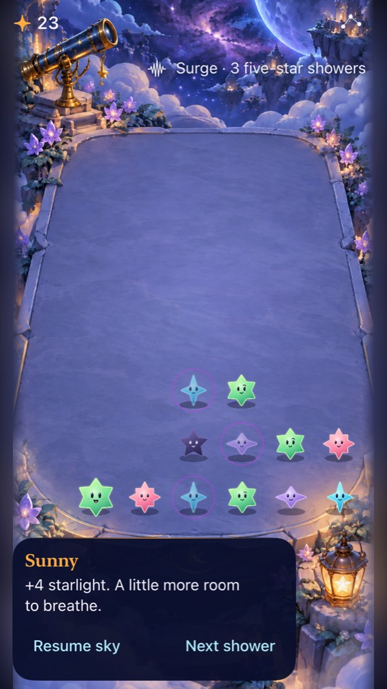
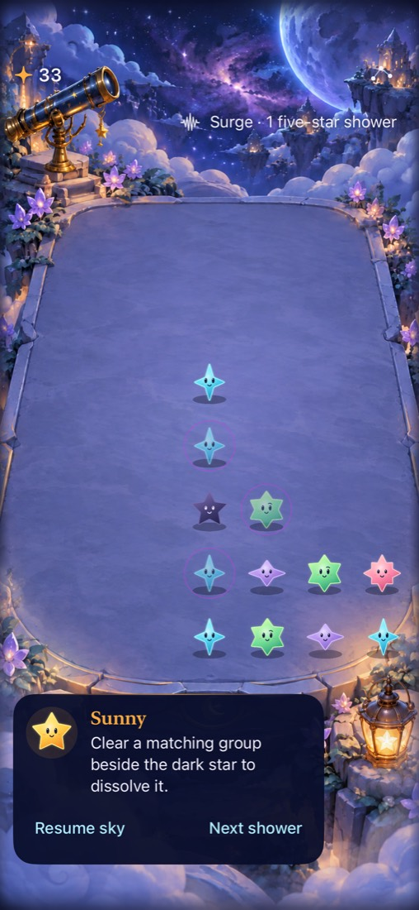
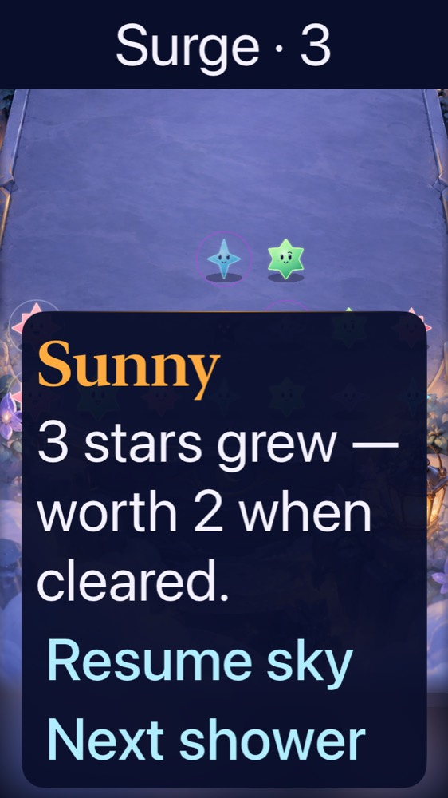

# Paused committed-outcome feedback trial

**Result: Partially verified isolated refinement · Date: 2026-10-17.** Natural/Surge exports now show the store's existing committed feedback in Sunny's paused guide. Growth, starlight, actual dark removal and invalid-input guidance are visible; active play stays quiet. Native checks cover opening, First Light, interruptions, restore and maximum-text control access. Focused VoiceOver reads the growth message. No production rules, saves or runtime route changed.

**Decision:** [The simulated follow-up](playtest.md) supports retaining this presentation in the isolated pair. **Next action:** evaluate guide-only adoption on the unchanged production generator with current native checks. Human learning, complete maximum-text board play and automatic-announcement listening remain open.

## Hypothesis and scope

Existing outcome messages may help players understand growth, clears and dark-star changes without reading accessibility cell values. The store already owns those facts. Exposing its single current message in the paused guide avoids another feedback state, timer, queue or save field. The same refinement applies to both rule candidates; their core bytes remain unchanged. The latest event or corrective input replaces the prior message, and resuming removes the card. This is a paused/manual-play experiment, not a narrator for every flowing shower.

The guide initially retained its turn-zero welcome branch. A native invalid-tap reproduction showed that this concealed the store's correction, and inspection found the same branch would conceal First Light's initial objective. The final trial always reads `store.message` while paused, with a concise initial instruction owned by the store. Opening, replay/new sky, challenge, restored state and outcomes therefore keep their existing message ownership rather than receiving more view-level exceptions. Production still uses its existing presentation; these corrections live in exported trials.

## Outcomes against acceptance

| Criterion | Result | Evidence / limit |
| --- | --- | --- |
| Explain committed manual outcomes | Passed | Growth describes worth 2; clears show starlight; actual dark removal says dissolved. An unrelated clear leaves one dark star and does not claim removal. Existing message priority selects one summary when multiple kinds occur. |
| Corrective input preserves rules | Passed | Dark tap and empty opening tap show the existing guidance without changing score/shower state. The initial hardcoded-welcome reproduction failed before correction. |
| Interruption and saved-state ownership | Passed for selected cases | Menu/background preserve paused summary; relaunch restores score with ordinary paused guidance, not transient clear text. Hosted save/clock/restart tests pass. No new save field. |
| Quiet active play | Passed | Resuming removes `experiment.message`; no new event clock or always-open active guide. |
| Dynamic Type and small-phone fit | Partial | Native growth guide/manual control checks pass at Accessibility XXXL on iPhone 17e and SE; ordinary SE captures leave stars/props clear. Existing maximum-text guide-over-board composition is still visible and not accepted for complete board play. |
| Actual screen reader | Partial | [Focused speech](voiceover.txt) includes warning, Next shower, phase count and “3 stars grew — worth 2 when cleared.” Service state restores afterward. No unsolicited-announcement or complete-round claim. |
| Rules/build regression | Passed within scope | Both core suites 61 passed, identical core hashes; final hosted/UI run 29 passed; Natural UI 3 passed; SE UI 4 passed; both Release builds passed. |
| Outcome comprehension / preference | Limited support | [Familiar-agent follow-up](playtest.md) preferred outcome feedback; exact totals still used AX. First-time human learning and enjoyment remain unverified. |

## Native and visual evidence

Actual iPhone SE (3rd generation), iOS 27 simulator, Debug final trial after a four-starlight clear. The guide reuses the existing footer; the nearest stars and lantern remain visible. This still does not prove animation quality.

Actual iPhone 17e simulator after an invalid dark-star tap, final runtime source. The score remains 33 and the guide explains the adjacent-clear rule. The native scenario previously verified actual removal and an unrelated clear that left another dark star.

Actual SE simulator at Accessibility XXXL, final trial. Full-size message and actions are reachable through scrolling. Stars behind the card expose the unresolved baseline board/guide arrangement; this capture is not full accessibility-layout acceptance.

One earlier clear attachment caught the SpringBoard foreground transition. It is rejected as visual evidence. The final test captures the settled clear before starting menu/background transitions; the corrected small-phone attachment above is used instead.

## Verification context and reproduction

Use `python3 tools/mechanics/prepare-observatory-labs.py --ref 6fdb8d0` with this tool revision. [source.json](source.json) records immutable base, final exports, candidate/tool hashes, binary identity and runtime equality with the broad native-tested revision. Final App/Core/assets are identical to the 29-test and three-test exports; only UI-test screenshot placement changed afterward, then all four affected feedback cases passed on SE. The base is a clean Git archive, excluding local Xcode project/signing/branding changes. Runtime injection appends tests to existing target members; no project membership changed.

Native toolchain: Xcode 27.1, iOS 27.0. iPhone 17e `A84C81F5-AE41-496A-97AE-E17C63E18D29`; iPhone SE (3rd generation) `E90550D2-AE94-4695-8E6F-707BD527C12F`. Debug tests use `CODE_SIGNING_ALLOWED=NO ARCHS=arm64 ONLY_ACTIVE_ARCH=YES -parallel-testing-enabled NO`, scheme Starfall. Select `StarfallAppTests/FallingSkyStoreTests`, `StarfallAppTests/BurstPhaseAnnouncementTests`, `StarfallUITests/ObservatoryBurstPhaseTests`, and `StarfallUITests/ObservatoryFeedbackTests` for the 29-case Surge run; only the feedback class for Natural/SE. Release builds use the same architecture/signing flags. The Mechanics simulator already had system Reduce Motion enabled; no motion settings were changed. SE's system motion state was not separately audited in this batch. Full falling-motion quality remains unverified here.

Raw logs and results are under `~/Library/Developer/XcodeBuildMCP/workspaces/Starfall-27844ad883f3/`:

| Check | Result | Artifact stem |
| --- | --- | --- |
| Initial feedback + existing phase/store checks | 27 passed | `test_sim_2026-10-17T16-48-38-339Z_pid40582_7caf1afb.xcresult` |
| Initial Natural feedback / maximum text | 1 passed, 1 failed after Home/activate before quiet-active assertion | `test_sim_2026-10-17T16-51-07-577Z_pid40582_a7da3932.xcresult` |
| Same Natural cases with explicit input-ready wait | 2 passed | `test_sim_2026-10-17T16-53-11-444Z_pid40582_d6c5549b.xcresult` |
| Opening invalid-tap reproduction with welcome branch | Failed: correction remained hidden | `test_sim_2026-10-17T16-56-25-312Z_pid40582_115aa108.xcresult` |
| Final Surge hosted/phase/feedback, including opening/First Light and focused growth speech | 29 passed | `test_sim_2026-10-17T16-57-08-074Z_pid40582_e338b159.xcresult` |
| Final Natural feedback | 3 passed | `test_sim_2026-10-17T17-00-03-997Z_pid40582_6fdc3e16.xcresult` |
| Final SE feedback, corrected capture timing | 4 passed | `test_sim_2026-10-17T17-01-45-936Z_pid40582_ce9bcec1.xcresult` |
| Surge Release | Build passed | `build_sim_2026-10-17T16-59-55-793Z_pid40582_37fde6da.log` |
| Natural Release | Build passed | `build_sim_2026-10-17T17-01-37-865Z_pid40582_a1627793.log` |

The initial foreground test tapped Resume without waiting for the store's input-ready state after activation. The test now waits on `enabled == true` with a bounded timeout; it retains the original guide-disappearance assertion and restore checks. This changes the test precondition, not app lifecycle behavior, and does not prove every foreground timing case is fixed.

Core commands: `swift test --package-path <export>`, logs `/tmp/starfall-paused-feedback-{natural,surge}-core.log`, 61 each. Final core bytes retain the [independently replay-verified hashes](../observatory-phases-2026-10-17/source.json); no rule/RNG/schema change was introduced. Python compilation, `python3 scripts/ci-hygiene.py` and `git diff --check` pass.

Physical device, minimum supported OS, tablet, uncoached cold-opening learning, automatic-event listening and full maximum-text board play remain open. Hosted tests cover First Light completion, overflow, restart, stale callbacks and due-rain input; this batch does not add new full native win/loss or rapid-tap acceptance.
