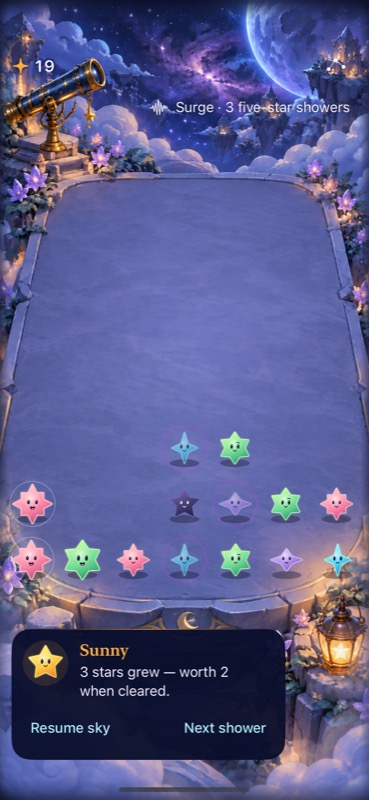
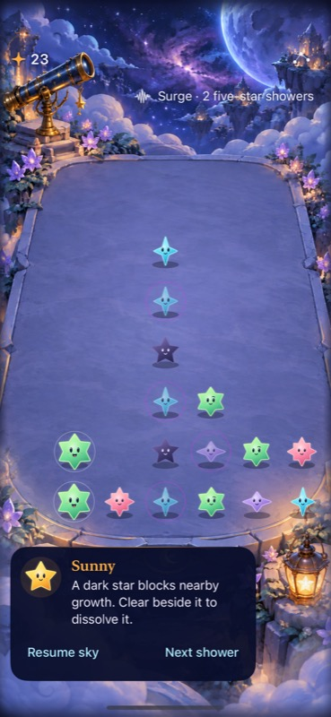
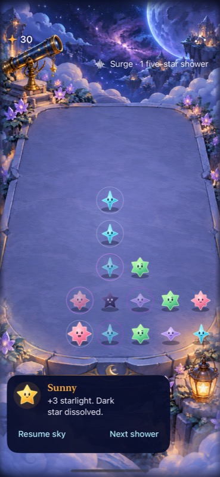

# Simulated feedback follow-up

**Decision: retain the paused-feedback refinement in the isolated pair.** One familiar agent preferred the new outcome text to the [static Sunny baseline](../observatory-phases-2026-10-17/playtest.md). It distinguished growth, an unrelated clear, corrective dark-star guidance and actual dissolution. This supports guide-only evaluation on the production generator; it does not promote Surge rules or establish first-time human learning.

The same agent played ordinary-text Surge from prepared shower 8 through 13, score 19→33, without loss or tool failures. It inspected screenshots and visible guide text before consulting exact accessibility cell values. Prior familiarity remained strong; AX still supplied precise group totals, tap locations and blocked-growth confirmation. The comparison was against its earlier recorded observations, not a blinded randomized session.

| State | Intent and observed feedback |
| --- | --- |
| 8 | No ready groups; advance from paused guidance. |
| 9 | “3 stars grew — worth 2 when cleared” and larger stars/rings explained changed value. Clear rose for space → 23, generic space message; dark star remains. |
| 10 | Dark-arrival text explained blocked growth and adjacent clearing. Tap upper dark star → corrective guidance without score/board change. Clear remote mint → 27, space message; both blockers remain. |
| 11 | Growth text accompanies new rings. Clear high amber → 30, “Dark star dissolved”; upper blocker disappears. Clear newly connected aqua → 33, same dissolution message; lower blocker disappears. |
| 12 | Recovery plus growth text supports waiting with low unblocked groups. |
| 13 | “2 stars arrived. Make room for the next shower.” Recovery remains eight calmer showers. Stop at 33. |

The unrelated mint clear and direct dark tap were useful counterexamples: neither falsely claimed removal. Consecutive amber/aqua removals used identical text, so score and board changes remained necessary to distinguish the second event. This is a residual feedback limit, not evidence that every event needs another notification.

Latest-event text persisted across tool-paced pauses until another action replaced it. No early disappearance or normal-text star obstruction was observed in these states. The lower guide covered some decorative scenery; telescope/lantern remained recognizable. Other text sizes were outside this agent check; native maximum-text limits remain in the [verification report](README.md).

Actual isolated Debug app, iPhone 17e simulator, shower 9 / score 19. The guide explains growth value without exposing the forecast strip.

Actual shower 10 / score 23. The guide explains blocked growth and the adjacent-clear rule.

Actual shower 11 after amber clear / score 30. The text reports the committed removal, replacing the prior generic paused copy.

No source or system settings changed. Installed executables/dylibs match the tested Debug products recorded in [source.json](source.json). This is paused agent simulation, not new-rule superiority, human enjoyment, urgency, full-motion or actual VoiceOver evidence. The separate native test supplies focused screen-reader speech evidence.

Next decision: evaluate the same guide-only correction with the unchanged production generator and current native checks before production adoption. Keep natural/Surge generation isolated; resolve maximum-text board/guide layout and obtain uncoached cold-opening observations before broader comprehension claims.
