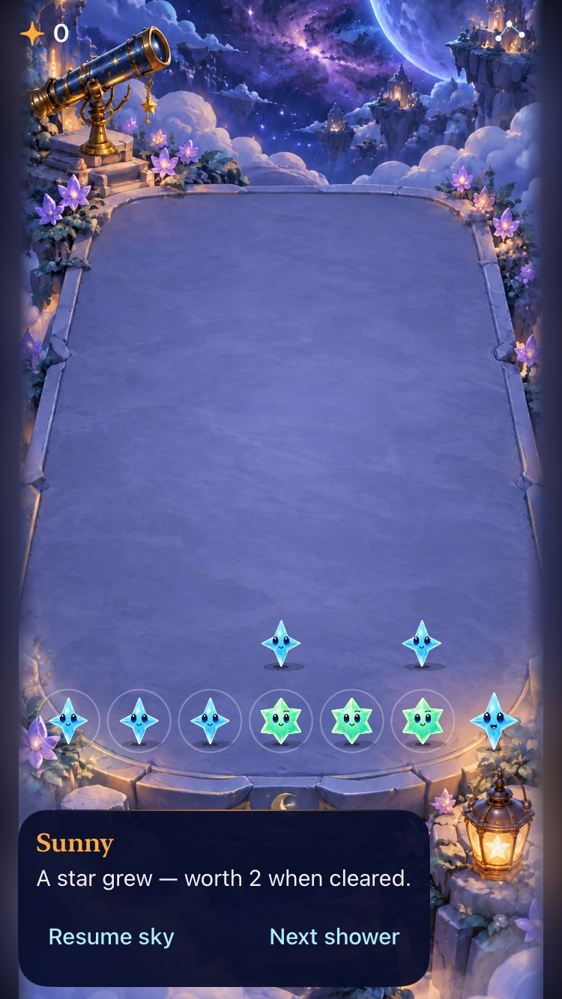
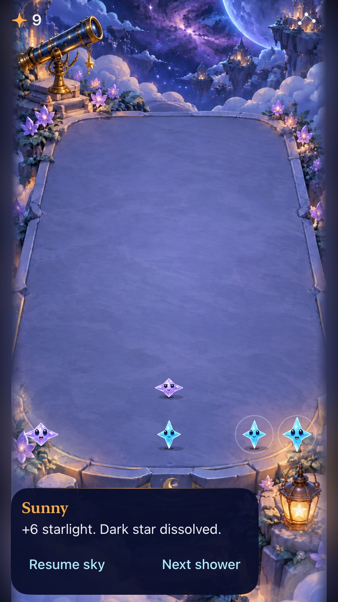
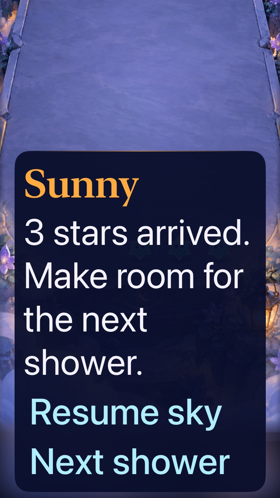

# Production paused guidance adopted

**Result: Partially verified · Owner: current implementer · Date: 2026-10-17.** Adopt the paused-guide refinement independently of shower experiments. Sunny now displays the store's existing committed/corrective message while paused. Opening copy explains clearing value; active play stays quiet. Production shower generation, core rules, saves and routing are unchanged.

Production checks support the message change, including focused actual VoiceOver and small-phone interaction. They do not accept largest-text board usability, complete VoiceOver play, human comprehension or animation quality. The guide still obscures stars at maximum text.

**Next action:** repair the shared board/guide layout boundary and verify real edge taps at maximum text, then compare natural showers and Surge with an uncoached person. Keep candidate rules isolated.

## Outcomes against acceptance

These criteria were recorded before the production changes.

| Criterion | Observed result | Evidence / limit |
| --- | --- | --- |
| Opening corrections and First Light objective visible | Pass | Both assertions fail with the original static guide and pass with store-owned text. |
| Growth, unrelated clear, actual dark removal | Pass | Seed-five manual sequence: growth at shower three; dark arrival at six; direct dark tap changes no state; remote clear scores 3 without removal; adjacent clear scores 6 and removes it. Final test verifies displayed connected values, message prefixes and total score coherently. |
| Menu/background and restore | Pass | Summary survives menu and Home/activate; relaunch restores score 9 with ordinary paused guidance rather than saved transient text. |
| Win/loss/restart/rapid input/settings | Pass in selected native scenarios | First Light loss, completion, replay and survival; first-clear double tap; automatic pause/menu; settings dismissal. No claim about every input interleaving. |
| Accessibility and quiet outcomes | Partial | Actual Next shower focus/activation and growth speech pass; Calm/manual outcomes and largest-text settings controls pass. Whole-round VoiceOver remains open. |
| Visual and animation | Partial | Inspected native growth/dissolution and maximum-text captures below. No new animation observation; iPhone 17e Reduce Motion was on. Screenshots do not establish falling motion quality. |
| Rules/save/runtime boundary | Pass | App/Core baseline comparison differs only in two guide lines; no new flag, schema, feedback engine or candidate rule patch. No save migration needed. |

## Native appearance

| Growth | Dark removal | Maximum text: known gap |
| --- | --- | --- |
|  |  |  |

Native iPhone SE (3rd generation), iOS 27.0, final export below. The ordinary messages fit and describe different outcomes. At Accessibility XXXL, a hittable settings/control flow does not establish usable board play. Images are compressed copies of retained xcresult attachments; original pixels and manifests remain in temporary storage. Markdown rendering was not separately reviewed.

## Verification context

**Source:** final export from `80b07a664f3963640552a45a91a3e86e26ed6a16`, with explicit overlays of `App/FallingSkyStore.swift`, `App/FallingSkyView.swift`, `UITests/FallingSkyInteractionTests.swift`, and `UITests/ObservatoryInteractionTests.swift`. The integrated Crystal Glow assets are included. [Source manifest](source.json) contains every tested App/Core/resource/test/config hash, export paths and dirty status. Baseline used `1a751bcd0b1af0ee802cbe6cc3ac1d26a508c6a8`; verified all baseline/final App/Core bytes differ only in the two guide files. All three candidate exports have identical App/Core bytes. UI checks evolved to await settled input and use actual declared group values; the final form passed on the small phone.

The source-bound exports exclude concurrent local `Starfall.xcodeproj/project.pbxproj`, generated workspace and untracked branding changes. Only the exported `Config/Clean.xcconfig` changes bundle/display name to `com.starfall.validation.guide` / Guide Review. This isolates reset/restore tests from normal app saves; no normal bundle reset occurred. No files or target membership were added to the app.

**Environment:** Xcode 27.1, arm64 simulator, shared Starfall scheme, iOS 27.0. Debug native runs use iPhone 17e MechanicsLab (`A84C81F5-AE41-496A-97AE-E17C63E18D29`) and iPhone SE3 Small Phone QA (`E90550D2-AE94-4695-8E6F-707BD527C12F`). Signing disabled; `ARCHS=arm64 ONLY_ACTIVE_ARCH=YES`; native tests serialized.

| Check | Result | Source-bound raw artifact |
| --- | --- | --- |
| `swift test` | 61 passed; production core unchanged | `/tmp/starfall-guide-production-core.log` |
| Original-guide reproduction | 2 failures: hidden opening correction and First Light objective | `test_sim_2026-10-17T17-13-08-723Z_pid40582_1f98ac60.xcresult` |
| Debug production hosted/native | 23 passed: all 17 FallingSkyStore tests plus six UI methods listed below | `test_sim_2026-10-17T17-15-36-228Z_pid40582_24c2f3f2.xcresult` |
| Actual focused VoiceOver, maximum text/settings, Calm | 3 passed | `test_sim_2026-10-17T17-21-21-666Z_pid40582_b285fc3f.xcresult` |
| Final small-phone production | 5 passed, including settled outcome captures and projected corner taps | `test_sim_2026-10-17T17-23-59-925Z_pid40582_79c92f60.xcresult` |
| Release simulator build | Passed, no reported warnings | `build_sim_2026-10-17T17-29-19-082Z_pid40582_9855d076.log` |
| Exporter compatibility | Modern and legacy exports succeed; candidate core hashes unchanged | Legacy `--ref 6fdb8d0`; modern validated snapshot; see below |
| Hygiene | `python3 scripts/ci-hygiene.py`, `git diff --check`, Python compile | Passed |

Raw results are under `~/Library/Developer/XcodeBuildMCP/workspaces/Starfall-27844ad883f3/result-bundles/`; build/test logs are under its `logs/`. Attachments exported to `/tmp/starfall-guide-small-attachments` and `/tmp/starfall-guide-focused-attachments`. [Actual focused speech](focused-voiceover.txt) records three Next shower activations and “A star grew — worth 2 when cleared.” Test teardown verifies service restoration. This does not prove unsolicited announcement delivery or fix the previously reproduced terrace-first cell focus failure.

### Reproduce the selected checks

From the source revision containing this change, run `python3 docs/evidence/paused-guide-adoption-2026-10-17/export-validation.py`. It archives HEAD, overlays only the four named files and isolates bundle identity; inspect its emitted manifest before testing. The following commands run against the printed export path, using a local simulator ID in place of `SIMULATOR_ID`:

```sh
xcodebuild -project EXPORT_PATH/Starfall.xcodeproj -scheme Starfall -configuration Debug -destination 'platform=iOS Simulator,id=SIMULATOR_ID' CODE_SIGNING_ALLOWED=NO ARCHS=arm64 ONLY_ACTIVE_ARCH=YES -parallel-testing-enabled NO test -only-testing:StarfallAppTests/FallingSkyStoreTests -only-testing:StarfallUITests/FallingSkyInteractionTests/testFirstShowerIsPlayableAndManualInputStaysPaused -only-testing:StarfallUITests/FallingSkyInteractionTests/testPausedGuideReportsGrowthDarkOutcomesAndRestore -only-testing:StarfallUITests/FallingSkyInteractionTests/testFirstLightCanOverflowWithoutCompletingGoal -only-testing:StarfallUITests/FallingSkyInteractionTests/testFirstLightGoalCompletionRestoreReplayAndSurvival -only-testing:StarfallUITests/FallingSkyInteractionTests/testCompactHUDMenuSuspendsWithoutChangingPauseChoice -only-testing:StarfallUITests/ObservatoryInteractionTests/testCelestialHUDGuideAndMenuPagesKeepTheRound
```

The focused run selects `FallingSkyInteractionTests/testVoiceOverReadsPausedGrowthFeedback`, `FallingSkyInteractionTests/testLargestTextSettingsFeedbackAndDismissal` and `ObservatoryInteractionTests/testCalmPropResponsesAndManualClearUseSameOutcomes` with the same target prefix/options. The final small-phone run selects the first-shower, outcome and largest-text methods plus `ObservatoryInteractionTests/testActualCastSparseDenseAndProjectedCornerTaps` and `ObservatoryInteractionTests/testCelestialHUDGuideAndMenuPagesKeepTheRound`. Release uses the same export/flags with `-configuration Release build` and no test selection. Executed through XcodeBuildMCP `test_sim` / `build_sim`; session configuration and exact exports are in the manifest.

## Root cause, scope and adoption

The store already computed correct feedback, but the paused view replaced it with static copy. That presentation boundary hid opening corrective help and First Light's objective as well as growth/clear/dark outcomes. Showing the store-owned message fixes those examined paths without duplicating event logic or persisting transient text. Terminal outcomes already used the committed result; active play still omits the guide. Restore intentionally substitutes ordinary paused guidance. No rule or RNG path changed.

The native regression covers both demonstrated hidden-message failures and representative sibling outcomes, interruptions and restore. The existing Observatory VoiceOver test also moves service restoration from Swift defer to pre-registered XCTest teardown, matching the new focused test. Its full board-focus flow was not rerun or accepted in this batch; its known failure remains in [engineering](../../ENGINEERING.md).

`prepare-observatory-labs.py` now accepts the current guide owner and strictly adapts recognized legacy guide text. Initial copy comes from production rather than another literal. Modern snapshot and legacy `6fdb8d0` exports succeeded; natural and Surge core hashes remain `edcff392193c6e811e3df873276d0449200601df8ec7918534c76968c6f40ad5` and `1c6c5437ab9879c955fd1f901ae99e618b86b0cd1819743850f7359c0757d723`. This checks export compatibility, not new native acceptance of the candidate algorithms.

**Decision:** adopt this bounded presentation result; no permanent pilot flag remains. Retain natural/Surge exports only for their separate comprehension/choice question. [Simulated feedback preference](../paused-feedback-2026-10-17/playtest.md) supports the refinement but is not human learning evidence. Maximum-text board overlap, complete actual VoiceOver play, minimum OS, tablet, physical-device feel and uncoached human comparison remain unverified. They are next work, not reasons to infer storm-rule adoption.

Additional publication checks are recorded in [publication verification](publication-verification.md), with their own source receipt.
