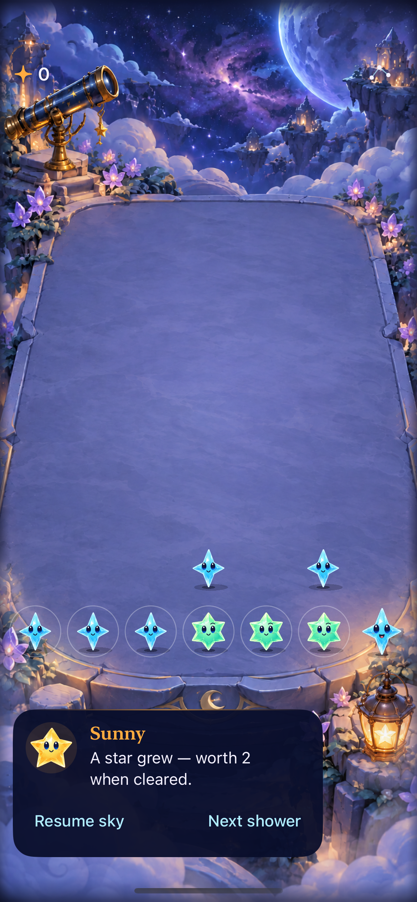
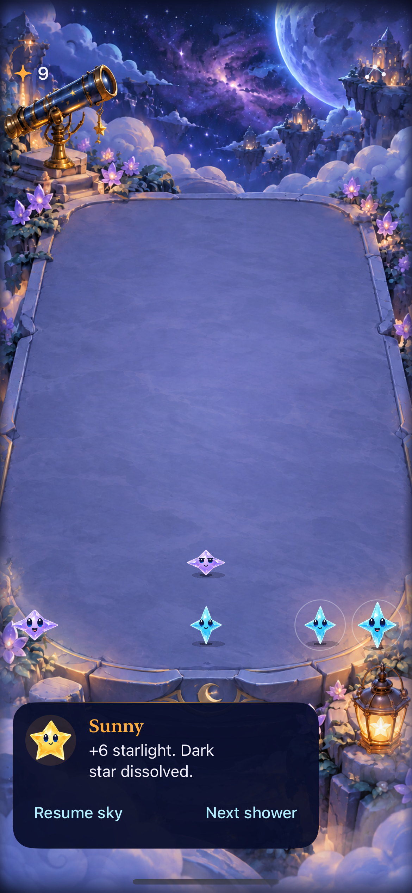

# Paused-guide adoption with production rules

**Result: Partially verified · Date: October 17, 2026.** Adopt the existing store-owned guidance throughout paused play. The guide now reports committed growth, clears, dark-star arrival/removal and corrective input, rather than replacing them with generic paused text. Opening guidance remains concise. Rules, RNG, save schema, clocks and default routing are unchanged.

**Limits:** The existing general VoiceOver terrace/cell focus and maximum-text edge-tap issues remain open in the [Crystal Glow evidence](../crystal-glow-integration-2026-10-17/README.md). This run verifies focused paused-guide speech, not a complete accessible round. No new physical-device, broad visual-animation or human-learning claim is made.

## Native result

| Growth | Actual dark-star removal |
| --- | --- |
|  |  |

**Native captures — source `bd7a744`, iPhone 17e / iOS 27.0.** Both were inspected: committed feedback is visible above usable Resume sky / Next shower actions, with the retained Crystal Glow cast and Observatory. These are still-image and native-interaction checks, not proof of full animation quality.

## Acceptance and checks

The tested app/test/configuration bytes match clean source `bd7a744418b8c5a1133f5e157242dc77f97ca138`; [source hashes](source.json) identify the files. Later changes are documentation/evidence only. Dedicated disposable QA simulator `D65C5E40-734F-42BF-8F91-97E980ED19C2` isolates reset tests from normal device saves. No personal signing/project edits were included.

Native commands use `xcodebuild -project Starfall.xcodeproj -scheme Starfall -destination 'platform=iOS Simulator,arch=arm64,id=D65C5E40-734F-42BF-8F91-97E980ED19C2' ARCHS=arm64 ONLY_ACTIVE_ARCH=YES CODE_SIGN_IDENTITY=- CODE_SIGNING_ALLOWED=YES DEVELOPMENT_TEAM= CODE_SIGN_STYLE=Manual`. Tests additionally use `-configuration Debug -parallel-testing-enabled NO`. Xcode 27.1 (27A9275), Swift 6.4.

| Check | Scope and result |
| --- | --- |
| Core | `swift test`: 61 passed, zero failures. Core source unchanged. |
| Hosted | All 17 FallingSkyStoreTests passed, zero failures/skips. Clock, interruption, feedback and restore contracts remain. |
| Native gameplay | Five passed: paused growth/dark arrival/corrective input/unrelated clear/actual dissolution/menu/background/relaunch; opening invalid-input guidance; First Light completion/restore/replay/survival; Observatory menu/help/balance; settings/background preservation. |
| Actual VoiceOver | `testVoiceOverReadsPausedGrowthFeedback` passed. It enables the real screen reader, activates three Next shower actions, then focuses the guide and verifies spoken growth/value wording. [Transcript](voiceover.txt). Native teardown asserts restoration of the prior screen-reader state. This does not close the separate board-focus issue. |
| System Reduce Motion | `testSystemReduceMotionKeepsManualPlayWorking` passed, including a real shower and clear, and restoration of the previous setting. |
| Builds | Debug via native test build and explicit Release ARM64 simulator build passed. |
| Tooling / branding | Offline lab exporter parses; its production-guidance adaptation keeps one store owner. Retained branding SVGs parse as XML, Python generators parse, and HTML references resolve locally. Prior browser-render evidence remains source-bound to each study; no new native cover/icon adoption. |
| Hygiene | `python3 scripts/ci-hygiene.py` and `git diff --check` passed. |

Raw results: `/tmp/starfall-remaining-native.xcresult` (five UI methods), `/tmp/starfall-remaining-accessibility.xcresult` (two UI methods and 17 hosted), `/tmp/starfall-remaining-release.log`, and `/tmp/starfall-remaining-core.log`. Derived data: `/tmp/starfall-remaining-derived` and `/tmp/starfall-remaining-release`. No retries or weakened assertions were used.

## Ownership and remaining work

`FallingSkyStore.message` already distinguishes actual committed outcomes from invalid input. `FallingSkyView` now presents that authoritative value in the paused guide; it does not introduce a new feedback state machine or derive a result from animation. Transient wording is not saved: relaunch restores the committed round with ordinary paused guidance. The offline lab recognizes current production guidance and adapts only its known legacy form, rather than duplicating the current opening copy.

The earlier [isolated guide study](../paused-feedback-2026-10-17/README.md) remains historical evidence for its own source. This adopts guidance only, independently of natural/Surge rule candidates. Next: preserve the outstanding board-focus/large-text issues in UI/accessibility work and evaluate comprehension with players; simulation and passing checks do not establish learning or enjoyment.
