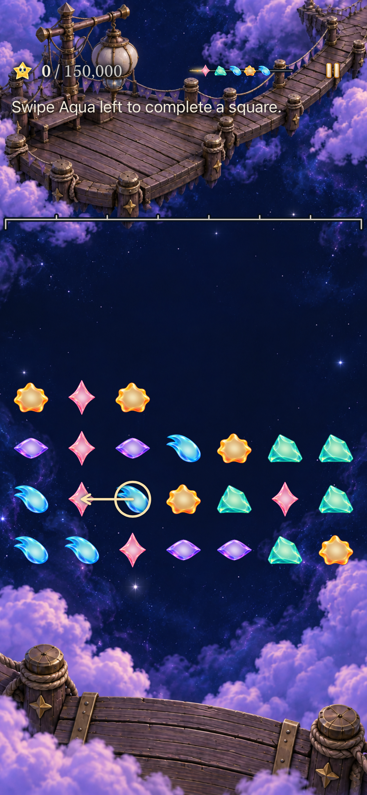
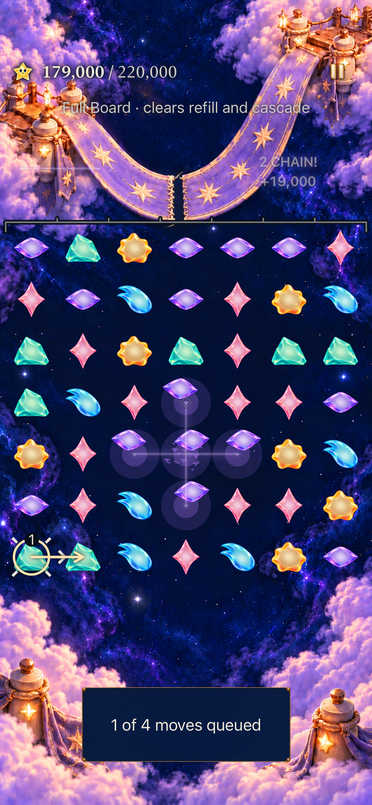

# Keep playing while the sky celebrates

**Status:** PR prepared; mechanical checks pass, visual acceptance held · **Date:** October 24, 2026

The [prioritized action plan](../../design/PLAYER_MOMENTUM_PLAN.md) starts with responsive input and a faster first real clear. Full physical presentations and celebration effects continue while the player queues independent moves. Genuinely new players can begin Lantern Landing from Home in one tap and follow one visible cue to its actual opening square. Rules, supply, targets and scoring are unchanged.

The next product decision requires the [uncoached pilot](../../design/CURRENT_STORY_PLAYTEST.md): observe first intentional clear, control, satisfaction, stop reason and voluntary continuation. Native automation cannot establish that players learn faster, enjoy the result or return later. No commercial success or retention claim follows from these checks.

## Implemented boundaries

- Four accepted plans per continuous presentation burst, ordered through sequential Core previews. There is no wall-clock expiry. A later contact appends rather than replaces an accepted plan.
- Input names visible stationary star identities. Moving, replaced or conflicting endpoints reject rather than retarget. Manual taps validate every member of their intended group. This first queue supports independent plans, not arbitrary plans involving future falling stars.
- Only executed actions commit and save. Background, round replacement, layout/motion change and incompatible direct commits cancel pending intentions. One existing shower remainder resumes after draining; already-due rain keeps priority. The admission bound prevents indefinitely replenishing a burst to starve rain.
- The shared surface submits a tap before releasing its contact hold, so release cannot dispatch an older plan and reinterpret the tap. View contact snapshots survive ordinary physical contact, while generation changes invalidate stale input without discarding accepted queue entries.
- Fresh Home eligibility requires missing archive and no rejected/world/mastery/accumulation history. **Play Lantern Landing** uses the ordinary guarded Begin and persistence owners. Returning players keep Continue; Tutorial and other choices remain available.
- A passive first-action header and board marker describe the exact Lantern4 Aqua-left square. The actual exchange earns 15,000 through two phases; any board/supply change withdraws the cue. No forced move, granted repair or delayed shower is added. Detailed forecast reading returns after that board change.
- Reset-only native tooling requires an explicit Debug flag triple and clears only `Starfall.SkyFlowReview`. Cold relaunch removes reset and restores the same archive. Release excludes this fixture; ordinary defaults remain untouched.

## Independent visual review — adoption held

The independent reviewer compared the approved October 19 concept with seven complete native captures at source `ea075f97`, without seeing an implementer verdict. Home passed its scoped composition review. The whole play journey was rejected: queue status borrowed an oversized reading panel, first-action/queue markers lacked a registered shared role, and AX3XL guidance contributed to a detached dark header. Post-clear inspection also retains the separate, already-reopened [HUD correction #382](https://github.com/lbeezr/starfall/issues/382). Passing interactions do not override this verdict.

The current correction registers `SkyPlayStatus` and `SkyMoveMarker` in the official component roster and removes the queue reading panel. A proposed first-round-only scrolling header was removed after source review found it could scroll Pause away and crowd the post-clear board. The existing HUD owner is actively correcting the common scenic reading layout and optional inspection hierarchy; integrate that accepted correction before new complete-screen review. This PR remains held, with current work open; the known failure is not deferred to a later product goal. No whole-screen visual adoption is claimed below. Original test counts and capture bytes retain their historical source boundaries.

## Current-main integration

[Integration recheck](main-integration.json) carries the slice onto main `5a4988fc` and preserves its newer adaptive mode/inspection support row. Local commit `ea075f97` passes 352 Core, 135 hosted and six native checks with zero failures/skips, plus Debug/Release. New native checks cover ordinary forecast inspection, background/world return and AX3XL forecast-to-Full-Board navigation. Original captures below retain their recorded source; the integration record does not relabel them. Human observations remain unperformed.

## Tested source and environment

Base `0d71f18cf8d41277bc3ae1a5b8c6536cde7cb9ca` plus the 15 build-affecting dirty paths in [source snapshot](source-snapshot.json), snapshot `90b622e0042b`. Computed runtime fingerprint `dev.b4043586aa`; the simulator app's actual build label is `dev.local` (0.1.0/1). This is a working-tree acceptance, not a clean published commit. No Core, project, scheme, entitlement, dependency or target-membership changes; all Swift and dialogue resources retain existing membership.

macOS arm64, Xcode 27.1 (`27A9275`), iOS Simulator 27.0 (`24A434`), SDK 27.1. Dedicated iPhone 17e `362DC1A0-13DB-41F5-9CDB-86A72EB0E7A0` and iPad mini (A17 Pro) `9ADC6510-1A37-4046-9FCA-FC6B498444FA`. Debug tests use arm64 with normal system motion; the named tablet journey separately enables actual app Calm and AX3XL text. No physical-device installation, actual VoiceOver, minimum iOS 17 runtime or sustained performance acceptance was performed.

## Verification

| Check | Result / scope |
| --- | --- |
| Core | 352 pass, 0 failures; unchanged Core at the same base. Temporary module/cache paths avoid the shell sandbox's protected default cache. |
| Final focused hosted | 135 pass, 0 failures/skips: 36 SkyTechniqueStore, 18 ResponsiveInput, 46 SkyFlowState, 29 SkyDialogue and 6 SkyPhasePresentation. All queue regressions and three new Debug-isolation guards ran on the final built source. |
| Final native input / return | Three pass, 0 failures/skips: normal-phone first play/real clear/cold restore; AX3XL actual-Calm tablet equivalent; normal-phone three rapid plans through the real five-phase Ribbon cascade. The latter asserts 15 exchanges, unchanged 179,000 points, 49 actual stars and no remaining queue. |
| Debug build-for-testing | Pass on the recorded source, including the final Debug isolation route. |
| Release simulator build | Pass on the recorded source; Debug fixture excluded. |
| Hygiene / whitespace | `python3 scripts/ci-hygiene.py` and `git diff --check` pass. |

Commands and disposable logs/bundles are recorded in [verification summary](verification.json). Build/test artifacts remain under `/private/tmp/starfall-momentum-*`; the report retains small summaries and selected inspected captures.

## Inspected native appearance

[Five unchanged native PNG exports](captures.json) bind device, scenario, source, timestamp and SHA-256. Phone Home shows the new direct action beside all three existing alternatives. Phone opening shows the exact cue and marker with the full board. The queued frame shows “1 of 4 moves queued” and a numbered direction while “2 CHAIN!” and the physical pattern are still visible. The settled frame shows the expected 49-star result. The AX3XL actual-Calm opening keeps the complete instruction above the board; lower rows remain below the viewport and the native test scrolls to reveal the gesture targets. It does not establish a whole-board largest-text fit.

**Debug iPhone 17e / iOS 27.0 Simulator, normal system motion, snapshot 90b622e0042b.** These inspected stills establish sampled appearance. The normal-motion native input scenario establishes execution through presentation; no continuous motion-quality, hardware latency or human-recognition claim is made.

## Failures and corrections retained

The old single 650 ms buffer expired a valid swipe during Ribbon's five-phase presentation. The queue removes expiry while retaining identity validation and bounded admission. Review also exposed an upward exchange that could settle back into its original cell: every exchanged endpoint and identity now remains unavailable throughout its physical transaction. A held tap could release before submission and be interpreted after a queued head; surface ordering and regressions correct that boundary.

An initial largest-text native first-clear test passed, but its screenshot showed the instruction below the viewport. That layout was rejected. The cue now sits before the board, and the native test requires its complete frame inside the viewport. Forecast-detail controls are omitted only during the exact first-play opening.

The first normal-phone first-clear journey passed its gameplay and cold-return assertions but failed during redundant Settings cleanup. The helper now restores system Reduce Motion only when it actually changed that setting, retaining the normal-motion requirement. That initial bundle remains failed. A superseded phone run was canceled before a test case started; it is not acceptance evidence.

Initial command failures used a protected Swift cache and a dual-architecture simulator build against an arm64 package. The corrected commands use task-specific temporary caches and explicit arm64. Assertions, motion and test selections were not weakened to pass.

## Delivery and remaining acceptance

The implementation is published for review in [PR #395](https://github.com/lbeezr/starfall/pull/395), targeting main, and remains unmerged pending corrected visual acceptance. Earlier GitHub issue publication attempts were rejected by automatic approval review because external posting was not authorized. After explicit user approval, the prioritized plan was published through the GitHub plugin as [issue #393](https://github.com/lbeezr/starfall/issues/393), verified open on October 24. No installation was performed. The [plan](../../design/PLAYER_MOMENTUM_PLAN.md) records the ordered follow-ups. [Engineering](../../ENGINEERING.md) retains physical input/recognition acceptance and the concrete queue-policy extraction follow-up for the Store's size.
