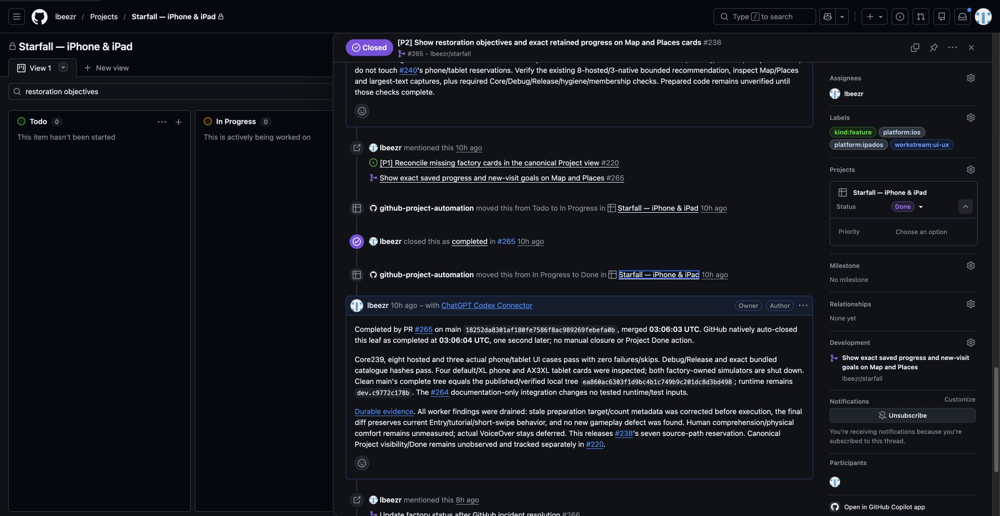
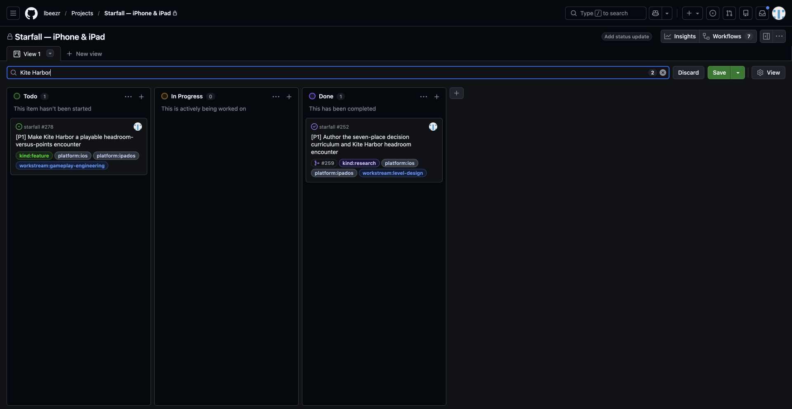
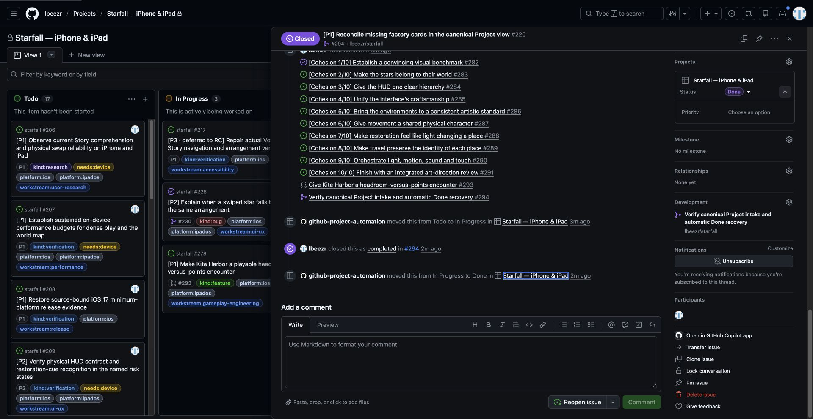

# Canonical Project recovery observed

**Verified for the observed cases — October 23, 2026, 12:58–13:12 UTC.** The [canonical Starfall Project](https://github.com/users/lbeezr/projects/1) now shows the previously missing cards and genuine new factory intake. Existing issue **#238 / Project item 280445612** proves native intake→In Progress→Done after its resolving main merge. New issue **#278 / item 280936410** was visibly Todo at 13:04:28 UTC, agreeing with its issue-side status. This satisfies [#220's](https://github.com/lbeezr/starfall/issues/220) missing view/intake/completion evidence without waiting for Kite's future merge.

**Resolved through [PR #294](https://github.com/lbeezr/starfall/pull/294).** Issue220 natively closed completed at13:19:32 UTC. Its same canonical **item280018905** moved In Progress→Done by `github-project-automation` at13:19:35, with no manual status, membership or closure change. [Postmerge receipt](issue-220-postmerge-294.json) records the actual UI observation at13:22:38 UTC. Keep checking future individual merge projections; no additional gate remains for #220. Gameplay/native host capacity is independent.

## Actual automation, not manually reconciled Done

The [same canonical item 238](https://github.com/users/lbeezr/projects/1/views/1?pane=issue&itemId=280445612&issue=lbeezr%7Cstarfall%7C238) shows this complete history. Exact times below are UTC on October 23, from time elements backing the rendered GitHub timeline and PR page.

| Event | Actor | UTC |
| --- | --- | --- |
| Added to this Project | github-project-automation | 00:25:12 |
| Set Todo | github-project-automation | 00:25:13 |
| Todo→In Progress | github-project-automation | 03:05:23 |
| [PR 265](https://github.com/lbeezr/starfall/pull/265) merges commit `18252da8301af180fe7586f8ac989269febefa0b` into main | lbeezr | 03:06:03 |
| Native completed closure in PR 265 | lbeezr | 03:06:04 |
| In Progress→Done | github-project-automation | 03:06:06 |

PR 265 explicitly closes 238. The canonical Done card links that merged PR; the item pane agrees. Done follows merge by three seconds. This audit made no issue, membership, priority or status changes.

## Recovered view and new intake

The unfiltered saved Status board visibly includes previously missing 212/213/215 in Done and 217 in In Progress. Unsaved title searches expose the real 238 Done card and [new 278 Todo item](https://github.com/users/lbeezr/projects/1/views/1?pane=issue&itemId=280936410&issue=lbeezr%7Cstarfall%7C278), rather than only issue-side metadata. Supplementary 271/275 and 251/276 issue pages also show automated intake/active/Done histories; their canonical item IDs were not extracted.

Viewing-mode workflow inspection shows seven enabled workflows. Auto-add selects `starfall` and displays `is:issue,pr is:issue is:open`; Item closed and Pull request merged both set Done. The archive visibly contains no items. No configuration or saved view was changed; temporary filters were never saved and no membership repair was necessary.

## Provenance and limits

[Observations and capture hashes](observations.json) bind exact URLs, identities, timestamps and screenshots. Source is authenticated Chrome through supported CUA: rendered accessibility/DOM and browser screenshots only. The in-app browser was unavailable; connected GitHub tools still lack Projects administration. No hidden networking, credentials, manual closure or automation-status write was used.

The original discrepancy's cause remains unisolated; these cases establish current recovery, not universal future reliability or a complete item inventory. There is no app/rule/save change or Core/build/native/physical/VoiceOver claim. Root owns integration hygiene/diff checks and 220's postmerge verification.

## Own resolving merge

The actual timeline records Todo→In Progress at13:19:17, native completed closure in294 at13:19:32 and automatic Done at13:19:35 UTC. This postmerge check supplements the earlier source-bound observations without rewriting their original timestamps or screenshots.
