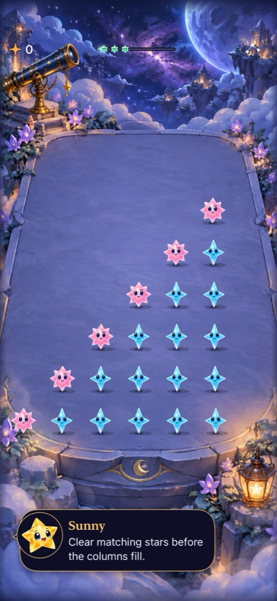
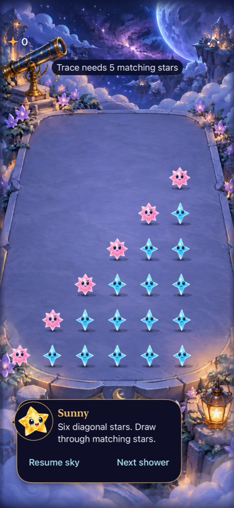

# Responsive production input

**Result:** Verified in Simulator; physical feel and RC accessibility open · **Owner:** Current implementer · **Date:** October 17, 2026

Ready groups can now clear while unrelated stars fall. Column reservations replace the global animation lock; gravity events retain their necessary board-wide lock. Contact outlines, anchored drifting taps, selected-trace counts and readable cancellation feedback explain what input did. [Design and acceptance](../../design/INTERACTION_FEEDBACK.md).

**Next action:** On the next physical build, compare finger/haptic feel and measured contact latency; run full actual VoiceOver at RC.

## Source and environment

Production base: `49dcd0ee0cd5b9f57d10aa1e28d47318b110221f`. Working changes: touch surface, scene, store, view/HUD, shared presentation footprint, explicit target membership and focused hosted/native tests. No Core, save archive, dialogue scripts, generation, resources or build settings changed. Final runtime snapshot **`7e2bdc3f5a56`**, with [source hashes](source.json). The earlier [snapshot `31b661ced8eb`](source-31b661ced8eb.json) differs in feedback ownership/announcement and shared outline cleanup; Core, rules, save/cadence and screen flow are identical. Final hosted/native checks below cover those refinements.

Xcode 27.1; iPhone 17e Simulator / iOS 27.0; `4103C352-DFC2-493E-A224-DE4CE3D50889`; Debug arm64, scheme Starfall, DerivedData `/tmp/starfall-responsive-current`. Native tool arguments: `CODE_SIGNING_ALLOWED=NO ARCHS=arm64 ONLY_ACTIVE_ARCH=YES -parallel-testing-enabled NO`.

| Check | Result |
| --- | --- |
| `swift test` | 110 passed, zero failures; `/tmp/starfall-responsive-current-core.log`. Existing replay/archive/rule tests remain authoritative. |
| Focused hosted input/trace/renderer | 34 passed, zero failures/skips; `test_sim_2026-10-18T02-01-19-738Z_pid42631_008de077.xcresult`. Includes native full-motion cadence/orbit windows, independent clear/shower rendering, reverse completion/save ownership, held input and stale release, analytic grazing/curved trace selection. |
| Debug simulator build | Passed; `build_sim_2026-10-18T01-59-48-340Z_pid42631_f7659ed9.log`. |
| Complete final hosted suite | **179 passed, zero failures/skips**; `test_sim_2026-10-18T02-12-27-760Z_pid42631_bf3b65e1.xcresult`. Includes stale feedback, wait-cue ownership, contact-outline preservation, gravity atomicity and previous app/store/scene suites. |
| New native input + existing trace/interruption | **4 passed, zero failures/skips**; `test_sim_2026-10-18T02-03-53-258Z_pid42631_2397c76a.xcresult`: normal/largest 8-point drift, incomplete feedback/settings, five-from-six/restore, multitouch/background/rotation. |
| Broader native gameplay on snapshot `31b661ced8eb` | **7 passed, zero failures/skips**, read directly from the completed bundle `test_sim_2026-10-18T02-07-06-772Z_pid42631_6eab8a75.xcresult`: automatic rain/paused clear/replay/settings, background/overflow, First Light win/restore/replay and loss, rapid taps/manual play, largest-text settings and system Reduce Motion. The tool timed out at 300 seconds; Xcode completed in about 319 seconds. Two selected orbit methods used the wrong class and did not run here; the final run below selects their actual class. |
| Final native feedback + orbit boundaries | **4 passed, zero failures/skips**; `test_sim_2026-10-18T02-13-49-557Z_pid42631_0cb8bc1f.xcresult`: actual 8-point drift at normal/largest text, incomplete/outside reason preservation and next input, orbit background/three-window expiry, reduced-motion orbit outcome. Across the three runs there are 13 distinct native methods; two are repeated after feedback refinement. |
| Final Release simulator build | Passed, zero warnings/errors; `build_sim_2026-10-18T02-15-51-417Z_pid42631_73f4a4ca.log`. Debug app/test compilation also passed. |
| Hygiene, project membership and diff | `python3 scripts/ci-hygiene.py`, `plutil -lint Starfall.xcodeproj/project.pbxproj`, `git diff --check`: passed. New app/hosted/UI files have explicit memberships. |
| Actual VoiceOver | Deferred to RC; not run on this development build. |
| Physical device, haptic feel and measured contact latency | Not run; no claim of human preference or frame-rate acceptance. |

Bundles/logs: `/Users/lbeezr/Library/Developer/XcodeBuildMCP/workspaces/Starfall-1ed6789fe30c/`. Routine attachments/recordings remain under `/tmp/starfall-responsive-current-captures`; only the two selected frames below are retained. Earlier original-checkout outputs are not acceptance of this production source.

## Root cause and examined paths

One global `busy` flag treated every animation as a board-wide input dependency. The renderer also used whole-board renders from individual completions. That contract could not safely admit independent moves. Presentations now own committed column footprints and independent identities; completions use the newest snapshot. Gravity is explicitly a different case because its phases cross columns.

A second mechanism classified any 8-point movement as a drag, even on an ineligible ordinary group. The session now checks eligibility, tolerates short ordinary drift, and anchors release to its original cell. The current production analytic trace hit testing and prefix forgiveness are retained. Contact holds, stale release, settings/scene/lifecycle cancellation, manual/automatic rain, dark adjacency, dialogue ownership and selected subset behavior are the analogous paths examined.

The first prototype was built against the initial `f35eba8` checkout. It passed focused checks, but GitHub production already contained newer tracing, saves, dialogue and orbit mechanics. The adaptation starts from `49dcd0e`; it does not publish the old prototype or its unrelated unpublished history. The obsolete broad native run was explicitly interrupted during reconciliation and is excluded from acceptance. No failed assertions or timeouts were weakened.

## Selected visual evidence

| Active play | Incomplete trace feedback |
| --- | --- |
|  |  |

**Current for runtime snapshot `7e2bdc3f5a56`** — inspected iPhone 17e / iOS 27.0 Simulator captures from the final native input test, default text and normal motion. The reset-only six-diagonal-star fixture supplies the board; it is not a naturally generated opening. The left image is active play after Resume; the right is paused after an incomplete draw. Text remains outside star targets, controls stay readable, and the board dominates. Source/appearance parity checked against this snapshot. These stills do not prove animation or physical latency; full-motion hosted checks establish actual motion and exact settling separately. JPEGs are display exports of the original XCTest PNG attachments.

## Final boundary corrections

Waiting feedback follows the touched/conflicting columns and ends when those reservations clear, even if another column is still animating. Rejected stale trace snapshots return without changing feedback in a new sky. Outside-board cancellation retains its specific reason instead of being overwritten by a later generic release. Explicit failures have a spoken-feedback request as well as readable text; actual VoiceOver speech/focus remains deferred to RC. Normal-motion renderer regression also verifies that completing unrelated presentations preserves a live contact outline.

The old `canClear` Boolean remains the established fully-settled-board flag. Per-cell readiness is `canClear(cell)`/`canContact(cell)`; historical whole-board timing windows do not measure the new partial availability.

Publication was rebased over `6961e29e320983a366fedfc6224f50bb96182e04`, whose changes are confined to documentation and native evidence. All App/Core/Config/project and test bytes remain identical to the verified snapshot; its curved-trace proof and images are preserved.
