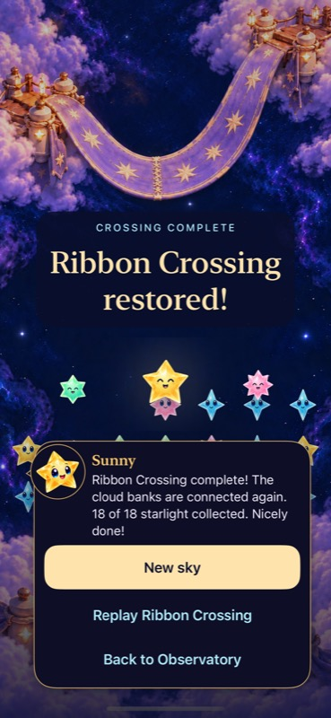
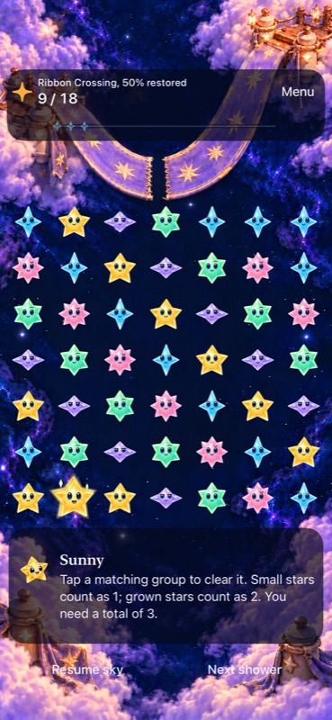

# Ribbon Crossing verification

**Result:** Verified for bounded development scope · **Owner:** Current implementer · **Date:** October 19, 2026

Ribbon Crossing is the second directly selectable 18-light challenge beside First Light / Lantern Landing. It preserves seed 42, the existing challenge rules and save version 8. Open sky remains the default; no campaign or unlock progression is added. Three bespoke artwork families show five restoration stages each. Completion restores the environment; characters do not walk across the bridge. Future travel clips belong to the user's later cutscene work.

**Confirmed:** Core 178/178; final focused hosted 49/49; compact win/replay; tablet rotation, native clears and ten states; Release build; all fifteen paintings inspected. Final normal-motion video shows the gap closing with ordinary result feedback. **Limits:** actual VoiceOver is deferred to RC, physical play is unverified, and the 49-star native sample establishes appearance only.

**Next action:** Publish and merge the verified tree, then install current main through the canonical updater and record its installed-identity receipt. The [production plan](../../design/ribbon-crossing-02/PRODUCTION_PLAN.md) owns acceptance; this folder owns source-bound checks and selected captures. Raw logs, bundles and video remain disposable local artifacts.

## Outcomes against acceptance

| Criterion | Observed result | Evidence / limitation |
| --- | --- | --- |
| Rules, identity and saves | **Pass** | 178 Core checks; typed Ribbon challenge, unchanged target/seed/rules/schema, old First Light archive compatibility. Final focused hosted checks cover flow, presentation and celebration boundaries. |
| Normal play, win, replay and interruption | **Pass for sampled paths** | Phone 14 → 18 native win, background/relaunch restored result and replay at zero; preview/cancel preserves a Lantern round until Begin. Final compact win/replay repeats the simplified completion. |
| Tablet geometry and input | **Pass** | Final test rotates without replacing star identities, commits landscape 5 → 9 and portrait 9 → 13 clears, and captures five states in each orientation. |
| Artwork and board clarity | **Pass for sampled appearance** | All fifteen phone/portrait/landscape paintings inspected. Final phone 49-star fixture inspected with all 49 native occupied targets; dense input not confirmed. No center mask, split painting or spatial fade. |
| Normal motion | **Pass for sampled final win** | [Motion record](motion.json): 5.195-second actual clear, score commitment, whole-image transition and usable result; no bridge traversal. Stills are separate evidence. |
| Accessibility | **Development checks pass** | Largest-text/system-Reduce-Motion win and reachable actions pass at `a9b9612`; final change removes decorative traversal only. Final hosted geometry probe passes and compact result scroll/replay passes. Actual VoiceOver not run; required at RC. |
| Sibling behavior | **Pass for sampled paths** | Compact Lantern win/replay and survival rain/pause/clear/replay/settings pass at `c5c0359`; final removal is Ribbon-only decoration. |
| Builds | **Pass** | Final Debug test build and Release simulator build, zero warnings. |
| Main / physical delivery | **Pending** | Requires merged-main comparison and canonical updater receipt; no feature-checkout phone installation. Physical play and enjoyment are separate from installation. |

## Selected native appearance

| Phone completion | Crowded phone board |
| --- | --- |
|  |  |

**Native `4dff983`, runtime `dev.453e081fb5`, iPhone 17e / iOS 27.0 (24A434) Simulator; default text, normal motion.** The completion follows an actual 14 → 18 clear. The crowded frame is a separate isolated review fixture. A stale automation reference prevented its attempted clear, so no dense-input success is claimed.

**Native `15fbdf6`, same runtime `dev.453e081fb5`, iPad Air 11-inch M3 / iOS 27.0 Simulator; default text, normal motion.** Both final orientations were inspected; [portrait capture](dev-15fbdf6__ribbon-100__ipad-air11-m3__portrait.png). Earlier unchanged 0–75% artwork inspections keep their original source in [captures.json](captures.json). Scores 0/5/9/14/18 select scene milestones 0/25/50/75/100 while the HUD truthfully shows actual progress 0/28/50/78/100%.

## Verification context

Final implementation: **`4dff9836249f69923b42ce9491a022b97a942c8a`**, runtime **`dev.453e081fb5`**. Final tablet run: **`15fbdf69b437ccacda52b929ac441f551e145283`**, a merge of main's test/evidence maintenance with identical runtime inputs. Documentation-only working changes did not affect these builds. Xcode 27.1 (27A9275), macOS 27.0.1, iOS 27.0 (24A434), arm64 Simulator. Debug reset fixtures use isolated review defaults; ordinary player saves are preserved.

Native runs use the shared `Starfall` scheme through XcodeBuildMCP `test_sim` with `STARFALL_BUILD_ID=dev.453e081fb5`, `-parallel-testing-enabled NO` and the selected tests below. Existing simulator signing overrides are `ARCHS=arm64`, `ONLY_ACTIVE_ARCH=YES`, `CODE_SIGN_IDENTITY=-`, `CODE_SIGNING_ALLOWED=YES`, `DEVELOPMENT_TEAM=`, `CODE_SIGN_STYLE=Manual`. Release uses `build_sim` with configuration Release. Raw bundle names below are under `~/Library/Developer/XcodeBuildMCP/workspaces/Starfall-d16ae84c7aac/result-bundles/`.

| Run / source | Result | Reproduction / raw evidence |
| --- | --- | --- |
| Core / `a9b9612`, unchanged through final | **178 passed** | `swift test`; `/private/tmp/ribbon-core-final.log`. |
| Full hosted / `7b103b0` | **327 passed**, 0 failures/skips/warnings | `test_sim_2026-10-19T15-36-42-775Z_pid14605_71662f4f.xcresult`; predates clearance revision. This is not a claim that the final 328-test inventory was fully rerun. |
| Phone / `a9b9612` | **3 Ribbon UI passed; 49/50 hosted passed** | `test_sim_2026-10-19T15-49-05-726Z_pid14605_1abbe54f.xcresult`; anchor probe failed, corrected below. Includes default and largest text/system Reduce Motion. |
| Tablet / `1eae369` | **1 passed** | `test_sim_2026-10-19T15-53-41-230Z_pid14605_78122cdb.xcresult`; all ten state captures and rotation/native clears. |
| Compact siblings / `c5c0359` | **Lantern and survival passed; Ribbon action visibility failed** | `test_sim_2026-10-19T15-57-49-974Z_pid14605_066cee20.xcresult`; test scroll correction below. Corrected anchor probe passed. |
| Final compact + focused hosted / `4dff983` | **50 passed**, 0 failures/skips/warnings | `test_sim_2026-10-19T16-08-01-191Z_pid14605_04bcbcd5.xcresult`; `StarfallAppTests/RestorationPresentationTests`, `StarlightCelebrationTests`, `SkyFlowStateTests` (49), plus `StarfallUITests/RibbonCrossingInteractionTests/testRibbonWinningClearPersistsNamedResultAndReplayStartsAtZero` on iPhone SE 3. |
| Final Release / `4dff983` | **Build succeeded**, 0 warnings | `build_sim_2026-10-19T16-08-16-636Z_pid14605_f3b581e7.log` in sibling `logs/`; 10.028 s. |
| Final tablet / `15fbdf6` | **1 passed**, 0 failures/skips/warnings | `test_sim_2026-10-19T16-13-08-153Z_pid14605_10bd403c.xcresult`; `StarfallUITests/RibbonCrossingInteractionTests/testTabletRotationKeepsRibbonRestorationAndNativeInput`, 167.402 s. |

The five Python suites passed **55 checks**: `python3 scripts/test_device_update.py` (21), `test_native_test_plan.py` (3), `test_rc_platforms.py` (12), `test_simulator_lifecycle.py` (10), `test_export_native_evidence.py` (9). Development discovery contains 123 UI / 328 hosted methods; discovery is not execution. Tablet-only routing and six development-deferred actual-VoiceOver methods remain explicit.

The offline reviewer passed `node --check board.js` and a minimal-DOM logic check of 57 score/view combinations, fixed identities, densities and guides. The atlas JS check covers twelve locations and sixty restoration descriptions. **Browser rendering remains unverified:** the tool denied the attempted local-file URL and prohibited alternate-route workarounds; none were attempted. Native acceptance above is separate. Final hygiene and whitespace results are recorded with the publication snapshot.

## Resolved findings and remaining limits

The original scenery probe used a 0.001-point analytic tolerance against SwiftUI's pixel-aligned geometry, producing approximately 0.1667-point differences. Test-only `c5c0359` compares rendered geometry within one physical pixel (`1 / screen.scale`) while preserving pure geometry checks, bounds and timeout. Final hosted checks pass.

On compact phones the longer Ribbon result scrolls. An assertion expected Replay to be visible before scrolling; actual native scrolling exposed all three actions. Test-only `72a6ae0` uses the existing `revealSkyControls` helper before checking and tapping Replay. The final compact native win/replay passes without weakened assertions or retries.

The user requested environment-only completion. `4dff983` removes the bridge procession, its path/task state and bespoke ripple. The ordinary result stars, score/light feedback and whole-painting restoration remain. Final video and both tablet completion captures verify this distinction. Earlier traversal recordings and 100% captures are historical and are not final acceptance evidence.

No new campaign, rule timing or animation-derived score/save state is introduced. No audio, sustained performance, physical comfort or human enjoyment claim is made. Revisit actual VoiceOver at RC and dense input/physical play before broader acceptance. The remaining ten locations and future travel clips remain design work.
