# Screen-flow polish verified in separate batches

**Result:** Partially verified · **Owner:** Current implementer · **Date:** 2026-10-17

The planned implementation is integrated in small verified batches: branded opaque launch, safe staged Entry, pause-preserving Continue, continuous readiness-gated handoffs, explanatory results over the final board, bounded star arrivals, saved-round context and shared settings/help before play. Rules/RNG/save schema are unchanged. The integrated development candidate is `1650c50`; final checks passed as recorded below. Physical-device, minimum-OS/full-tablet matrix, human comprehension and RC actual VoiceOver remain open. Captured frames are bounded evidence, not a universal zero-flash guarantee.

**Next action:** Use the RC matrix before release; development implementation and verification are complete. No distribution or device replacement is part of this task.

## Batch 1 — opaque launch

**Source:** `449ff89` plus `App/LaunchScreen.storyboard`, `LaunchBackground.colorset`, `StarfallApp`, `StarfallTheme`, `Clean.xcconfig`, deliberate Xcode resource/test membership and `LaunchSurfaceTests`. README edits do not affect builds. Core/rules/saves and navigation were unchanged. [Source hashes](batch-1-sha256.txt) identify tested inputs.

**Environment:** Xcode 27.1; Debug and Release; arm64 iOS Simulator. Native destination `6E9BC34B-C5C6-48ED-9593-D16AC994BCC8`, Starfall Compact HUD QA / iPhone 17e / iOS 27.0. Commands used `ARCHS=arm64 ONLY_ACTIVE_ARCH=YES CODE_SIGNING_ALLOWED=NO`. No physical-device or actual VoiceOver session was run for this development batch.

| Check | Result and reproducible context |
| --- | --- |
| Hygiene | `python3 scripts/ci-hygiene.py`, `git diff --check`: passed |
| Core | `swift test`: 63 passed; `/tmp/starfall-flow-b1-core.log` |
| Packaged launch | `LaunchSurfaceTests/testPackagedLaunchSurfaceIsOpaqueDarkInBothAppearances`: passed; loads the actual storyboard, checks named color/opacity in both appearances and one launch declaration |
| Native flow | Existing `SkyFlowInteractionTests/testWelcomeEntryBackgroundAndAnotherSky`: passed; real clear, rapid taps, entry/background, save restore, menu and new sky exercised |
| Debug | `xcodebuild ... -configuration Debug -destination 'platform=iOS Simulator,id=6E9BC34B-C5C6-48ED-9593-D16AC994BCC8' -derivedDataPath /tmp/starfall-flow-implementation -parallel-testing-enabled NO -only-testing:StarfallAppTests/LaunchSurfaceTests -only-testing:StarfallUITests/SkyFlowInteractionTests/testWelcomeEntryBackgroundAndAnotherSky -resultBundlePath /tmp/starfall-flow-b1.xcresult test`: two passed, zero failures/skips |
| Release/resources | `xcodebuild -project Starfall.xcodeproj -scheme Starfall -configuration Release -sdk iphonesimulator -destination 'generic/platform=iOS Simulator' -derivedDataPath /tmp/starfall-flow-implementation-release ... build`: passed. Both products contain `LaunchScreen.storyboardc`; effective plist selects `UILaunchStoryboardName=LaunchScreen`, no `UILaunchScreen` dictionary |
| Visual launch | Four recordings: Light/Dark process launch and immediate subsequent force-quit/relaunch. 280 decoded frames total, roughly 32–40 nominal fps, no central-region near-white full frame. Inspected sampled frames through settled Welcome; black system-transition frames are present. Not a new-install, warm foreground, tablet or device video acceptance claim |

Raw build/test logs: `/tmp/starfall-flow-b1.log`, `/tmp/starfall-flow-b1-release.log`; results `/tmp/starfall-flow-b1.xcresult`. Video/decoded frame metrics under `/tmp/starfall-flow-b1-launch/`; capture script `/tmp/starfall-record-launch.py`, AVFoundation frame reader `/tmp/starfall-audit-video.swift`. Each recording starts before `simctl launch`, holds four seconds, then stops; static-frame suppression produces variable presentation timestamps. The sample test labels “cold” mean a new process, not a rebooted device or first installation. All launches used isolated `--starfalls-reset --sky-flow-review`; normal saved rounds were not reset.

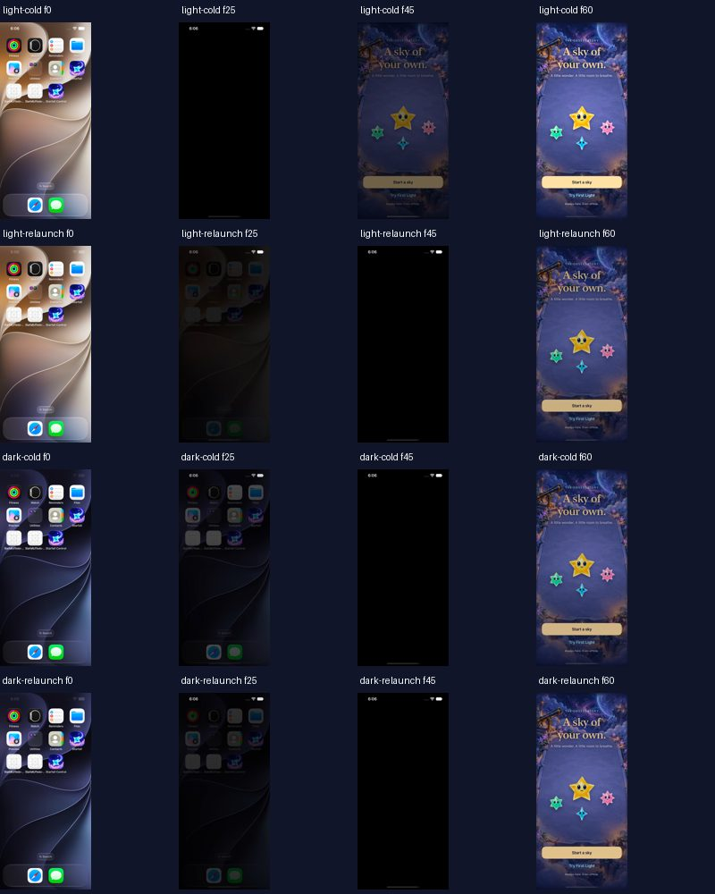

**Native captured frames, Batch 1 source above.** Each row selects frames 0, 25, 45 and 60; compression/resizing only. These show no white launch surface in the inspected sequences, but include system black transition frames. Frame metrics inspected all decoded frames; the contact sheet alone cannot prove continuity or full animation quality. No added artificial loading delay.

## Coverage limits

Batch 1 does not change gameplay, save admission, win/loss or geometry. The native regression exercises normal motion and interruptions; full win/loss, system Reduce Motion and broader settings/accessibility coverage belong to the next affected navigation batches. RC actual VoiceOver and physical-device checks remain separate. Capture sampling cannot rule out an uncaptured subframe flash.

## Batch 2 — stage Entry and preserve intentional pause

**Source:** `66aec66` plus [hashed inputs](batch-2-sha256.txt). `SkyFlowState` owns a pending request/identity; no game is constructed or saved until Begin consumes it. Menu New/Replay/First Light and Welcome Start/First Light share that boundary. Back discards the request. Continue opens the retained round without toggling pause; a new process retains the existing paused restore. Same seed, challenge, balance, opening-generation and ranking ownership stay with the existing store commit methods. No Core or save-schema change.

**Verification:** same 17e/iOS 27.0 destination and architecture settings as Batch 1. `swift test`: 63 passed (`/tmp/starfall-flow-b2-core.log`). Release build passed (`/tmp/starfall-flow-b2-release.log`). Final hosted run: **43 passed, zero failures/skips**, covering store, ranking and eight flow checks (`/tmp/starfall-flow-b2-hosted-final.xcresult`). Five native flow methods passed on this app source: win/overflow/replay, largest text, system Reduce Motion, Welcome/background/restore/new, and Entry cancellation/termination. The last passed in `/tmp/starfall-flow-b2-final.xcresult`; the other four passed in `/tmp/starfall-flow-b2.xcresult`. Native checks preserve existing semantic IDs and full-motion settings rather than forcing quiet mode.

The initial run had two failures: a new test waited for the offscreen First Light Form row before scrolling, and its clock assertion incorrectly assumed exact sub-second preservation despite the existing resume grace floor. The hierarchy confirmed only the first Explore row was materialized. The corrected native test scrolls to reveal the control and still asserts reachability. The final hosted fixture checks exact retained remainder during regular cadence and separately checks the existing 0.25-second opening resume grace. No scheduler behavior or assertions were suppressed. The intermediate rerun passed the corrected native test but still contained the older compiled clock assertion; its bundle therefore reports Failed. The separate final hosted run includes the corrected fixture and all 43 checks pass. These are source-bound combined results, not one entirely green intermediate bundle.

Final hosted command uses `xcodebuild ... test -only-testing:StarfallAppTests/SkyFlowStateTests -only-testing:StarfallAppTests/FallingSkyStoreTests -only-testing:StarfallAppTests/SkyLeaderboardTests -resultBundlePath /tmp/starfall-flow-b2-hosted-final.xcresult`; native final adds only `StarfallUITests/SkyFlowInteractionTests/testEntryCancellationAndTerminationRetainThePlayedSky`. The first run selected all `SkyFlowInteractionTests`. Logs match the bundle basenames. The shared manual clock/presenter were extracted without behavior changes into `FallingSkyTestSupport`; all affected store checks pass after extraction.

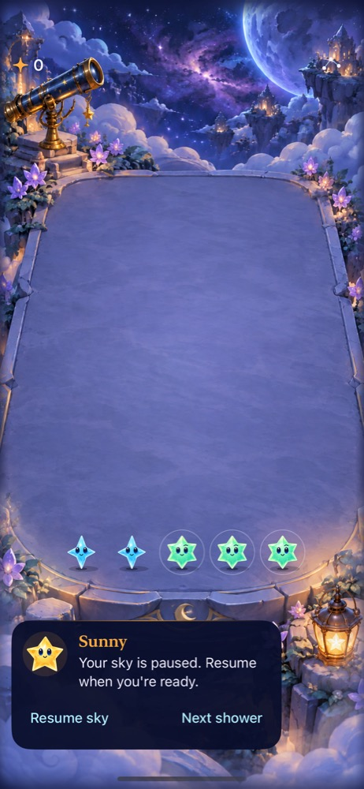

**Native final cancellation test capture:** same source/environment above; resumed ordinary board after staging First Light, terminating and relaunching without reset. The test checks retained score/board summary and paused controls; hosted checks additionally compare exact core-save and ranking-sidecar bytes. Larger-text Entry still puts decoration before actions; that preexisting layout limitation is assigned to Batch 5. Actual VoiceOver and device acceptance remain open.

## Batch 3 — one cancellable handoff and scene admission

**Source:** `8041774` plus [hashed inputs](batch-3-sha256.txt). Entry/Continue keep the scenery in place and gate gameplay while the outgoing ceremony yields over 240 ms. One presentation task/token owns settlement and the bounded preparing fallback. Scene attachment/size reports readiness; losing readiness freezes the store synchronously before SwiftUI's observer runs. Stale callbacks cannot reopen a canceled route, readiness alone cannot start rain, and the existing scheduler still chooses cadence. No Core/RNG/save-schema changes.

**Results:** 63 core checks passed. The first native/hosted selection passed **36 checks**, including full-motion opening/clear and system Reduce Motion. After the synchronous detachment correction, final-source store/flow checks plus Welcome/background/restore/new passed **35 checks**, zero failures/skips (`/tmp/starfall-flow-b3-final.xcresult`). An explicit normal-motion version of that native flow passed separately (`/tmp/starfall-flow-b3-motion.xcresult`); the test restores the original system preference. Release final build passed (`/tmp/starfall-flow-b3-release-final.log`). Hygiene and diff checks passed. Commands retain Batch 1's architecture/destination/DerivedData settings; logs and result bundles use `/tmp/starfall-flow-b3*`.

The additional detachment check injects readiness loss with a captured due callback, verifies synchronous suspension/deadline cancellation, invokes that stale callback and advances the clock, and verifies no shower. Handoff checks cover not-ready, inactive, modal, unsettled, canceled and replaced tokens. The normal native run verifies actual input and backdrop; it does not reproduce every sub-frame interruption or the rare real-device slow-preparation path.

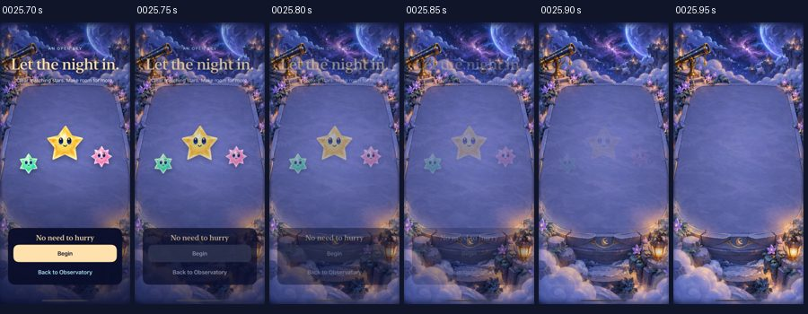

**Final-source normal-motion native recording**, `/tmp/starfall-flow-b3-motion.mp4`, 17e / iOS 27.0; sampled 25.70–25.95 seconds. Frame inspection shows the selected 240 ms fade and retained backdrop. Full-motion first-wave clearing passed in the separate native opening test. Earlier `/tmp/starfall-flow-b3-final-native.mp4` inherited the simulator's enabled Reduce Motion preference and therefore verifies the immediate settled route, not normal motion. This distinction was discovered during frame review; no animation was suppressed to obtain a pass. The explicit-motion recording includes Settings before/after the game and restores that preference. No physical-device, actual VoiceOver or general frame-pacing acceptance is claimed.

## Batch 4 — explain endings over the committed board

**Source:** `781fe35` plus [hashed Batch 4 inputs](batch-4-sha256.txt). Results now use committed score/target/blocked-column values, retain the final board, outline the blocked column through the shared projection, and offer mode-specific retry copy. No Core, save or RNG change. Terminal decoration is smaller and localized contrast panels protect reading and actions.

**Verification:** 63 core checks passed (`/tmp/starfall-flow-b4-core-final.log`). `/tmp/starfall-flow-b4-accepted.xcresult` passed 22 checks (20 hosted snapshot/geometry checks and two native result flows), zero failures/skips. After the final adjustment ensuring the burst starts at its initial pose, the original full-motion win/replay/overflow/restore reproduction passed again (`/tmp/starfall-flow-b4-motion-final.xcresult`, 150.7 seconds). Final Release build passed (`/tmp/starfall-flow-b4-release-motion-final.log`); hygiene and diff checks passed. Same Xcode, destination and architecture settings as Batch 1. The accepted run selects SkyFlowStateTests, ObservatoryGeometryTests, testFirstLightWinReplayAndFullSky and testResultActionsRemainHittableAboveTheVisibleFinalBoard; the final motion run selects the win/replay method only. Earlier `ObservatoryInteractionTests/testActualCastSparseDenseAndProjectedCornerTaps` passed in 19.553 seconds in `/tmp/starfall-flow-b4.log` before the input-layer correction; that overall run failed at the win action and did not finalize its bundle. Projection code did not change afterward.

The first native runs failed because Replay existed visibly after a win but was not hittable. Explicitly disabling board input and ordering the ceremony did not resolve the win-only failure, although the ordinary overflow sibling passed. Removing the completed celebration surface restored the original win/replay reproduction. The final boundary also places the finite celebration behind the scrollable controls, rather than leaving an invisible full-screen decoration above them. The native win check now asserts Replay is hittable as soon as the result is observed; the sibling independently checks overflow actions above the retained board. This examines those two surfaces, not every possible UIKit/SwiftUI overlay. Earlier failed logs `/tmp/starfall-flow-b4.log`, `-final.log` and `-verified.log` remain failures; the first two result bundles did not finalize and their finished test runs were stopped afterward. No assertion or motion setting was weakened to accept the batch.

| First Light win | Challenge overflow |
| --- | --- |
| 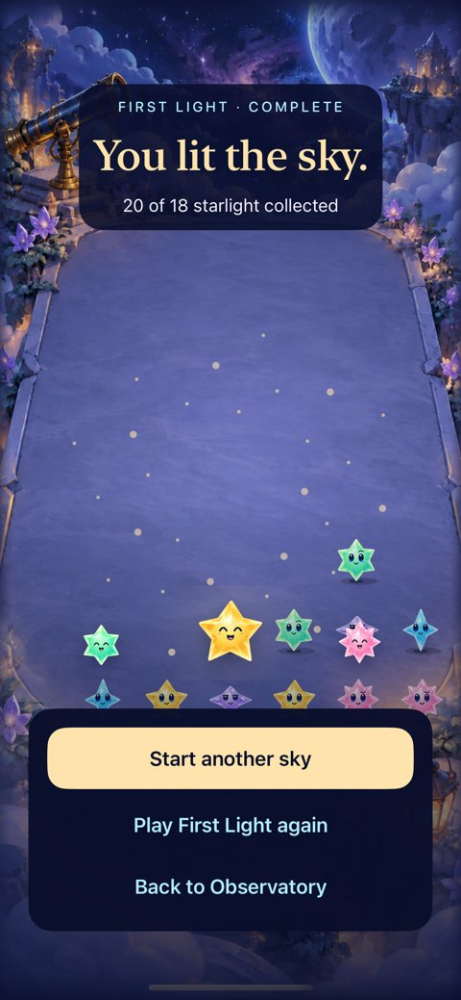 | 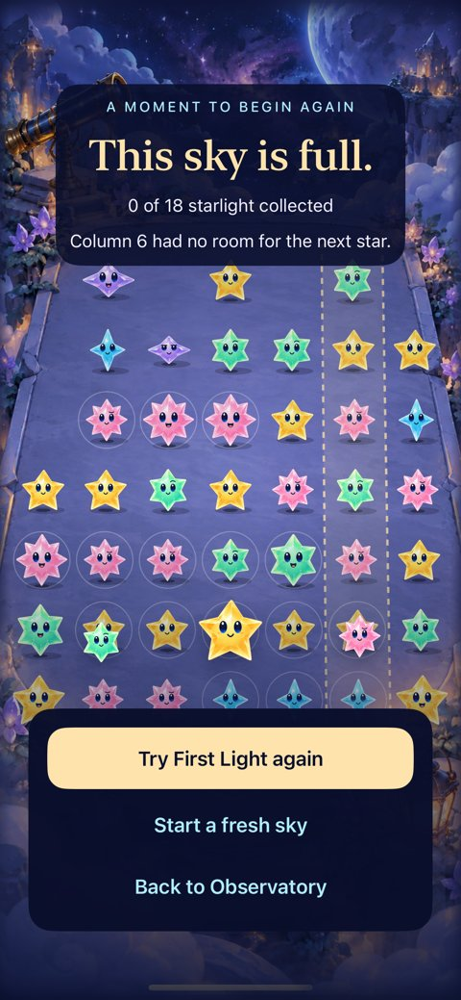 |

**Native captures:** `/tmp/starfall-flow-b4-accepted.xcresult`, 17e / iOS 27.0, normal-motion flow. The final burst-initialization change affects the brief celebration, not these settled panels; final-motion evidence is recorded separately.

### Launch follow-up: unsigned snapshots caused a captured black interval

A separate fresh bundle (`com.starfall.launchcheck`, simulator only) reproduced a black launch interval with the unsigned Release validation product. SpringBoard's SplashBoard log explicitly rejected `LaunchScreen.storyboardc` with resource security error `-67056`, then denied snapshot generation. After locally ad-hoc signing that same product and reinstalling only the temporary app, the repeat capture showed the packaged navy surface: 87 decoded variable-rate frames, no frame with central mean RGB below 3. The unsigned capture contained black frames. This supports a validation-signature cause for this reproduction; it does not establish physical-device launch acceptance or explain every reported black screen.

Raw signed/unsigned recordings, decoded statistics and system logs use `/tmp/starfall-flow-fresh-launch*` and `/tmp/starfall-fresh-launch*`. The temporary identity isolates normal saves. Use a signed simulator product for future launch-snapshot acceptance; the repository's existing simulator CI already uses `CODE_SIGN_IDENTITY=- CODE_SIGNING_ALLOWED=YES`.

An App Launch trace on the SE3 simulator sampled `StarCast.prewarm` for about 105 ms (21 main-thread running samples at 5 ms; approximately 100 ms first-to-last). The separate 1 ms table duplicates those timestamps and is not added to that count. This is one instrumented launch, not a population benchmark. It does not justify adding background artwork generation or a mandatory loading delay. Trace `/tmp/starfall-flow-launch-baseline.trace`; exported sample tables and lifecycle table share that prefix (the lifecycle table contained no rows). Initial export attempts occurred before trace saving completed and failed; the completed sample export succeeded.

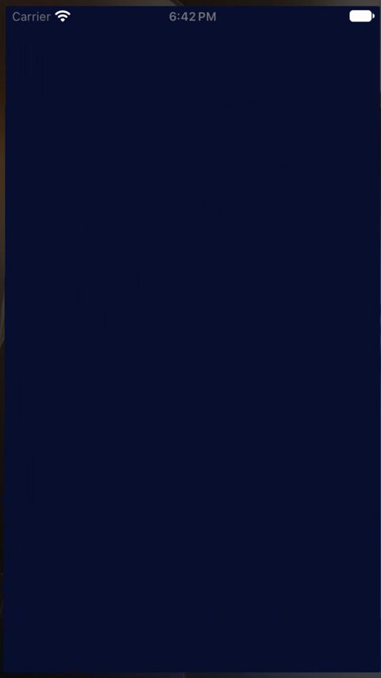

**Actual launch snapshot**, not a gameplay image: fresh temporary bundle, Release, locally ad-hoc signed, SE3 / iOS 27.0; frame 45 at 3.717 seconds of `/tmp/starfall-flow-fresh-launch-signed.mp4`. The system launch zoom includes Home around the app rectangle. This capture does not establish device signing or physical startup timing.

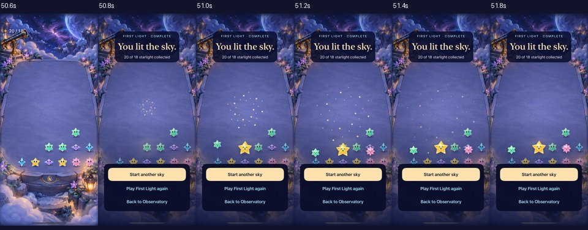

**Final-source normal-motion recording**, `/tmp/starfall-flow-b4-motion-final.mp4`, 17e / iOS 27.0; 50.6–51.8 seconds. Sampled frames verify the final clear settles before the result and the burst appears and ends without replacing the board. The same native run successfully uses Replay and completes overflow/restore/fresh Entry. Actual VoiceOver, physical device, and first-time comprehension remain open.

## Batch 5a — bounded arrivals and honest preparation

**Source:** `e2d21f9` plus [hashed inputs](batch-5a-sha256.txt). The reported invisible-border clipping corresponded to a 230-point offscreen entrance inside a clipped decorative region. `SkyCastFormation` now owns positions and short entrance poses: stars brighten/grow and drift 8–20 points inside the reserved area. The protective clip still keeps decoration out of headings/actions. Shared materials, board geometry, full normal-motion settling, quiet destinations and gameplay outcomes are unchanged. The static launch wordmark uses the same named gold as the ceremony. Only genuinely pending in-app preparation gets a spinner; quiet modes keep its readable text/Back action without the spinner. No forced delay or fake progress.

**Results:** 63 core checks passed (`/tmp/starfall-flow-b5a-core.log`); 15 hosted checks passed (`/tmp/starfall-flow-b5a-geometry-final.xcresult`), including actual packaged storyboard/wordmark/colors and full-raster-plus-shadow containment at six widths with progress −0.1…1.1. The first containment run caught the lowest star's shadow at 1.1; its position moved upward six points, and the original conservative assertion passes without relaxation. The initial combined run therefore failed, despite its Welcome native method passing. An obsolete quiet-test selector in that first command selected no method; the final run uses the actual method below.

Final-source normal Welcome/background/clear/restore/new and system Reduce Motion/Entry/replay passed on the 17e (`/tmp/starfall-flow-b5a-native-final.xcresult`, two methods). The normal Welcome method also passed on SE3 (`/tmp/starfall-flow-b5a-small.xcresult`). Both native tests restore the original system motion preference. Final signed Release build passed (`/tmp/starfall-flow-b5a-release-final.log`); hygiene/diff checks passed. Same toolchain/architecture settings as earlier batches, now using `CODE_SIGN_IDENTITY=- CODE_SIGNING_ALLOWED=YES`; SE3 destination `E90550D2-AE94-4695-8E6F-707BD527C12F`, separate DerivedData `/tmp/starfall-flow-small-qa`.

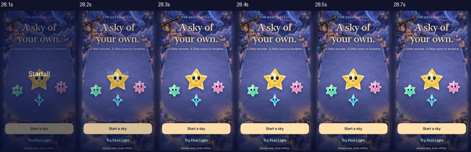

**Final-source native normal-motion SE3 recording**, `/tmp/starfall-flow-b5a-small-arrival.mp4`, iOS 27.0, 28.1–28.7 seconds at 0.1-second samples; includes the system launch crossfade. Inspected frames show complete bodies and shadows rather than a rectangular cutoff. The recording also includes Entry interruption/return, normal play, pause/settings and restore. `/tmp/starfall-flow-b5a-arrival-final.mp4` records the corresponding final 17e normal/quiet checks. Sampling is not a universal no-clipping guarantee; containment checks cover the modeled transform range.

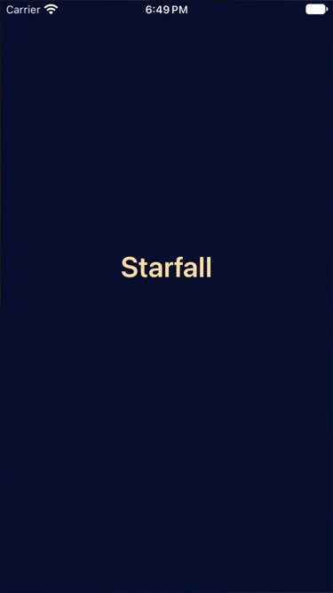

**Signed fresh-install static launch**, `/tmp/starfall-flow-b5a-signed-launch.mp4`, temporary simulator-only bundle / Release / SE3 / iOS 27.0: 108 decoded variable-rate frames, zero central near-white frames and zero central mean-RGB-below-3 frames. The capture includes the launch zoom and settled Welcome. The final source subsequently moved only the aqua arrival six points upward; launch resources did not change. The temporary app was isolated from normal saves. A static storyboard cannot animate; spinner rendering in the rare genuine delayed-readiness path was not reproduced visually. Its admission/Back/stale-readiness logic retains Batch 3's focused checks. Physical-device and RC actual VoiceOver acceptance remain open.

## Batch 5b — complete Welcome and accessibility ownership

**Source:** `c4f47dc` plus [hashed inputs](batch-5b-sha256.txt). Welcome now names Starfall, describes the retained mode/score/pause state, prioritizes Continue for unfinished skies and fresh Start for ended skies, and offers shared settings/help before play. `SkyPreferences` extracts the existing toggle/help content; bindings retain the same authoritative store/AppStorage keys. Typed modal identity keeps the game menu stable while a staged route dismisses it. Large text puts actions before decorative stars and scrolls without shrinking text. Entry states the real matching/18-starlight objective and automatic/pause behavior.

Heading focus belongs to each screen identity; preferences return targets its originating control. The app chooses ceremony-owned terminal speech through the store's narrow policy, so existing result announcements do not compete with heading focus. Other store clients retain their prior feedback default. Hosted checks verify terminal suppression only for the ceremony policy while explicit nonterminal feedback still speaks; the original default-announcement and stale-completion checks also pass. This establishes ownership/semantics, not actual spoken focus acceptance.

**Checks:** 63 core checks passed (`/tmp/starfall-flow-b5b-core.log`); **41 hosted** store/flow/launch checks passed (`/tmp/starfall-flow-b5b-hosted.xcresult`); signed Release build passed (`/tmp/starfall-flow-b5b-release.log`); hygiene/diff checks passed. Final native preference flow passed (`/tmp/starfall-flow-b5b-preferences-native.xcresult`), changing Sound, visiting Help, dismissing to Welcome without a save, starting/pausing First Light, reading the same Sound value in the play menu, restoring that review preference and checking the saved Welcome context. Largest-text Welcome/preferences/Entry/Back/settings dismissal passed on 17e (method in `/tmp/starfall-flow-b5b-native.log`; that overall run failed the initial preference test) and SE3 (`/tmp/starfall-flow-b5b-small.xcresult`). Actual VoiceOver: deferred to RC; not run on this development build.

| Saved context | Shared pre-play preferences | Maximum text |
| --- | --- | --- |
| 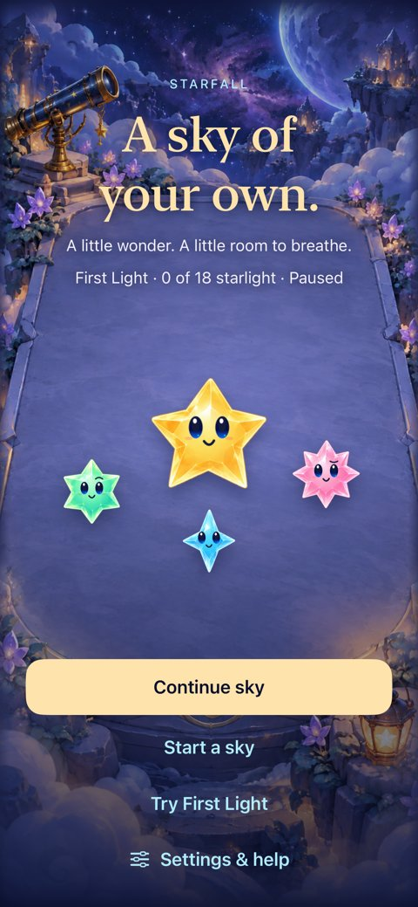 | 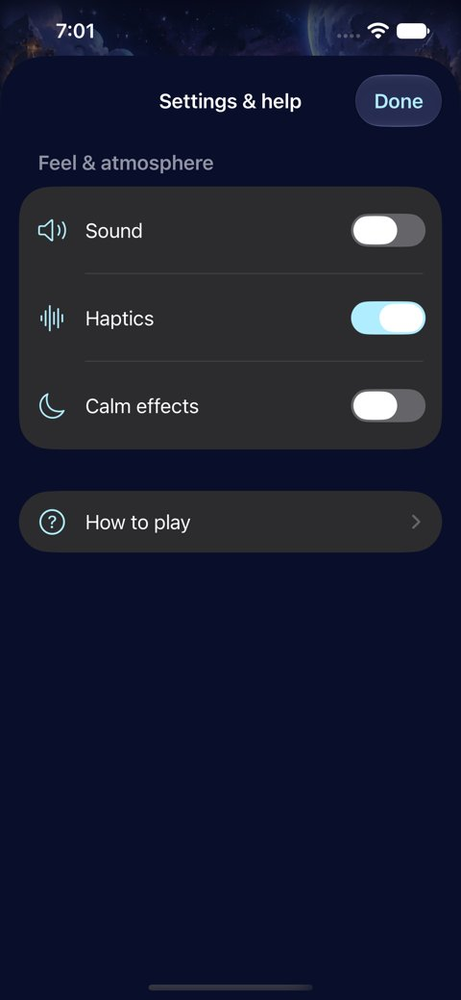 | 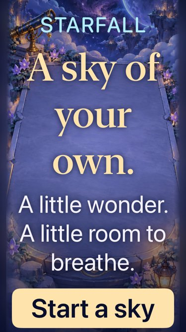 |

**Native references:** preference/context captures from the final preference run, 17e / iOS 27.0; maximum-text capture from the successful SE3 run. Maximum text requires vertical scrolling; the native test reaches preferences, Begin/Back and play/menu dismissal. A visible control alone is not used as proof of activation.

### Native diagnostics retained rather than hidden

The first preference test tapped the composite accessibility row (a 358×74-point outer Switch), while the actual native switch is its 63×28-point child. The value did not change. The corrected test targets that actual switch and retains value-change/shared-value assertions. No preference binding or product behavior was changed to mask that test-target error. The diagnostic log is `/tmp/starfall-flow-b5b-preference-diagnostic.log`; its initial bundle export was unavailable during finalization, and the failed test output remains retained.

Initial iPad landscape attempts failed the helper's `isHittable` predicate and produced rotated/cropped element screenshots. A simultaneous direct simulator recording (`/tmp/starfall-flow-b5b-tablet-direct.mp4`) shows intact full landscape frames during that same failure. LLDB found a correctly sized 1133×744 window/hosting view and a transparent, interaction-disabled SpriteKit host; no app coordinate workaround was added. In `/tmp/starfall-flow-b5b-tablet-activation.xcresult`, XCTest reported `isHittable == false` but native activation successfully opened Preferences, returned, opened Entry and began play. The final tablet test verifies those actual destinations and captures `XCUIScreen` instead of the misleading element crop. This strengthens the behavior check rather than accepting the failed boolean as success. Phone helpers retain their hittability assertions; tablet-only coverage skips on portrait-only phone widths.

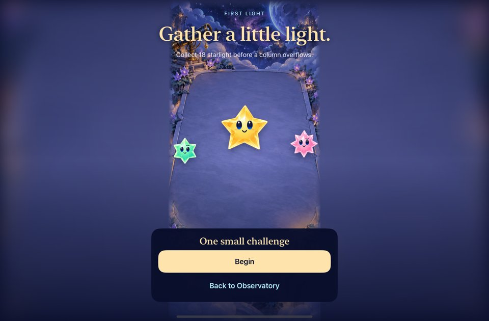

**Final native tablet check passed**, `/tmp/starfall-flow-b5b-tablet-final.xcresult`, iPad mini (A17 Pro) / iOS 27.0, destination `EDE6B5F3-53C9-4703-B3D8-E654BEFA22A0`, DerivedData `/tmp/starfall-flow-tablet-qa`; same signed architecture settings as 5a. Image is the whole-screen capture with orientation metadata normalized for embedding. This covers portrait-launch → landscape rotation and actual Preferences/Entry/Begin activation. It does not establish every tablet orientation, cold-landscape launch or physical-device behavior. Earlier failing tablet bundles remain failures; `/tmp/starfall-flow-b5b-tablet*.log` records the progression.

## Batch 6 — integrated development candidate

**Source:** `1650c507e7846ad52d0cb92df5bfbf327d0c7859`, clean working tree when commands started. Subsequent differences are documentation/evidence only; no compiled source/resource/build-setting input changed during candidate checks. Same Xcode 27.1, arm64 signed simulator settings and 17e / iOS 27.0 destination as 5a. Release build, 63 core checks, hygiene and diff checks passed. The integrated run passed **112 checks with zero failures and 11 skips**: four native flows passed; 108 of 119 hosted checks ran while the simulator retained its original enabled Reduce Motion setting. The 11 normal-animation checks explicitly skipped under that system preference. A second exact-app-source hosted run on SE3, whose system Reduce Motion was already off, passed **all 119 hosted checks, zero failures/skips** (`/tmp/starfall-flow-candidate-normal-hosted.xcresult`, 17.2 seconds). No system setting was changed to obtain that run; the QA phone retains its original setting. Across these source-bound runs, all 119 hosted checks and the four selected native flows passed. No source assertions were weakened to turn skipped animation into claimed coverage.

The final native selection runs Entry cancellation/termination, full normal-motion First Light win/replay/overflow/restore, system Reduce Motion/Entry/replay, and normal-motion Welcome/background/clear/restore/new; it also selects the entire `StarfallAppTests` hosted target. Command: `xcodebuild -project Starfall.xcodeproj -scheme Starfall -configuration Debug -destination 'platform=iOS Simulator,id=6E9BC34B-C5C6-48ED-9593-D16AC994BCC8' -derivedDataPath /tmp/starfall-flow-implementation ARCHS=arm64 ONLY_ACTIVE_ARCH=YES CODE_SIGN_IDENTITY=- CODE_SIGNING_ALLOWED=YES -parallel-testing-enabled NO -only-testing:StarfallAppTests` plus those four `StarfallUITests/SkyFlowInteractionTests/<method>` selectors, `-resultBundlePath /tmp/starfall-flow-candidate-1650c50.xcresult test`. Matching log and native recording share that prefix. Core: `/tmp/starfall-flow-candidate-core.log`; Release: `/tmp/starfall-flow-candidate-release.log` with the same signed architecture settings and generic simulator destination.

### Signed launch sampling on final app source

Release was copied to a temporary `com.starfall.launchcheck` bundle, with only bundle identity and ad-hoc signature changed. Fresh-installed Light appearance and force-quit/relaunch Dark appearance were recorded on SE3 / iOS 27.0. Both show the actual navy Starfall wordmark before Welcome; no central near-white or central mean-RGB-below-3 frame was captured. The temporary app was removed afterward and the original Light appearance restored; the normal app/save were retained.

| Capture | Decoded frames | Nominal rate / final decoded timestamp | Near-white / black frames |
| --- | --- | --- | --- |
| `/tmp/starfall-flow-candidate-launch-light.mp4` | 66 | 21.46 fps / 3.060 s | 0 / 0 |
| `/tmp/starfall-flow-candidate-launch-dark.mp4` | 74 | 8.94 fps / 5.677 s | 0 / 0 |

These are variable-rate captures. Per-frame central-region statistics and decoded samples use matching `*-audit.json` and `*-frames/` paths. Central near-white means over 90% of samples have all RGB channels above 235; black uses central mean RGB below 3. System zoom/Home frames are included. Static intervals need not emit frames at the nominal rate; sampling cannot exclude an uncaptured subframe flash. This covers neither physical launch nor every saved/corrupt/terminal launch combination.

### Remaining acceptance belongs to its actual stage

| Area | Development result / remaining limit |
| --- | --- |
| Rules, saves, cancellation | Core/hosted/native contracts cover retained bytes, modes, duplicate/stale Begin, pause and restore. No rule/schema change. |
| Normal animation/input | Native recordings cover real arrivals/clears, handoffs and settled endings; full-motion tests explicitly restore the simulator's original motion setting. Bounded formation transforms include overshoot. |
| Phone/large text | 17e and SE3 checks pass; XXXL uses vertical scroll with actions before optional cast. Screenshots inspected separately from reachability. |
| Tablet | iPad mini portrait-launch → landscape rotation, Preferences → Entry → Begin activates successfully; whole-screen captures inspected. Full orientation/cold-landscape/device matrix remains open. |
| Accessibility | Automated labels/values, hidden-board structure, reachable native actions and ownership tests pass. Actual VoiceOver: deferred to RC; not run on this development build. Physical speech/focus and haptics remain open. |
| Slow readiness | Admission/Back/stale-token logic tested; the actual delayed spinner surface was not reproduced visually. Verify when inducing a genuinely slow renderer or at RC. |
| Human comprehension/enjoyment | No first-time participant result collected. Copy and visual causes improved; do not infer enjoyment from fixed seeds or green tests. |
| Device/minimum OS | No physical-device installation or iOS 17 runtime run in this task. SDK availability/build checks are separate from runtime acceptance. |

| Final signed launch | Final explanatory ending |
| --- | --- |
| 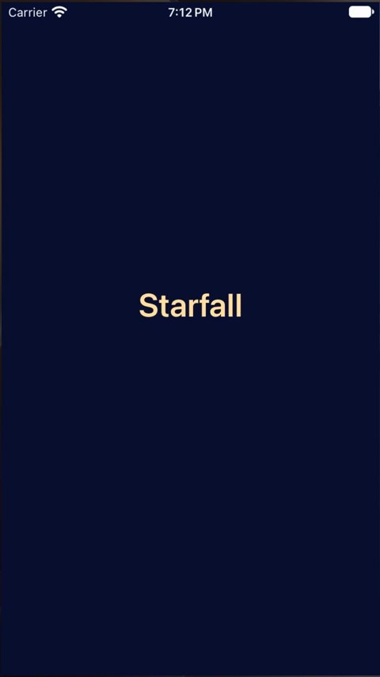 | 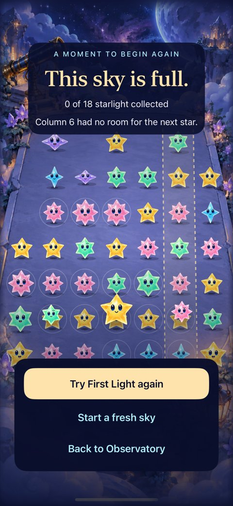 |

**Integrated-source captures:** signed temporary Release / SE3 Light launch frame 30 at 1.71 seconds; full-sky frame from the successful clean-commit 17e native flow. Raw frame statistics and native recording remain in `/tmp`. These images establish appearance at the captured instants; actual animation/input evidence is the successful native run and recording described above.

## Current-main publication verification — PR #38

**Result: Verified for development integration.** Screen-flow commits were replayed onto published main `f6f1cd81c5e1e5c6e1adb49a5dac35b696cae182`, preserving its Opal/storm generation, announced cadence, constellation tracing, v4 save archive, build identity and delivery tooling. No Core/rule, schema, entitlement or network change is included in this PR. Earlier sections remain evidence for their original source, including the then-local ranking sidecar; rankings are absent from current published main and were not introduced by this integration.

**Source:** Clean integration `9c4133c1a85b11d53ec609212ed57ef494134afb` / published `fcb693a0d595daa13dcbbf401ae95b516de4895b` share exact Git tree `beb13d22442c182276ff17b153b1df47593912a8`. Local CLI authentication was unavailable, so GitHub Git Data publication was followed by a fetch and zero file diff. The subsequent `2a08759adf4300c246c9616ab36806924e91d6e5` changes only the storm UI test's foreground-readiness wait (plus comments); its focused run tested that behavior from the working tree. Final changes beyond these sources are this evidence text and capture.

**Environment:** Xcode 27.1 (27A9275), iOS 27.0 Simulator (24A434), arm64. Debug native/hosted runs use SE3 `E90550D2-AE94-4695-8E6F-707BD527C12F`; sibling checks use iPhone 17e `6E9BC34B-C5C6-48ED-9593-D16AC994BCC8`. Both were already booted. System motion preferences were restored by the flow tests. Signed builds use `ARCHS=arm64 ONLY_ACTIVE_ARCH=YES CODE_SIGN_IDENTITY=- CODE_SIGNING_ALLOWED=YES`, parallel testing disabled.

| Check | Result / raw evidence |
| --- | --- |
| `python3 scripts/ci-hygiene.py`; `git diff --check` | Pass; final evidence-only commit checked again before publication. |
| `swift test` | **89 passed**, no failures; `/tmp/starfall-pr-core.log`. |
| Signed Release generic simulator build | **Passed**; `/tmp/starfall-pr-release.log`, derived data `/tmp/starfall-pr-release`. |
| Debug hosted + five flow tests | **139 passed, zero skips/failures**: 134 hosted plus Entry cancellation/termination, First Light win/replay/full-sky/restore, Reduce Motion, Welcome/background/new sky, and shared pre-play preferences. `/tmp/starfall-pr-integrated.xcresult`, summary `/tmp/starfall-pr-integrated-summary.json`, log `/tmp/starfall-pr-integrated.log`. |
| Native sibling checks on 17e | Four passed: Opal selected trace, large-text phase/ceremony visibility, forecast/menu/background fallback, and largest-text Welcome/Entry/Back. `/tmp/starfall-pr-siblings.xcresult`. That run also retained one failing pre-existing storm dismissal check, diagnosed below. |
| Focused storm/menu/background check | **Passed**, one test, no skips/failures after readiness correction; `/tmp/starfall-pr-storm-ready.xcresult` and `.log`. |
| Delivery/native matrix tooling | `python3 scripts/test_native_test_plan.py`: 3 passed; `python3 scripts/test_device_update.py`: 10 passed. |
| Visual inspection | Current-main native Welcome and full-sky attachments inspected: complete settled cast, retained final board, column-six explanation/cue, readable mode-specific retry actions. Native test motion was enabled for normal flow and separately exercised with Reduce Motion. Captures alone do not prove animation quality. |

Reproduce with `xcodebuild -project Starfall.xcodeproj -scheme Starfall -configuration Debug -destination 'platform=iOS Simulator,id=<device above>' -derivedDataPath <temporary folder> ARCHS=arm64 ONLY_ACTIVE_ARCH=YES CODE_SIGN_IDENTITY=- CODE_SIGNING_ALLOWED=YES -parallel-testing-enabled NO -only-testing:<selection> -resultBundlePath <new bundle> test`. Integrated selections: `StarfallAppTests` and `StarfallUITests/SkyFlowInteractionTests/{testEntryCancellationAndTerminationRetainThePlayedSky,testFirstLightWinReplayAndFullSky,testReducedMotionEntryAndReplayKeepExplicitBegin,testWelcomeEntryBackgroundAndAnotherSky,testWelcomePreferencesShareValuesWithPlayAndDoNotCreateASave}` (one flag per method). Siblings: `ShowerForecastInteractionTests`, `ConstellationTraceNativeTests/{testLargestTextPhaseReflowsAndCeremoniesHideTheCue,testNativeTraceIncludesOneOpalAndPreservesTheOther,testStormWarningCountRecoveryAndMenuSuspension}` and `SkyFlowInteractionTests/testLargestTextWelcomeEntryAndBackRemainReachable`, all under `StarfallUITests`. Focused rerun selects only the storm method. Release substitutes `-configuration Release -destination 'generic/platform=iOS Simulator' build` without test selections.

**Failures examined and corrected:** Initial hosted integration failed two inherited assumptions: modern saves use the v4 envelope/current generation, and nonterminal cadence/storm transitions legitimately speak. Tests now use the authoritative archive and generation, and isolate the terminal turn's speech ownership; production behavior was preserved. Initial output remains `/tmp/starfall-pr-hosted.log` (134 tests, two failures); xcodebuild stalled after reporting the suite and received an interrupt, so that bundle is not accepted evidence. The successful complete integrated bundle above supersedes it.

The storm test's first Done tap after `app.activate()` left the sheet open. A clean `git archive origin/main` export at `/tmp/starfall-pr-baseline` reproduced the same failure before the PR (`/tmp/starfall-pr-baseline-storm.log`, one failure). The failing native recording and hierarchy showed the menu still visible with the same nine-shower committed board. The corrected test waits for running-foreground, enabled and hittable Done, makes **one tap**, explicitly asserts the menu disappears, then verifies the unchanged storm count and the remaining storm-to-calm sequence. No retry, forced motion setting or product workaround was added. The focused run passed in 19.372 seconds. This bounds the demonstrated automation-readiness mechanism; it does not certify every native reactivation path.

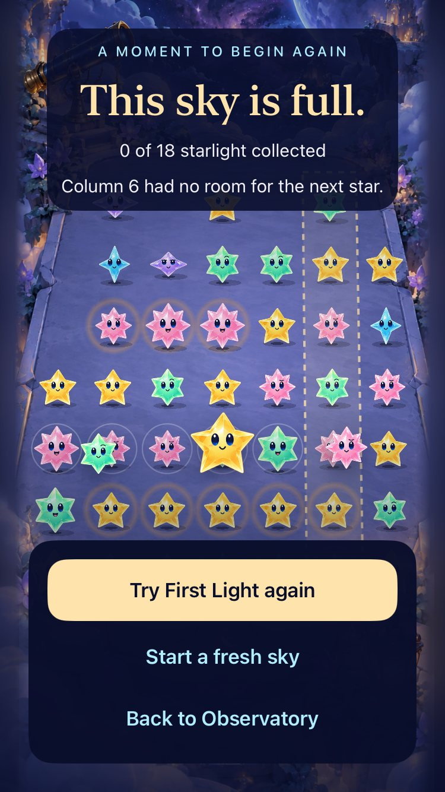

**Runtime evidence:** SE3 Debug, clean `9c4133c`, successful normal-motion First Light win/replay/full-sky run; screenshot at the settled ending, normalized to JPEG. Human comprehension/enjoyment, physical-device launch, minimum iOS runtime, actual VoiceOver, full tablet orientation matrix and visual reproduction of the rare preparation spinner remain the RC checks already tracked in [Engineering](../../ENGINEERING.md#sky-flow-release-acceptance). No physical-device update was requested or performed for this PR.
