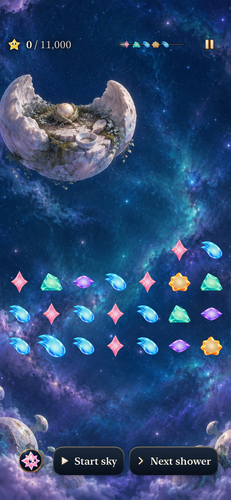
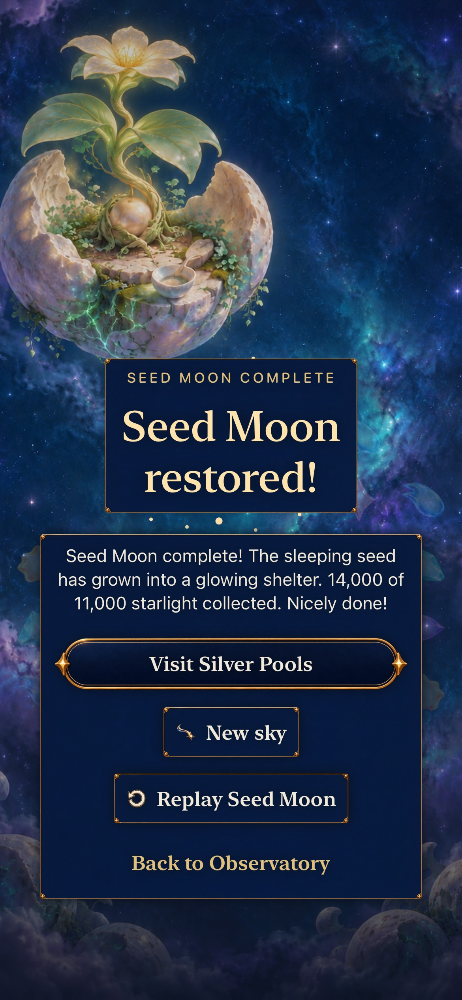

# Seed Moon: spend or preserve a grown ingredient

**Status:** Verified development on final combined main source; ready for merge · **Issue:** [#279](https://github.com/lbeezr/starfall/issues/279) · **Date:** October 23, 2026

New Seed visits select revision 4: 23 stars, 24 light, one visibly grown aqua ingredient and an announced 11,000-point objective. Spending it in a four-star line earns 6,000 immediately; moving it into the five-star arrangement earns 8,000 after setup. Complete ordinary routes finish at 11,000 and 13,000. One ignored shower leaves both finishes available; the preserve route reaches 14,000 through naturally grown rose light. Waiting does not raise the already-grown aqua star's value.

This adapts the [seven-place curriculum](../../design/STORY_ENCOUNTER_CURRICULUM.md) and [Puzzle League reference](../../design/POKEMON_PUZZLE_LEAGUE_REFERENCE.md) into a distinct ingredient choice. The 2,000-point first-clear difference includes an additional star and the existing pattern-size bonus; it is not a new grown-star multiplier. These are separate depth-one clears, not a causal chain. Ordinary legal alternatives can win; no required order, shower, or minimum duration is added.

Historical Seed0 remains manual/18-light on Continue and same-round Replay; nonexistent Seed1–3 reject. Explicit new visits select Seed4. Seed adds no archive field: the merged main archive14 preserves Seed4 from valid v13 while retaining all older supported contracts. Seed keeps existing seeded supply, scoring, clocks, scene, paintings and journey owners authoritative. Seed completion earns immediate Silver access; Silver's new sequencing encounter is a separate subsequent slice.

## Inspected native appearance

 

The phone opening uses clean combined source `26124268`, computed runtime `dev.596d285373`; the actual-clock result uses `fb3ff776` / `dev.a7fb00d69e`. Both local bundles are labeled `dev.local`. [Twelve inspected captures](captures.json) retain original dimensions, source hashes and per-frame limits. The integrated compact-action surface changes button appearance; the earlier clock image retains its earlier source.

The largest-text quiet iPad case reads Seed's key Help instructions across three overlapping viewports, then finishes the preserve route and uses onward travel. Text remains large, the grown ingredient remains visibly larger/haloed, and Done stays fixed outside the reading area. Its result shows 13,000/11,000 and Visit Silver; lower actions continue below the captured viewport and are revealed before use. Stills do not prove animation chronology or uncoached recognition.

## Verification and limits

Computed runtime input `dev.a7fb00d69e` starts from merged main `b41a623c633d22dc9248e4fcdfc5bb505be1452f`; actual local test bundles use `dev.local`. [Verification](verification.json) records exact input hashes, commands and results. Raw logs and result bundles remain under `/private/tmp/starfall-next-encounters-20261023/`.

The full Core suite passes 257 tests with zero failures/skips. The initial sandboxed invocation could not write the existing compiler cache; the authorized execution passed. Core coverage includes full-state equivalence of moving the grown aqua before the first shower versus after it, 14,000-point recovery, replay, old-save admission and immediate terminal behavior. Catalogue validation passes 457 keys, 103 scripts and 108 unique line IDs; all 100 previous scripts remain unchanged.

Acceptance passes across the recorded sources: 108 selected flow/dialogue/archive/world hosted tests, three integrated artwork hosted tests and five native cases with zero skips on their passing runs. The native cases cover historical Seed0 win/Replay, both current choices, saved ingredient/result restore, current Replay and fifth-shower overflow, ordinary-clock recovery with genuine earned Silver access, three retained-round preview cancellations, and AX3XL quiet Help/full-round/onward.

The earlier clean compiled source `26124268` / `dev.596d285373` integrates main #300's passive compact-action material. Its phone preview cancellation, three artwork hosted checks, full iPad case, Debug and Release pass. Core, store, clock, score, catalogue and selected hosted-test bytes remain unchanged from the earlier 257-Core/108-hosted source, so those results retain their original scope; the automatic-clock case is not claimed as re-executed on the compact-action source. Source/Debug/Release dialogue hashes match. Hygiene, diff, membership and local links pass.

 The first automatic-shower native route reached the Seed win, then its new helper incorrectly compared the entire spoken ceremony sentence with the bare live-HUD score label. The same mistake affected the persisted result comparison. The test-only correction keeps an exact delimited numeric score slot in the ceremony; outcomes and targets are unchanged. The next comparison run reached both wins, restored the result and replayed correctly, then its new overflow loop waited only for Next after the fifth shower had already begun the loss presentation. The bounded wait now accepts either ready Next or the terminal result, matching the existing Kite boundary. Its complete rerun passes with the original loss and score assertions. Neither correction changes production code; the two failed runs remain recorded separately.

Uncoached player recognition, comfort and enjoyment, physical-device play, minimum-OS and actual VoiceOver acceptance are not performed here. VoiceOver stays deferred. No physical device was probed or installed.

## Later main integration: Lantern comparison and ceiling

Main `6f8fc7a0` / PR #301 arrived after the compact-action acceptance. Clean combined input `8bc0ebf667910f4e262e60c06c5b4bb7ac17b9b0`, tree `05e84c4890671a6f5373f427f81ab794df09e1a2`, computed runtime `dev.495b77cd3c`, preserves its optional Lantern5, archive14 and ceiling indicator alongside Seed4. Neither Core nor App required a production merge repair. All 268 Core tests pass; strict combined content passes 477 keys/107 scripts/112 unique line IDs. Final combined acceptance passes: 128 hosted plus real automatic-clock phone recovery, the full AX3XL quiet iPad Help/round/onward case, Debug and Release. Source/Debug/Release catalogue hashes match. Earlier captures and passing receipts retain their original source; they do not alone certify the new shared renderer/archive input.

Final-source review confirms the ceiling remains above occupied rows and does not obscure the board or Help. The last Help capture ends visibly at “finish the repair”; its final optional “too.” remains below that captured viewport. The complete label and ordinary scrolling remain available; this is a capture-coverage limit, not a demonstrated UI defect. No extra product or test change was made merely to fill that screenshot.

The final `8bc0ebf6` / `dev.495b77cd3c` phone result and tablet opening are retained alongside the preceding source-bound views. Their original-resolution PNG and retained JPEG hashes are in the capture index.
