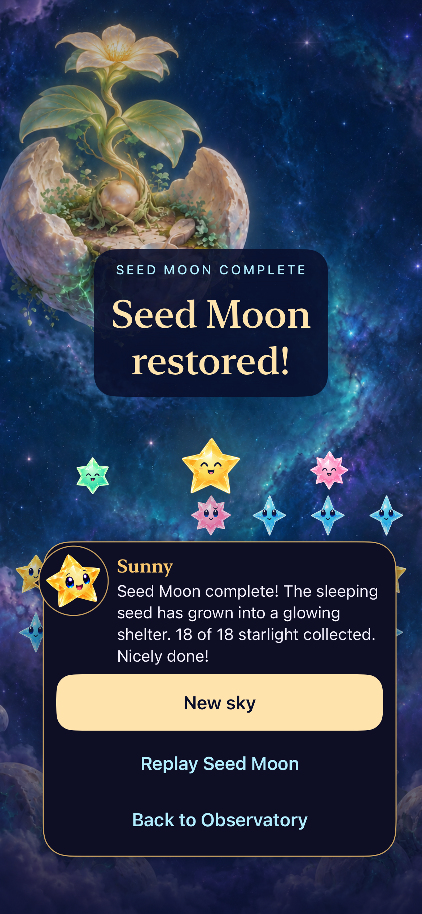
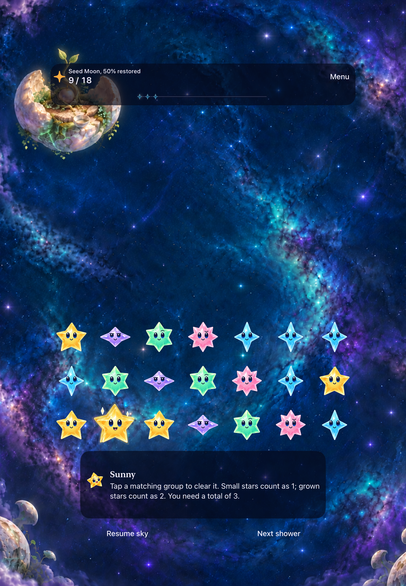

# Seed Moon verification

**Result:** Verified within development scope; publication/delivery pending · **Owner:** Current implementer · **Date:** October 19, 2026

Seed Moon is the fourth selectable seed-42, 18-light challenge. All fifteen restoration states have been inspected natively across phone, iPad portrait and landscape. Hosted checks, phone win/restore/replay, largest text/system Reduce Motion, preview/cancel over all three prior locations, tablet rotation/clears and final phone dense input/motion pass within the source boundaries below. **Final compact, focused overflow and Release checks pass. Publication and canonical delivery remain pending.**

**Next action:** Publish and merge the change, then canonically deliver it and record the installation receipt against the [production plan](../../design/seed-moon-04/PRODUCTION_PLAN.md). Existing light transfer, whole-image restoration and the ordinary result own completion; no gardening system, scenery travelers, campaign or unlocks are added. Actual VoiceOver and physical play remain separate acceptance.

## Verification context

**Final runtime:** `b77a1003f5d22b9da67d5d4c54f3515481d45ea3` / `dev.545382e6f6`. It changes only the phone 50% painting from `a0c73606d68b332dad12d2d3aa3b827ea4a10960` / `dev.017575ea43`, raising the early shoot above the header. The prior image’s shoot overlapped the HUD; its original record remains preserved. At the final source, Debug build, corrected image/dense input, manual overflow and recorded normal completion pass. Final test-only checkpoint `124fd21c39a71030723c0485882839e546e032a0` adds the overflow/replay UI regression without changing that runtime. It passes focused, compact and Release checks below. Earlier hosted/UI results are not relabeled as final-source reruns.

**Hosted/UI checkpoint:** `a0c7360`, based on main `618e2c8`, with only documentation/evidence dirty and no build-affecting differences. Main PR #173’s UI-test-only storm timing/helper maintenance is incorporated. Xcode 27.1 (27A9275), macOS 27.0.1, iOS 27.0 (24A434), arm64, scheme Starfall; Debug native checks use iPhone 17e, iPad Air 11-inch (M3) and iPhone SE (3rd generation). [Verification metadata](verification.json) owns commands, source/device details and result-bundle/log names as they are recorded.

**Earlier Core/Python source:** Dirty tree based on `babc534762f90e75bc0d5af60ae85ab075342777`. Core changes were limited to `Sources/StarfallCore/StarfallChallenge.swift` and `Tests/StarfallCoreTests/StarfallChallengeTests.swift`; other app/test/tooling/artwork work was in progress. Core finished at 13:34:26 EDT / 17:34:26 UTC on an arm64e macOS host. These results do not establish later app-only source-size fitting or native rendering.

## Outcomes against acceptance

| Check | Observed result | Source / evidence / limit |
| --- | --- | --- |
| Core rules/save | **178 passed, 0 failures**, 17.263 s wall | `swift test`, dirty `babc534`; `/tmp/starfall-seed-core-tests.log`. Existing seed/target/save identities retained. |
| Python tooling | **55 passed**, 5.902 s | Earlier dirty boundary; `/tmp/starfall-seed-python-tests.log`. Expected child-process fixture failures/timeouts are not suite failures. |
| Hosted app | **329 passed**, no failures/skips/warnings | `a0c7360`, 129.041 s. Includes stage-specific source-size fitting; separate from Core. |
| Phone win and accessibility | **2 UI tests passed**, 110.019 s | `a0c7360`: native win, persisted named result and replay at zero; Accessibility XXXL with actual system Reduce Motion. Exported stills inspected; scrolling exposes large-text actions. |
| Retained-round preview | **1 UI test passed**, 175.421 s | `a0c7360`: preview/cancel retains Lantern, Ribbon and Kite in turn; Begin selects Seed Moon. Six entry/post-Begin stills inspected. |
| Tablet rotation / input | **1 UI test passed**, 172.725 s | `a0c7360`: rotation retains state/identity/geometry; native 5→9 landscape and 9→13 portrait clears. All ten tablet milestone captures inspected. |
| Native scene appearance | **All fifteen states inspected** | Phone 0/25/75/100 and all tablet states at `a0c7360`; corrected phone 50% at `b77a100`. Continuous art, distinct closed75/open100 and readable cast/HUD. See limits below. |
| Final dense input | **Native 49-star 9→13 clear passed** | `b77a100`, phone; final corrected 50% painting inspected with dense cast. Appearance and actual score-changing input were both checked. |
| Normal completion | **Recorded final 14→18 win inspected** | `b77a100`; frames from 0–4.5 s reviewed by the native owner: light transfer, full-image canopy reveal and ordinary result. No scenery travelers. [Motion record](motion.json) retains timing, video hash and limits. Stills are not the motion evidence. |
| Overflow / focused presentation | **13/13 passed**, 62.344 s | Test-only `124fd21`: 12 RestorationPresentationTests plus native Seed dense-overflow/replay UI; runtime `dev.545382e6f6`. Manual final-runtime overflow also passed. |
| Compact portrait siblings | **4/4 UI tests passed** | `124fd21`, SE3 / iOS 27: Seed + Kite win/replay (150.855 s); Lantern win/replay + Open sky automatic showers/pause/clear/replay/settings (134.140 s). No failures/skips/warnings/errors. |
| Debug / Release | **Both passed** | Debug at `b77a100`, 15.137 s; Release at `124fd21`, 16.744 s. Same runtime, no warnings/errors. |
| Final tooling recheck | **15/15 passed** | Native-plan 3 + RC-platform 12 after the overflow test registration; separate from the earlier Python 55. |
| Artwork provenance | **15 packaged/source byte matches; 20 attempts preserved** | [Prompt records](../../design/seed-moon-04/art-prompts.json) preserve originals and clearance corrections; [asset manifest](../../design/seed-moon-04/production-assets.json) owns selected hashes, dimensions and bytes. |
| Merge / canonical delivery | **Pending** | No publication or installation receipt claimed. |

## Native visual findings

| Phone completed result | iPad portrait 50% |
| --- | --- |
|  |  |

**Native runtime evidence:** `a0c7360` / `dev.017575ea43`, iPhone 17e and iPad Air 11-inch (M3), iOS 27, default text. The final phone50 correction does not change these two scenes. [Capture metadata](captures.json) retains exact source, device and hashes. Images are unmodified; the result still does not establish transition timing.

The closed 75% bud is clearly above the header and the completed canopy remains visible at result. Tablet portrait 25% has a small, readable root cue below a HUD that partly covers the pearl; the change is subtle. Phone lower white controls cross pale clouds and remain readable in inspected frames, with weaker contrast than the HUD. Physical contrast/comfort needs its own review. Accessibility XXXL wraps without horizontal clipping; its scrolled result shows New sky and Replay, with the rest of Back to Observatory below that viewport rather than all actions visible simultaneously.

Eight compact Seed/Kite stills were independently inspected with no blocking layout issue. Closed/open Seed landmarks and dark/lit Kite mast states stay distinct. Result headings wrap to two lines; the native-win views are scrolled to readable dialogue, New sky and Replay, with Back to Observatory continuing below. Relaunch and active-play views show different scroll positions; native tests establish action usability.

Light reaches the pearl seed on phone and tablet landscape. Tablet portrait instead uses the persistent visible mint root seam below the HUD, normalized **(0.160, 0.214)**; the upper bud/canopy retains a separate protected focal region. No masked center, scenery inhabitants or extra unfolding animation is introduced.

Some manual-driver taps reported success without a state change; explicit 120 ms native touch contact committed the same observed controls. The cause is unestablished and no runtime fix is claimed. Independent XCTest win and overflow/replay checks pass; [the motion record](motion.json) preserves unsuccessful attempts separately.

## Remaining limits

Publication and canonical delivery remain pending. Actual VoiceOver remains an RC requirement. Physical play, audio, sustained performance and human satisfaction are unobserved. Compact acceptance covers portrait; no independent Seed Moon compact-landscape runtime sample is claimed. This is not a full RC matrix.

The offline reviewer passes syntax and 57 score/view combinations, fixed identities, 24/40/49/0 samples, milestones, guides, image status, query precedence, natural-size updates and cast paths. **Browser rendering is unverified:** the earlier local-file denial prohibited alternate-route workarounds; none were attempted. The other eight locations, map traversal and future user-generated clips remain outside this slice.
