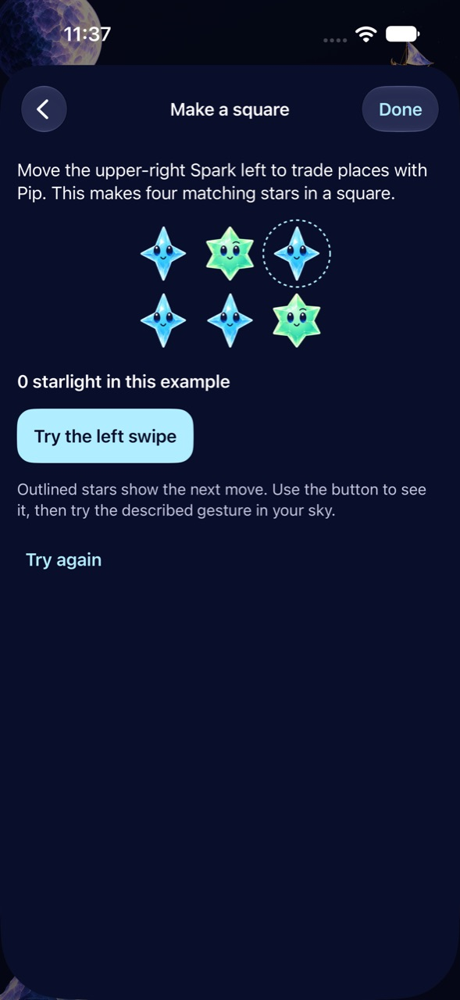
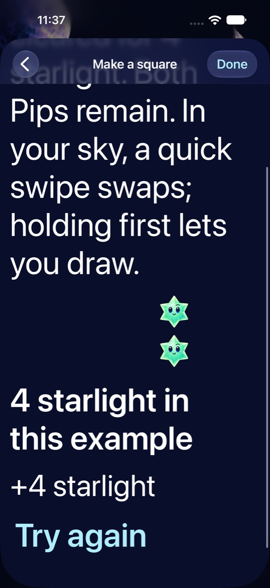

# See useful setups before trying them in a round

**Result:** Partially verified · **Owner:** current implementer · **Date:** 2026-10-18

Help now offers four optional interactive examples: making a square, tracing a cross, including Opal and creating a relay. Each explicit button applies the real Core move to an isolated value, shows exact rewards and retains the surviving stars. Outlines identify the next move; the original board dimensions stay fixed through its steps. These are consequence demonstrations, not gesture-execution training.

**Next action:** Merge and verify canonical delivery before reward rhythm.

## Outcomes and boundaries

`SkyLesson` owns the authored positions and explicit moves. It delegates to existing swap, tap and constellation rules; no rule, RNG, save schema, shower cadence or live-round state changes. `SkyLessonView` owns a local value with no Store, archive, shower clock or asynchronous work. Help keeps using the existing suspension boundary. Retrying affects only the example; navigating away discards it. First Light excludes these Open sky techniques, and legacy skies omit Opal.

Core checks establish that the swap creates a square without clearing, both traced shapes spend only the selected stars, Opal joins only the started color, and the relay's second square was created by its first clear. All four sequences are legal and retain unrelated identities and forecast values. The examples create no campaign, progression, unlocks, rewards in the live round or alternative app.

Native checks exercise every action and reset, unchanged live score/board after dismissal, and subsequent shower input. Separate checks cover largest-text scrolling, calm effects, background/resume, pending First Light Help and system Reduce Motion. Real VoiceOver and physical learning/comprehension remain RC/player observations.

## Verification context and corrections

Xcode 27.1 (27A9275), Swift 6.4, iPhone 16 Pro Max QA / iOS 27.0 (24A434) Simulator. Commands: `swift test --disable-sandbox` with `/tmp/starfall-swipe-clang` module caches; XcodeBuildMCP `test_sim` with `-sdk iphonesimulator CODE_SIGNING_ALLOWED=NO ARCHS=arm64 ONLY_ACTIVE_ARCH=YES`, explicit build identity and `-parallel-testing-enabled NO`. [Source](source.json) and [results](verification.json) distinguish runtime revisions. Raw bundles/logs are disposable under `artifacts/setup-discovery/`.

The first compile rejected a switch expression passed directly as an argument; assigning its typed key first fixed it. The first native run passed all example moves but failed an incorrect test expectation that omitted “ready” from the existing board summary. The exact expectation was corrected, preserving the assertion. Initial screenshot inspection also caught animated text crossfading over itself; only the diagram now animates. The corrected focused run passed 29 hosted and three native tests. A subsequent compact layout keeps authored dimensions, outlines next-move stars and clarifies which Spark to swap; final native/Release acceptance follows below.

Source/resource membership explicitly includes the new view and native test in the regular app/test targets; the package automatically includes the new Core example and test files. There is no new asset or external dependency. Existing live win/loss/save behavior is unchanged; the preceding delivered batch retains its native outcome/replay evidence.

The compact-layout run found a native test precision issue: a 44-point target was reported as `43.99999999999994` after coordinate subtraction. The assertion now allows `1e-9` point of floating-point error, far below a physical pixel, while retaining the 44-point requirement. Product geometry was unchanged. The initial run passed 13 checks and failed two instances of this assertion; the focused corrected native run is recorded separately.

## Inspected appearance

*Runtime evidence: clean product source `774cf98`, `dev.14bd6d9ce3`, iPhone 16 Pro Max / iOS 27.0 Simulator. Left: normal text/motion, before action. Right: accessibility XXXL and calm effects, scrolled to the completed result. Both were inspected. These frames establish presentation and reflow; they are not physical learning or actual VoiceOver evidence. The initial capture run's numerical target-size failure is recorded above; it did not change product pixels.*

## Final local acceptance

**172 Core tests passed.** The 29 affected hosted checks passed before the compact layout, with all 12 dialogue/catalogue checks passing again on the final runtime. Six distinct native checks pass across the recorded sources; the final three example checks pass on runtime dev.14bd6d9ce3 (normal, largest-text/calm and system Reduce Motion). The unchanged Help container also passed its complete largest-text read-through; pending First Light and rapid live gestures pass. Release Simulator build, hygiene and whitespace checks pass. Only evidence/documentation paths were dirty for final acceptance. Actual VoiceOver and physical comprehension remain separate; these checks do not certify an S-tier enjoyment rating.
