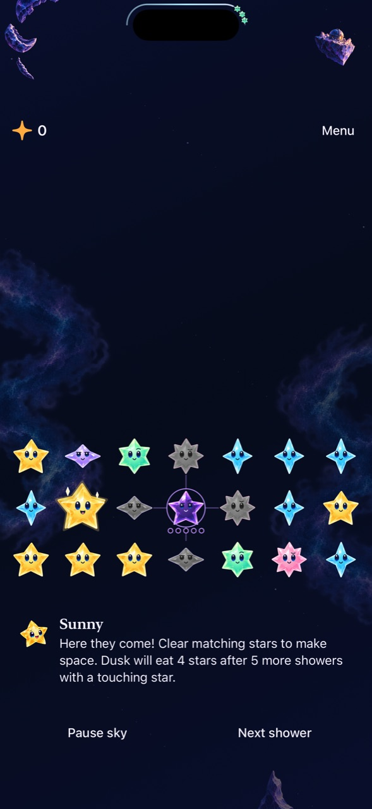

# The shower forecast follows the real countdown

**Result:** Partially verified · **Owner:** current implementer · **Date:** 2026-10-18

The forecast now samples the Store's monotonic scheduler and frozen remainder. Holding a star or pausing no longer visually restarts its journey. Quiet motion updates once per second instead of freezing the forecast; normal presentation retains 30 updates per second. Neither path schedules or commits rain.

**Next action:** Continue setup discovery; follow the open older-compiler CI result.

## Acceptance and findings

The previous view converted a separate wall-clock date into progress, then treated a missing date during contact as a fresh interval. It also paused its animation timeline whenever quiet motion was enabled. A native quiet-mode reproduction failed to reach “Shower approaching” before the next shower. Its first draft used an obsolete pace-menu label; after correcting that locator, the actual forecast regression failed as expected.

`SkyShowerCountdown` carries only presentation values. The narrow read closure samples the existing scheduler; deadline/remainder/due changes are observable, with no per-frame Store mutations. Frozen states render once. A periodic timeline supplies ongoing updates in normal/quiet modes, including system Reduce Motion. The separate display-only wall-clock deadline was removed. Core, clock scheduling, pause grace and input admission rules are unchanged.

Focused hosted checks follow an actual deadline through a 40-second contact hold, resume, committed arrival, overdue presentation and a single deferred shower. Separate checks preserve the half-second interruption grace through pause/background/quiet mode. Native normal/quiet checks require the approach cue while the original board is still unchanged, followed by the actual arrival.

## Verification context

Base main `1ddd5f267bd13d31e48ebc4b7a628aadb097c170` plus snapshot `d7b3658a2852`; runtime **`dev.ec06fde86d`**. [source.json](source.json) hashes all five runtime/test paths. Xcode 27.1 (27A9275), Swift 6.4, Debug and Release; iPhone 16 Pro Max QA / iOS 27.0 (24A434) Simulator. Focused normal/quiet checks preceded addition of the system Reduce Motion test method, with identical product inputs; full acceptance uses the recorded source.

Commands: `swift test --disable-sandbox` with `/tmp/starfall-swipe-clang` module cache; XcodeBuildMCP `test_sim` with `-sdk iphonesimulator CODE_SIGNING_ALLOWED=NO ARCHS=arm64 ONLY_ACTIVE_ARCH=YES STARFALL_BUILD_ID=dev.ec06fde86d -parallel-testing-enabled NO` and scoped identifiers. Raw output is under `artifacts/shower-forecast/`; expected-red native bundle is `artifacts/shower-forecast-quiet-red.xcresult`.

No RNG, generation, save schema, balance, shower delay, geometry, artwork, score, sound or haptic change. Current/future renderers receive no clock-mutation capability. Actual VoiceOver, physical timing comfort and sustained device performance remain separate RC/player observations.

## Current survival pacing review

[The deterministic sample](cadence-summary.json) uses fresh no-aging survival, seeds 0–63, default balance, and a 120-shower cap. The current saved timing version is `announcedCycleV1`: opening delays 0.25/1.8/1.8/1.8 seconds, then a twelve-shower cycle of six 3-second, three 2.5-second and three 3.5-second gaps. Existing rounds keep their saved timing version.

| Tap-only policy | Median showers | Median scheduled seconds | Lost before cap |
| --- | ---: | ---: | ---: |
| No actions | 18 | 47.65 | 64 / 64 |
| One highest-value tap group after each shower | 51.5 | 147.9 | 64 / 64 |
| Clear every available tap group after each shower | 54.5 | 157.15 | 62 / 64 |

These instant policies omit thinking, touch holds, swaps and constellations. They describe reproducible pressure and action benefit, not human duration, optimal play or enjoyment. The broad seed variation is retained in the JSON; no balance change is justified by this sample alone. Keep the current curve while correcting the misleading forecast, then observe actual fast play on the delivered app.

Reproduce with `xcrun swiftc -module-cache-path /tmp/starfall-swipe-clang -parse-as-library -O Sources/StarfallCore/*.swift docs/evidence/shower-forecast-2026-10-18/cadence-review.swift -o /tmp/starfall-cadence-review`, then run that executable. The script's first draft selected the lowest cell even when it was an Opal connector, causing its own legal-clear assertion to fail; the final script uses Core's authoritative colored group start. Product rules were not changed. Raw runs remain disposable in `artifacts/shower-forecast/cadence/results.json`.

## Compiler compatibility found during acceptance

The preceding edge-feedback main [CI run](https://github.com/lbeezr/starfall/actions/runs/39192010682) failed at app compilation under Xcode 26.3 / iOS 26.2 SDK: `FallingSkyView.swift:56:25`, the compiler could not type-check the root expression in reasonable time. This is a product compilation failure, distinct from the earlier simulator-inventory timeout. Local Xcode 27.1 acceptance did not establish compatibility with the older compiler.

Commit `ce00692` separates scene composition, lifecycle observation and modal/award presentation into smaller expressions, preserving their order, state owners and behavior. No type erasure, timeout changes, compiler suppression or workflow changes were added. [compatible-source.json](compatible-source.json) records this clean final runtime, **`dev.9020625ab7`**. Native/Release checks are repeated after extraction; older-compiler acceptance requires the next main CI run and is not yet claimed passed.

## Inspected native forecast

*Runtime evidence: clean `ce00692`, `dev.9020625ab7`, iPhone 16 Pro Max / iOS 27.0 Simulator, default text, calm effects. This historical Dusk fixture isolates timing; it does not depict fresh-survival aging rules. The native check verifies the approach label before board commitment and then the arrival. The still establishes placement, not motion smoothness or physical camera fit.*

## Local acceptance

Core **169 passed** on unchanged Core inputs. After the view extraction, **300 hosted and eight native checks passed**, with zero failures or skips; Release Simulator build passed. Native checks cover normal/calm/system Reduce Motion countdowns, maximum text, all five nightscapes in both orientations, settings/background, fast same-color swaps and held tracing, First Light win/replay and full-sky loss. [verification.json](verification.json) separates the pre-extraction and final-source runs. Only evidence/documentation paths changed after clean runtime commit `ce00692`. Hygiene and whitespace checks passed. No new source/resource files require target membership.

The retained screenshot was visually inspected. Normal-motion native outcomes are exercised; sustained physical frame pacing, subjective fairness and actual VoiceOver are not established. Older-compiler CI and phone delivery remain pending.

## Delivery

[PR #147](https://github.com/lbeezr/starfall/pull/147) merged as `94da76e80c7817b193da4abe262659e32f033481`; its tree exactly matches local publication `62c002b`. The canonical updater verified actual installation of **dev.9020625ab7** from that main commit, with Core tests and signature checks passed. Main CI was pending at installation. [Sanitized receipt](delivery.json). No player-data reset or automatic launch. [The remote Xcode 26.3 run](https://github.com/lbeezr/starfall/actions/runs/39194373430) remains an open compiler acceptance item.

## Older compiler result and broader CI limits

The completed logs confirm **Xcode 26.3 Debug and Release builds passed**, with 169 Core tests passing. The root-view type-check failure is corrected on that compiler. [Compact CI record](ci-compatibility.json). The run was canceled by the configured concurrency policy when PR #148 merged, after several broader native failures; it is not a green CI result. The 375×667 hierarchy exposes offscreen footer controls in the accepted scrolling layout, and some older assertions assume fixed board/control frames. Each failure still needs classification and a focused reproduction before changing assertions.
