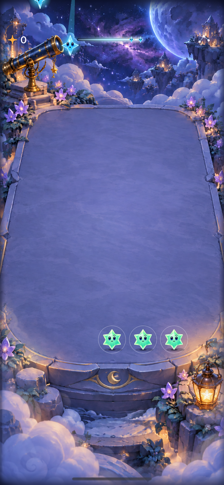

# Adopt the curved countdown with an equivalent header forecast

**Result:** Partially verified — adopted layout; native matrix incomplete · **Owner:** Current implementer · **Date:** October 17, 2026

The user selected the [native island trial](../island-timer-2026-10-17/README.md). Adopt its upper-contour countdown and ordered cast miniatures in Debug and Release, removing the temporary launch argument. Non-island and uncalibrated devices use the existing straight HUD trail with the same complete ordered forecast. No gameplay, save or clock changes.

**Important limit:** Camera geometry is authored, not an OS-provided rect. Only the simulator-checked iPhone 17 portrait hardware profile selects the curve; other models keep a useful complete forecast in the safe area. Physical fit and expanded system activities remain device acceptance work.

## Acceptance for adoption

- Ordinary Debug/Release routing selects the calibrated curve, without a trial flag; notch/home-button/unknown hardware, changed viewports, VoiceOver and accessibility text use the header.
- Both shapes present the same committed arrival order, capped at five. Header miniatures have more room (14pt vs 10pt), preserving aspect ratio and non-color silhouettes. Shared forecast drawing and theme own the material/layout contracts.
- One existing deadline drives both shapes. Pause/menu/background/restart/outcomes retain existing ownership; no animation commits rules or forecasts.
- Check native island/non-island layout and input, maximum text, quiet modes, endings/restart and rapid input where practical. Record missing motion/actual VoiceOver/device evidence separately.
- Core tests, affected hosted/UI tests, Debug and Release simulator builds, hygiene and diff checks pass. Verify existing file membership; no new source/resource file is introduced.

## Verification

Source is base `f35eba87311f5e9e56740b9677bceb699154e8ae` plus the working tree, including the preceding timer trial. The [final source manifest](source.json) identifies the app/test changes. Historical trial evidence remains source-bound. No new source files or resource memberships; geometry tests use their existing target member.

Xcode 27.1 / arm64 host, iOS 27.0 simulators: iPhone 17 `A1C67F9D-6F58-4FB6-A842-D968783CDD2D`, disposable non-island iPhone 17e `1E9DCEF5-BF64-4052-AF8D-A6A205F711EE`. No clean published-commit acceptance. Raw logs, result bundles and diagnostic samples are under ignored `artifacts/shower-forecast-adoption/`.

| Check | Result and limit |
| --- | --- |
| Core | `swift test`: 63 passed. No core/save/RNG source change. |
| Build | Debug simulator app/test build and Release simulator build passed, explicit `ARCHS=arm64 ONLY_ACTIVE_ARCH=YES CODE_SIGNING_ALLOWED=NO`. Release now includes production placement routing. |
| Island production UI | `ShowerForecastInteractionTests/testIslandTimerMenuBackgroundAndSafeAreaFallback` passed (42.983s) before interruption of the broader run. Confirms no review argument, forecast value, top placement, menu/background and largest-text fallback. |
| Broader native flow | First Light UI test failed at existing line 683 (paused Next-shower/outcome expectation). Do not classify as baseline without comparison. Following Reduce Motion Settings automation stalled; stopped rather than claiming a pass. |
| Tooling recovery | Overlapping fallback run was waiting before tests. A sampled xcodebuild stack showed CoreSimulator installation bridge wait; manual install also stalled. Cancelled owned runs and restarted disposable simulator; subsequent focused run began successfully. This is a tooling diagnosis, not proof of the cause of the earlier gameplay assertion. |
| Fallback and hosted placement/store checks | 24 hosted store/placement checks passed after recovery. Fallback UI reached the menu and failed an island-specific removal assertion: the header is retained behind the modal sheet. Corrected the assertion to check non-hittability for header placement (while still requiring island removal and hidden gameplay inputs); final focused fallback UI run passed (28.163s), including menu shielding, background return and largest-text fallback. Entire focused command reported TEST SUCCEEDED. |
| Baseline comparison | Untouched `git archive HEAD` export built; first attempt blocked before execution. Recovered simulator comparison passed on untouched HEAD (167.273s), including First Light win, overflow, restored ending and replay/new sky. The candidate’s original failure remains recorded; recovered candidate passed the original failing paused-control boundary, completed win and full-sky assertions, then stalled during relaunch before restored-ending acceptance. Stopped after the framework repeatedly failed to snapshot the relaunched process. This is not a complete passing First Light UI case. |
| Hygiene | `python3 scripts/ci-hygiene.py`, `git diff --check`: passed. |
| Device / actual VoiceOver / full motion | Not run. User accepted trial appearance, not physical alignment or complete animation acceptance. |

Native commands use `xcodebuild -project Starfall.xcodeproj -scheme Starfall -configuration Debug -sdk iphonesimulator -destination 'id=<simulator above>' -derivedDataPath artifacts/shower-forecast-adoption/DerivedData CODE_SIGNING_ALLOWED=NO ARCHS=arm64 ONLY_ACTIVE_ARCH=YES -parallel-testing-enabled NO -only-testing:StarfallUITests/ShowerForecastInteractionTests -only-testing:StarfallAppTests/FallingSkyStoreTests -only-testing:StarfallAppTests/SkyShowerPlacementTests test`. The broader island run additionally selected the named First Light and Reduce Motion methods. Release used the same scheme, `-configuration Release`, derived data `artifacts/island-timer/ReleaseData` and `build`.

**Decision:** User selected adoption. Camera profile remains conservative; no permanent comparison flag. Complete remaining First Light, quiet-mode and physical/system-island checks before RC, and calibrate more hardware only with native/device evidence. [Engineering follow-up](../../ENGINEERING.md#camera-island-profile-acceptance).

**Native capture — iPhone 17e / iOS 27.0, Debug, final working-tree app source in the manifest.** Normal-motion automatic opening, with real arrivals in flight and two preview stars at the trail’s right. Header remains separate from the camera/notch; screenshot inspected for score/menu clearance. This still does not establish complete animation, five-star recognition, actual VoiceOver or physical-device acceptance.

## Lift the header only where space is available

The fallback uses the current viewport’s `safeAreaInsets.top`; it does not reserve the authored island height. A home-button phone with no upper cutout can place the score/forecast/menu at the top safe edge. A non-island phone with a notch still needs its camera clearance. This is layout geometry, not a notch/island hardware classification. The UI check now compares fallback timer/header centers rather than imposing a minimum y=40, which would incorrectly reject unobstructed phones. Native SE3 launch was blocked; top-edge visual acceptance remains pending; expanded system activities/device alignment remain separate.

[Apple’s safe-area guidance](https://developer.apple.com/documentation/uikit/positioning-content-relative-to-the-safe-area) describes the supported local layout contract. Tight contour artwork still uses the conservative calibrated profile, independently of header placement.

## Final native limits and launch diagnosis

Recovered iPhone 17 production forecast flow passed again (22.510s). The broader candidate First Light run passed its win and full-sky checks (including the original failed early boundary), then could not load the relaunched app. Sampling that exact process showed a 336KB footprint, no loaded binary-image list, and every main-thread sample in `dyld_sim` preparing/mapping the shared cache (`__mmap`), before game code. This establishes a pre-entry simulator launch blockage for this relaunch, not the cause of the earlier paused-control assertion. Its source-bound raw sample is `artifacts/shower-forecast-adoption/relaunch-app-sample.txt`. Native SE3 likewise never reached its UI checks; the observed capture is a black launch screen with the system status bar, not gameplay. Neither is a passing acceptance result. Stopped these owned runs after bounded recovery and diagnosis rather than changing gameplay or loosening the First Light assertion.

The separate final non-island iPhone 17e UI command passed. Its header-to-menu alignment assertion now also supports unobstructed screens without assuming y > 40. That SE-specific native branch still needs a run after host/simulator recovery. Debug/Release builds, 63 package tests, 24 hosted checks, and the focused island/non-island flows pass as detailed above; full quiet-mode/motion, complete candidate restore/replay, SE native and physical/actual VoiceOver acceptance remain open. No production source changes followed the successful builds; subsequent changes were the general header-alignment UI assertion and documentation.

## Pull-request integration on current main

The user requested a PR and merge. The original worktree was detached at `f35eba8`; current GitHub main was `1f5d5b9e99e93fd69adbbbf6dd2cf7953fbd9faa`. Checkpoint `90af14f` preserves the original work. Only that scoped change was applied to current main as `cf0d98f`, preserving main's game/store/scene changes and resolving documentation append conflicts without importing unrelated local history. This integration changes no core, clock, saves, build settings, resources or networking.

Clean committed source `cf0d98f`, Xcode 27.1 / arm64: `swift test` passed all 63 tests; `python3 scripts/ci-hygiene.py` and `git diff --check` passed. Debug and Release generic iOS Simulator builds and Debug `build-for-testing` passed. Commands used the shared Starfall scheme, `-destination 'generic/platform=iOS Simulator'`, `CODE_SIGNING_ALLOWED=NO ARCHS=arm64 ONLY_ACTIVE_ARCH=YES`, derived data `artifacts/pr-forecast/DerivedData`; raw output is under ignored `artifacts/pr-forecast/`.

These are fresh integration core/build/compilation checks, not a new native interaction run. Earlier focused native results and failed/interrupted flow checks remain bound to their recorded source; physical alignment, SE visual acceptance, complete candidate restore/replay, full motion/quiet-mode matrix and actual VoiceOver remain open. The Moonbeam addition is a proposal in the mechanics notebook, with no charge meter or ability implemented.
