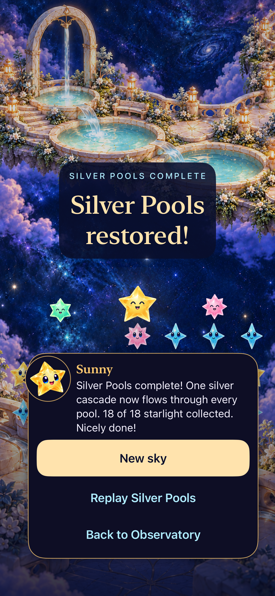

# Silver Pools development and delivery

**Result:** Verified for development; publication and delivery pending · **Date:** October 19, 2026

Silver Pools adds a fifth optional seed-42, 18-starlight challenge through the existing rule, save and presentation owners. The 329-test hosted suite, eleven selected phone/tablet/compact UI checks and Release build pass. All fifteen native scene states and a recorded normal-motion finish have been inspected, alongside dense boards, rotation, largest text and system Reduce Motion samples. No blocking visual issue was found; the first-pool cue beneath the HUD and lower control contrast remain visible development tradeoffs.

**Next action:** Root publishes and merges the verified source/assets/evidence, then delivers current main through the canonical updater. Publication and delivery remain pending; no Silver Pools installation is claimed.

## Completed development acceptance

**Native source:** `aabd67346bf56ae27b9940a7d6d916559d16c218`, runtime `dev.98f8ba82e6`. Later `84ae918` changes the design kit, tooling and documentation without changing native inputs. Remaining working-tree changes are documentation, reviewer and evidence files. [Verification records](verification.json) retain exact selections, commands, result bundles, durations and source boundaries.

**Environment:** Starfall scheme, Debug tests and Release compilation, Xcode 27.1 (27A9275), macOS 27.0.1, arm64; iPhone 17e, iPhone SE (3rd generation) and iPad Air 11-inch (M3) Simulators on iOS 27.0 (24A434). Native tests run through XcodeBuildMCP with parallel testing disabled and isolated review saves. These are development checks, not the full release-candidate matrix.

| Check | Observed result |
| --- | --- |
| Final Core package | 178 passed, zero failures, 12.824 seconds on84ae918 with accepted native inputs; final log and source in verification.json. |
| Hosted app suite | 329 passed, zero failures, skips or warnings. Covers the shared rule/save/presentation boundaries and resource registration. |
| Phone states, win and accessibility samples | 3 passed: all five states keep the board fixed; a real winning clear persists its named result and replays at zero; maximum Dynamic Type with system Reduce Motion keeps result actions usable. |
| Preview/cancel and Begin | 2 passed across Lantern Landing, Ribbon Crossing, Kite Harbor and Seed Moon. Preview cancellation retains each existing round; Begin replaces it with Silver Pools. |
| Dense phone input and interruptions | 2 passed. A 49-star board overflows at zero with named replay; rapid input commits one 9→13 clear, and settings/background retain the resulting board. |
| Tablet states, rotation and dense completion | 2 passed. Both orientations cover five states, stable native geometry and real clears; dense 75% boards reach the named 100% result through native input. |
| Compact phone | 2 passed in 136.839 seconds: Silver win/relaunch/replay and Open sky Welcome/Entry/background/another-sky flow. All eight compact attachments inspected; controls reflow or scroll without horizontal clipping. |
| Release compilation | Passed in 16.958 seconds, zero warnings/errors, with the same native inputs. |
| Independent still inspection | All 44 phone, preview, dense and tablet attachments plus eight compact attachments inspected, covering all fifteen scene states. [Capture records](captures.json) identify sources, hashes and retained native images. |
| Recorded normal-motion finish | Thirteen frame samples inspected with system Reduce Motion and Calm effects off. Selection, committed +4, rising light packets, settling stars, whole-painting crossfade and named result are observed. [Motion record](motion.json) preserves source, video hash, timings and tooling retries; this is not a frame-rate measurement. |
| Python tooling | 55 passed. The level-design kit and shared reviewer have the separate checks and limits recorded below and in `verification.json`. |

## What the native scenes show

**Native development capture:** `aabd673` / `dev.98f8ba82e6`, iPad Air 11-inch (M3), iOS 27.0, default text. The 75% painting keeps the held droplet and its air gap clear while a full native board remains readable. This still does not establish animation quality.

**Native development capture:** same source/runtime, iPhone 17e, iOS 27.0, default text. The actual winning clear releases the arch stream; the result names Silver Pools and shows New sky, Replay Silver Pools and Back to Observatory. The [scrolled largest-text result](dev-aabd673__silver-100__iphone-17e__ax3xl-scrolled-result.png) preserves readable copy; Back continues below that captured viewport, with action usability established separately by the native test.

The garden remains a substantial connected place across the three bespoke compositions. Dry basins, the first filled pool, two connected pools, the held drop and the released thread are distinguishable. Full-board edge cells overlap some pool rims, plants and foreground architecture, but their faces and shapes remain readable. The [phone 25% capture](dev-aabd673__silver-025__iphone-17e__default-text.png) shows the first pool through the translucent HUD; the cue is subdued on phone and tablet portrait. At phone 75%, the end of “Next shower” crosses a bright foreground runnel. Reviewers could read the supplied captures, but this is not a measured contrast pass. The [engineering follow-up](../../ENGINEERING.md#active-debt-and-next-actions--october-18-2026) requires physical contrast and cue-recognition checks at RC play or the next relevant artwork/control change.

The initial isolated fountain direction was rejected; the user approved this richer connected garden. [Source artwork and provenance](../../design/silver-pools-05/README.md) preserve all attempts and the fifteen selected paintings. The [level-design kit](../../design/level-design-kit/README.md) provides reusable layout, bleed, scale and camera guidance. Its diagrams are authoring aids, not universal safe areas. The shared offline reviewer passes logic checks, but browser rendering remains unverified after local-file access was denied.

## Initial implementation checks

These are development probes on base `2357b20197bbaa2832d353b0dbed3a46fead0d2f` plus the evolving working tree, not clean-commit acceptance. [Initial snapshot](initial-snapshot.json) records the subsequent dirty files; artwork and registration continued changing after the earliest checks. Runtime label `dev.silver-work` is a probe label, not the final content fingerprint.

| Check | Result and source limits |
| --- | --- |
| `swift test` | 178 passed, zero failures, 17.805 seconds. Initial sandbox attempt failed because the compiler cache was inaccessible; authorized compiler execution passed. `/private/tmp/silver-core.log`. |
| `python3 -m unittest discover -s scripts -p 'test_*.py'` | 55 passed, 5.372 seconds. `/private/tmp/silver-python.log`. |
| Debug build/run | Passed on iPhone 17e / iOS 27.0 Simulator with no warnings/errors. Initial artwork incomplete. |
| Shared test extraction | Existing Seed Moon win, background/relaunch and replay scenario passed after extraction into `RestorationInteractionScenarios`: one test, zero failures/skips, 72.877 seconds. Result bundle `test_sim_2026-10-19T18-49-21-787Z_pid14605_f129fab0.xcresult`. |
| Hosted flow/save checks | 42 passed, zero failures/skips, 16.067 seconds: `RestorationFlowTests`, `SkyFlowStateTests`, `SkySaveArchiveTests`. Includes all five identities, cross-location preview/Begin, stale completion rejection and prior v8 bytes. Result bundle `test_sim_2026-10-19T19-03-04-014Z_pid14605_4c2fcc2e.xcresult`. |
| Reviewer logic | Seed and Silver each pass 57 score/view combinations, fixed cast identities, density controls, query precedence, milestone selection and natural-image sizing. JavaScript syntax passes. Static minimal-DOM execution only; browser rendering is unverified. |
| Hygiene | `python3 scripts/ci-hygiene.py` and `git diff --check` pass for the initial tracked paths; rerun after final staging. |

Apple tools: Xcode 27.1 (27A9275), iOS 27.0 (24A434), arm64. Root owns native tooling. Tests use `-parallel-testing-enabled NO`, scheme Starfall, Debug, temporary DerivedData, simulator identity `21025903-D90D-4E30-BA74-45D3EFB2F5E4`, and the existing ad-hoc simulator signing settings. Raw result bundles remain in XcodeBuildMCP's workspace; no physical install occurred during these checks.

## Delivery and remaining limits

Exact-source publication/merge and the canonical installation receipt remain pending. Development acceptance is complete within the sampled scenarios; it does not establish the full release-candidate matrix.

Actual VoiceOver follows the release-candidate cadence and has not been performed here. Physical gameplay, contrast, audio and enjoyment remain unverified. A final `swift test` rerun on `84ae918` (native inputs identical to `aabd673`) passed all 178 tests in 12.824 seconds; `/private/tmp/silver-core-final.log` and `verification.json` distinguish it from the earlier probe.

## Reconciliation with current main

Main advanced to `4f13da8` through PRs #176/#177 while Silver acceptance ran. Local merge `64acd98` preserves its entry screenshot readiness and coherent automatic-sky UI snapshots. Only UI-test/docs inputs changed; app/Core/resources and runtime `dev.98f8ba82e6` are identical to the accepted Silver source. The evidence index conflict retained both entries. The compact Welcome/Entry/background/another-sky test passed again on that merged source: one test, zero failures/skips/warnings, 68.333 seconds. This is additional to the eleven Silver development checks.
