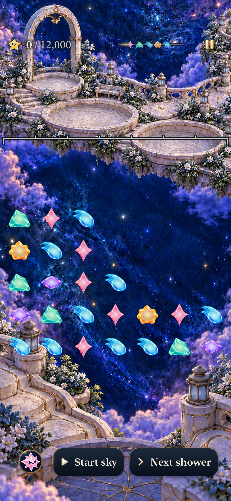
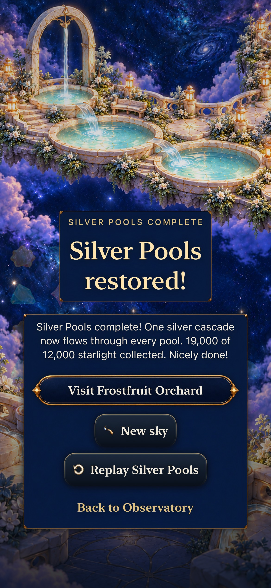

# Silver Pools: make the falling survivor count

**Status:** Development-verified; ready for merge · **Issue:** [#280](https://github.com/lbeezr/starfall/issues/280) · **PR:** [#315](https://github.com/lbeezr/starfall/pull/315) · **Date:** October 23, 2026

New Silver visits select revision 4 and a complete 12,000-point objective. The recipe-free 24-star opening rewards a support-first action: four rose supports clear for 5,000, a surviving aqua falls four rows, and its new five-star line earns 14,000 at causal depth two. The same action wins at 19,000. Taking the low aqua line first earns 7,000; a separate rose clear finishes at 12,000. Those independent actions are not a chain. The chain dominates measured score/headroom; this is a rewarded planning solution with a forgiving alternative, not evidence of balanced strategies or enjoyment.

This follows the [curriculum](../../design/STORY_ENCOUNTER_CURRICULUM.md) and [Puzzle League adaptation](../../design/POKEMON_PUZZLE_LEAGUE_REFERENCE.md). Other lawful wins count immediately. No prescribed sequence, shower or minimum duration, new scoring, mode, artwork, RNG or save field is added. Historical Silver0 keeps manual/18-light Continue and same-round Replay; Silver1–3/5 reject. Seed4, Kite4, current Lantern/Ribbon4, retained revisions and optional Full Board Lantern5 remain distinct. Ordinary committed Silver completion earns Frostfruit access.

## Inspected appearance

 

[Ten inspected captures](captures.json) retain original dimensions, raw/retained hashes, exact test/route and per-frame limits. Phone views use `acad49b2` / `dev.ddaff18f86`; tablet views use final combined `0ecdfa33` / `dev.85611977b9`, integrating #314's Seed scenery. Actual local bundles are `dev.local`. Earlier images retain their earlier source.

The quiet AX3XL iPad case reads/scans Help, uses Done, completes both independent clears and travels onward. Help's final “Other legal clears can finish too.” is visible. The sampled frames do not form a complete overlapping readthrough: one interior phrase falls between captures. Entry Begin and lower result actions extend below sampled viewports and were revealed before use. Native scrolling/interaction passes; these are capture limits, not demonstrated layout defects. Stills do not establish motion chronology or uncoached recognition.

## Verification and adoption

[Verification](verification.json) records source hashes, commands, counts and failures. Raw outputs remain disposable under `/private/tmp/starfall-next-encounters-20261023/`. Initial clean compiled input is `acad49b2867ef3caf5807d191ff53f76c582e9f7`. First clean combined input is `0ecdfa338fed93febad93287784cabc02249dc30`, tree `30a10a73193eff7c652c718bf72df809d6bf2751`, computed `dev.85611977b9`. All 59 Core/package/test input hashes and affected hosted-test bytes stayed identical across the passive Seed-art integration.

| Check | Result and scope |
| --- | --- |
| Full Core | 276 pass, zero failures/skips; exact phase adjacency/IDs/four-row fall, separate-action reset, both wins, three one-shower variants, terminal rejection, every-state validation/Codable/forecast/conservation/Replay and historical rules. Idle overflow is shower 4, zero score. |
| Affected hosted | 133 pass, zero failures/skips: selected flow, dialogue, archive, journey, optional Full Board, ceiling and restoration-flow suites. New-definition map/Entry/Begin/Help, retained 9/18, v13-to-v14 byte preservation and earned Frostfruit are covered. |
| Integrated scenery hosted | 12 pass, zero failures/skips; registered resource dimensions, idiom/viewport selection, layout and committed restoration. |
| Phone | Both complete choices, 7,000-point choice/process restore, 12,000 result restore/Replay, fourth-shower overflow, historical Silver0 win/restore/Replay. Preview/cancel retains Lantern/Ribbon/Kite/Seed 9/18 and pause/save until Begin; current Seed's actual-clock recovery earns Silver12k Entry. |
| Actual-clock Silver | Earlier and final-source runs pass: earn Kite and Seed without legacy access, admit one ordinary automatic Silver shower without Next or an extra pause during Silver recovery, perform the support exchange, win 19,000/12,000 and earn Frostfruit18 Entry. Ordinary effects and actual system Reduce Motion off. |
| Tablet | AX3XL quiet Help/Done, opening, separate 7,000 + 5,000 finish and Frostfruit onward pass with ordinary system motion. |
| Builds/resources | Debug/native builds and Release pass on combined source. Catalogue has 478 keys / 110 scripts / 115 unique line IDs; all 107 previous scripts preserved. Source/Debug/Release dialogue SHA-256 matches. Existing targets/scheme retained; no product asset family added. |

Seven distinct native methods pass in ten executions, zero skips on passing runs. Adopt the bounded encounter for development. Revisit recognition, setup cost and preference through actual player observation; do not impose that study as a gate for unrelated work. Frostfruit remains its existing historical encounter until the separate ordered [#310](https://github.com/lbeezr/starfall/issues/310) runtime slice.

## Failed checks and limits

The first build caught a test reference to nonexistent `depth`, corrected to Core's actual `comboDepth`. The next native attempt stopped before gameplay because Settings exposes a sidebar collection on the phone too; the helper's existing iPad coordinate-touch workaround is now restricted to actual iPad idiom. The normal phone button action, bounded Motion checks and real setting/teardown restoration remain. Phone siblings and the iPad case pass. No production clock, buffering, rule or assertion was changed for either failure.

The connector timed out at 300 seconds on two longer batches. Their owned runners completed successfully at 303.856 and 455.057 seconds; final xcresults confirm two and three passes respectively. Those are connector timeouts, not hidden test failures or retries. No healthy runner or unrelated process/device was stopped.

An early whole-test recording lacked a finalized movie index. A second recording was explicitly stopped at the win capture while the native run remained active; it has a movie index, and passthrough excerpt export succeeds, but macOS frame extraction cannot decode it. Detailed frame-by-frame causal-motion review is unavailable; no animation fault or host-contention cause is inferred. Ordinary-effects native completion and Core's committed causal phases are verified separately. Originals and errors retain exact hashes in verification; no further unchanged recording retries were made.

Uncoached recognition, touch comfort, enjoyment, physical-device, minimum-iOS17 and actual VoiceOver acceptance are not performed here. No physical phone was probed or installed; VoiceOver stays deferred.

## Final integration with optional mode discoveries

Main #316 arrived while Silver was publishing. The merge preserves its optional Lantern/Full Board discoveries, tutorial layout, ceiling clearance, input/return behavior, persistence and project membership. The two textual conflicts kept both Silver Help and the newer practice Help, plus both roadmap sequences. Latest clean compiled input is `37aa5747ff686338aaffe58eb66bccf05ed20e48`, tree `0525fcb6dba6031879348cadb2fcd4e095766a54`, computed `dev.9333725eea`; actual bundles remain `dev.local`.

Full Core now passes **280**, including all 13 tutorial checks. **174 affected hosted** tests pass across phone170 and tablet4; the latter explicitly selects the four new `SkyModeDiscoveryPresentationTests`, distinct from the seven historical `SkyTutorialPresentationTests`. The real automatic-clock phone route and AX3XL quiet tablet Help/full-round/onward both pass on this combined source. Release passes in 73.855 seconds. Strict content is **488 keys / 110 scripts / 115 line IDs**; source/Debug/Release catalogue hashes match. All 16 source inputs recorded by #316 are preserved: 13 exact, three matching when only Silver additions are removed in memory. No production integration correction was required.

Two additionally inspected original-resolution captures refresh the final phone19k/12k result and tablet0/12k opening. Their exact timestamps, source/raw/retained hashes and limits are in verification. Earlier pictures retain their original source and do not independently certify this later integration. Detailed recorded-motion and human/physical/VoiceOver limits above remain unchanged.

## Final current-main integration: 42b6ff43

Main advanced through #317 (actual-duration flight handoffs) and #318 (optional visible Full Board choices). Clean input `42b6ff4329cf02e1d9b384a8dcbb09a8df6b4bac`, tree `a9a4641f690a48c3b7bd1ece24354dd4186edf08`, computed `dev.b4eac280c4`, actual test bundles `dev.local`, retains all Silver behavior and both main changes. Only the experiment/roadmap paragraphs conflicted; both streams were preserved. Documentation-only corrections after that input update root Silver adoption and remove a stale claim that movie frame decoding succeeded.

All **288 Core tests** and **188 affected hosted tests** pass with zero failures/skips. The hosted batch adds the five Full Board choice and nine SkyPiece cases to the earlier 174 selectors; actual per-suite counts are retained in verification.json. The strict ordinary-clock phone case passes again (166.745 seconds native, 247.380 seconds whole tool batch), genuinely earning Kite, Seed, Silver and Frostfruit access. The AX3XL quiet iPad Help/full-round/onward case also passes on this source. Seven distinct native methods now have twelve passing executions across the explicitly recorded source integrations. Earlier source-specific results/captures remain earlier evidence.

Release arm64 generic Simulator passes in 17.088 seconds. Its first sandboxed invocation stopped at dependency resolution because existing caches and simulator services were inaccessible; the authorized same command passed with unchanged source. Catalogue source, Debug and Release hashes agree at `613ce0eeb6c125af27263fa795925cb89895f04c6f1e9ca6f75024c8def42f3c` (499 keys, 110 scripts, 115 line IDs). Current-source raw phone win/Frostfruit and tablet opening captures were inspected; verification.json records their exact attachment identities/hashes. The twelve retained JPEGs keep their original source labels. This adds no independent movie-frame, human, physical-device, minimum-OS or actual VoiceOver evidence.
