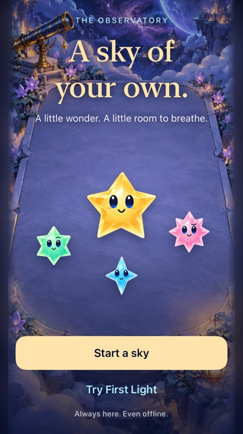

# Integrate sky flow with the current drawing game

**Status:** Partially verified · **Owner:** Current implementer · **Date:** 2026-10-17

The sky flow is rebased onto GitHub main `ba348d7`, preserving the adopted constellation drawing, existing bundle/save identity, build-ID display and main-to-iPhone updater. The Game Center checkpoint remains separate in draft PR #31; this integration includes none of its transport, account, ranking, entitlement or configuration changes.

**Next action:** Merge [PR #33](https://github.com/lbeezr/starfall/pull/33), then verify CI and the updater's observed result. Do not describe the phone as updated until installed provenance identifies the new build.

## Boundaries and evidence

Only the sky-flow commit `f35eba8` is ported. Conflicts preserve main's trace-surface/input-generation cancellation, build ID and all current source/configuration owners. `SkyFlowCeremony` owns isolated Debug review defaults so no parked rankings fixture is required. Main's original rules, assets and CI/updater scripts remain unchanged. Its existing tests gain explicit Begin/Resume navigation; the restored constellation swipe still clears the chosen five and leaves the sixth.

The original [flow report](README.md), captures and hashes remain historical evidence of the pre-integration prototype. They do not establish current drawing-game acceptance. New integration results follow below.

- `swift test`: 63 passed, zero failures; `/tmp/sky-flow-integrated-core.log`.
- Updater policy: six passed; native matrix policy: two passed. Hygiene and diff checks passed.
- Debug integration: 91 hosted tests and six of seven targeted UI scenarios passed on 17e / iOS 27.0. The resume test paused the newer four-second cadence before the first shower, so its attempt to tap a matching group found an empty sky. Its setup now explicitly calls the first shower when the saved board summary is zero showers; all original clear, interruption, resume and new-sky assertions remain. The corrected case passed on SE3 / iOS 27.0 in `/tmp/starfall-sky-flow-integrated-resume.xcresult` (one test, zero failures/skips).
- The other six UI scenarios cover all three adopted constellation checks (chosen-five/leave-sixth, cancellation/ordinary taps, largest text/build ID), First Light win/full/replay/terminal restore, maximum-text flow and system Reduce Motion. Product source is identical to published `8bb3890`; the final test/documentation follow-up adds no runtime behavior. See [integrated hashes](integrated-source-sha256.txt).
- Initial native compilation identified a missing shared system-motion setter from the old local base; it was added to the existing test utility. The broad run's result packaging stalled after tests finished and was interrupted; its raw log `/tmp/starfall-sky-flow-integrated-v2.log` records the 91 hosted passes, six UI passes and one failure. Do not report that broad run as all green. The completed targeted rerun bundle is authoritative for the corrected case.
- Debug simulator build and Release arm64 simulator build passed, Xcode 27.1; Release log `/tmp/starfall-sky-flow-integrated-release.log`.
- Actual VoiceOver: deferred to RC; not run on this development integration. Physical-device gameplay/motion acceptance remains separate from successful updater installation.

The local updater was observed enabled and up to date (`dev.bc187c831e`) before the merge. Its contract waits for successful CI on the exact main commit, then signs and installs over `com.starfall.prototype`; it never resets, uninstalls or launches the app. Pending/failed CI, a locked/unavailable phone, or signing/install errors defer delivery and preserve the existing installation.

Integrated-source native capture, SE3 / iOS 27.0 Simulator, Debug, from the successful resume/new-sky rerun. It shows the current Welcome appearance; the older report's captures remain bound to the previous prototype. No physical-device installation or animation acceptance is inferred from this still.
