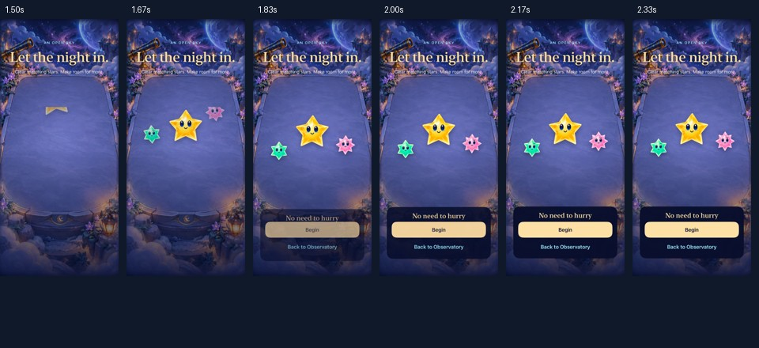
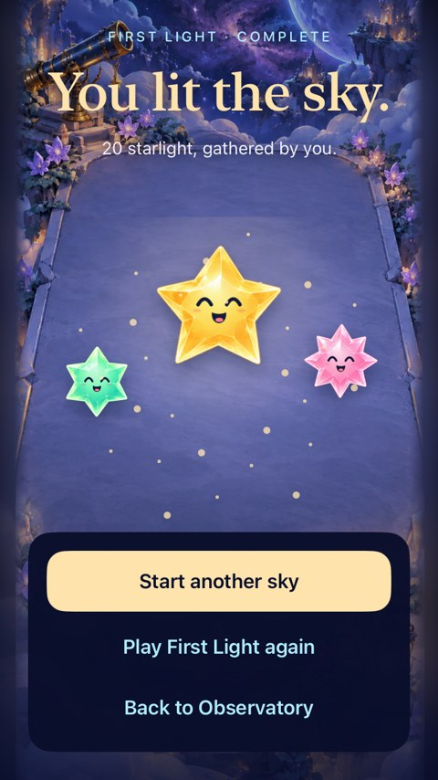
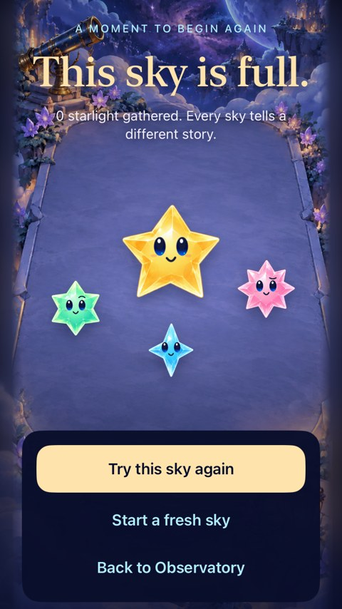
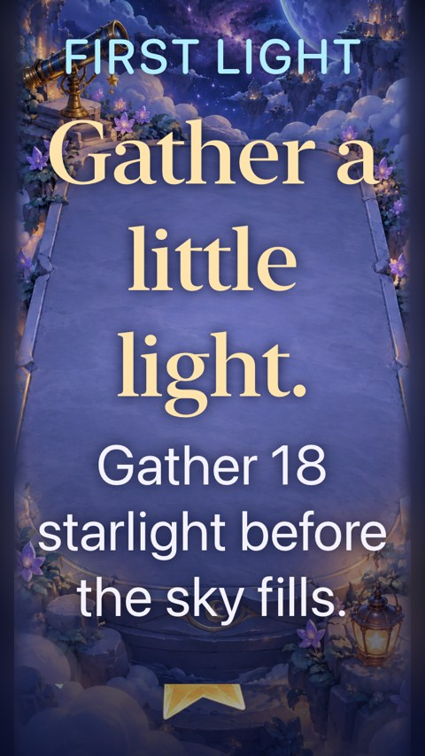

# Welcome, entry and sky endings

**Status:** Partially verified · **Owner:** Current implementer · **Date:** 2026-10-17

The selected overlapping reveal is integrated into the default Observatory flow. Welcome offers Start, First Light and a validated local Resume; Entry waits for Begin. Wins use the happy shared cast and a finite light burst. Full skies settle gently. Replay/new/challenge always pass through Entry. No new rules, RNG, save schema, economy, network transport or assets.

**Next action:** Try the integrated flow on the physical iPhone and tune perceived timing with the user. Actual VoiceOver remains a release-candidate gate.

## Source and scope

Baseline `f371256`; working-tree changes in `FallingSkyView`, `FallingSkyStore`, `FallingSkyMenu`, `SkyFlowCeremony`, `StarfallTheme`, Debug fixture support, native tests and deliberate Xcode membership. No unrelated dirty source was present at the start. Core remains unchanged. [Source hashes](source-sha256.txt) identify the final runtime/test inputs. The integration commit contains the implementation and this record; commands below used working-tree sources, not a clean published export.

The view owns navigation and suspends the store whenever a ceremony is visible. The store admits Resume only after validating a local sky. The final committed turn settles before the ending appears. The reveal is cancellable presentation work: roughly 650 ms cast settling with 65 ms staggering, action emergence at 360 ms, immediate settled layout in quiet modes, no replay after backgrounding. Result actions are immediately available. Twenty-eight analytic sparks expire after 1.2 seconds.

## Verification

| Evidence | Procedure | Result |
| --- | --- | --- |
| Core | `swift test` | 63 tests passed; `/tmp/starfall-flow-core.log` |
| Debug/Release | Xcode 27.1, arm64 iOS Simulator, explicit `ARCHS=arm64 ONLY_ACTIVE_ARCH=YES` | Debug and final Release builds passed. Initial generic builds tried x86_64 against an arm64 package module and failed; explicit host architecture resolved that tooling mismatch. |
| Hosted | `FallingSkyStoreTests`, `SkyLeaderboardTests` | Final source: 35 passed, zero failures/skips, `/tmp/starfall-sky-flow-store-final.xcresult`. Includes no-write save admission, corrupt-save rejection, transient-message restore, timing, stale completions, replay, First Light and existing offline rank contracts. |
| Native flow | `SkyFlowInteractionTests` on iPhone 17e and SE3 / iOS 27.0 | All four passed on 17e: connected welcome/entry/restore/new, First Light win/replay/full/terminal restore, maximum text, system Reduce Motion. All four also passed on SE3, plus the save-admission hosted check (five total, zero failures/skips), `/tmp/starfall-sky-flow-small-final.xcresult`. |
| Existing native play | Full-motion first-wave clear, menu pause, projected corner taps, settings/background, offline rankings | Five passed on 17e. Combined result: 43 tests, zero failures/skips, from `/tmp/starfall-sky-flow-final.xcresult`. The MCP response timed out after 300 seconds; the completed result bundle independently reports Passed. |
| Hygiene | `python3 scripts/ci-hygiene.py`, `git diff --check` | Passed at integration. |
| Actual VoiceOver / physical device | Not run for this development integration | Release-candidate gate; prior device/VoiceOver evidence does not verify these new screens. |

Raw results: `/tmp/starfall-sky-flow.xcresult` (first failures), `/tmp/starfall-sky-flow-v2.xcresult`, `/tmp/starfall-sky-flow-final.xcresult`, `/tmp/starfall-sky-flow-small.xcresult` (invalidated when a preview launch interrupted testing), `/tmp/starfall-sky-flow-small-final.xcresult` (separate rerun). Debug products `/tmp/starfall-flow-build` and `/tmp/starfall-flow-small-build`; Release `/tmp/starfall-flow-release`.

## Native appearance and motion

| Welcome | Entry |
| --- | --- |
|  |  |

Current implementation, iPhone 17e / iOS 27.0 Simulator, Debug with normal system motion and Calm effects off. These frames come from the recorded native entrance, `/tmp/starfall-overlap-native.mp4`; only resizing/compression was applied. The recording is 8.6 seconds, including pre-transition and settled holds.



Sampled native motion, 1.50–2.33 seconds in that recording. The panel is emerging at 1.83 seconds while stars are still settling; it is fully present afterward. Frame review verifies movement and overlap, not human preference or device performance.

| First Light win | Full-sky ending |
| --- | --- |
|  |  |

Final runtime source, iPhone SE3 / iOS 27.0 Simulator, Debug, real First Light rule outcomes. The win collected 20 starlight against the fixed 18 target; the overflow run intentionally cleared nothing. These are runtime captures, not scripted sample endings.



Maximum system text size on SE3: the heading and objective reflow, the decorative star field stays below the text, and Begin/Back are reached by native scrolling. The test activates the offscreen actions; this initial capture alone does not prove reachability.

## Reproduction and source limits

The final SE3 run used:

```sh
xcodebuild -project Starfall.xcodeproj -scheme Starfall -configuration Debug \
  -destination 'platform=iOS Simulator,id=E90550D2-AE94-4695-8E6F-707BD527C12F' \
  -derivedDataPath /tmp/starfall-flow-small-build ARCHS=arm64 ONLY_ACTIVE_ARCH=YES \
  CODE_SIGNING_ALLOWED=NO -parallel-testing-enabled NO \
  -only-testing:StarfallUITests/SkyFlowInteractionTests \
  -only-testing:StarfallAppTests/FallingSkyStoreTests/testWelcomeSaveAvailabilityDoesNotWriteOrAdvanceSky \
  -resultBundlePath /tmp/starfall-sky-flow-small-final.xcresult test
```

The 17e focused matrix used the same Debug architecture settings and its own destination/DerivedData, with the two hosted classes, all four flow tests, and these five existing methods: `testOpeningCascadeAllowsNativeClearBeforeLastWave`, `testCompactHUDMenuSuspendsWithoutChangingPauseChoice`, `testActualCastSparseDenseAndProjectedCornerTaps`, `testCastSettingsDismissalAndBackgroundPreserveBoard`, and `testOfflineCachedFriendsAndGlobalRemainReadable`. That run preceded the final clipping, keyboard-disable and menu-focus refinements; final-source SE3 flow tests, final-source hosted checks, native motion capture and Debug/Release builds followed those refinements. The final legacy First Light wait was updated to accept either a settled next action or a terminal outcome; all test targets compile afterward, but the full historical UI/actual-VoiceOver suite was not rerun.

Release command: `xcodebuild -project Starfall.xcodeproj -scheme Starfall -configuration Release -sdk iphonesimulator -destination 'generic/platform=iOS Simulator' -derivedDataPath /tmp/starfall-flow-release ARCHS=arm64 ONLY_ACTIVE_ARCH=YES CODE_SIGNING_ALLOWED=NO build`; final log `/tmp/starfall-flow-release-final.log`. Raw small-phone log `/tmp/starfall-flow-small-final.log`; hosted final log `/tmp/starfall-flow-store-final.log`.

## Corrections found during verification

The first native run exposed underlying gameplay chrome and an obsolete outcome card behind ceremonies. The responsible presentation boundary now removes those controls and the duplicate outcome surface, rather than relying on opacity/accessibility hiding. Welcome, Entry and both results share that boundary. A normal live opening can replace a legal group between an automation snapshot and its tap; the restore test now explicitly pauses before its rapid taps, while the separate full-motion opening test continues to require a real clear before the fourth wave. Large-text visual review also prompted clipping decorative falling stars to their own layout region so they cannot cross the growing heading/subtitle.

Historical `--starfalls-reset` board fixtures retain paused-play initialization. `--sky-flow-review` selects the actual welcome route with isolated Debug defaults; without reset it exercises restore. Both ordinary Debug and Release start at Welcome. The first small-phone attempt was canceled after the implementer accidentally launched a preview on that test simulator; its tap failure is not counted as acceptance. It was rerun without preview interaction. Original accessibility outcome IDs/labels and score descriptions remain stable while visible headings gain the new ceremony copy.
