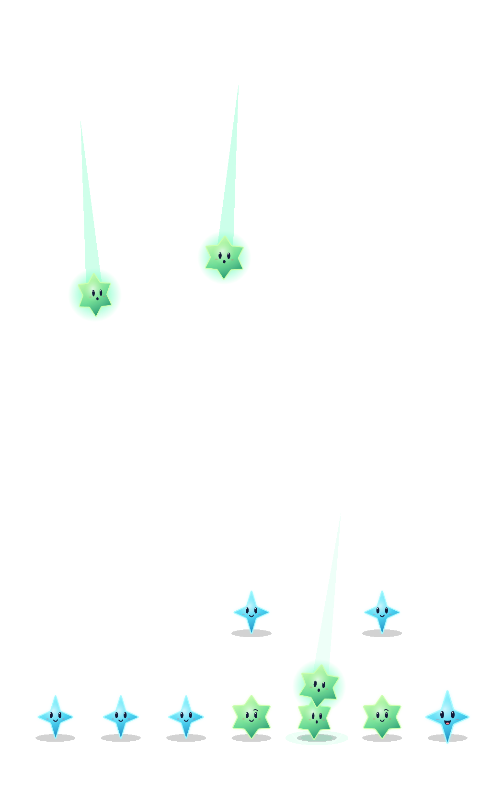

# Connected arrivals and a quiet resting sky

**Status:** Adopted; native checks verified, human/device acceptance open · **Date:** October 17, 2026

The candidate connects one arriving star to one nearby receiver, adds a brief local look and low surface light, and returns the board to stillness. It extends the adopted angled arrivals and survivor wave. Rules, saves, RNG, forecasts and clocks are unchanged. [Design and acceptance criteria](../../design/STAR_CONTACT.md).

## What changed

A finite authored trajectory reaches a real receiver before returning to its committed destination. Small, grown and dark receivers transfer different amounts of motion. The character's child owns that response; the parent owns landing and gravity, preventing competing position actions. Empty gaps do not generate remote collisions. One observer may look toward an arrival without receiving an invented impulse.

Clear gathers for 60 ms before light and the distance-delayed survivor wave release. Gravity begins at 320 ms, after the wave has recovered. Grounding marks follow gravity. Final rendering removes transient light and restores exact cells, sizes, expressions and unit transforms. Perpetual idle turns are removed.

## Source and checks

Baseline: `627411f`. Implementation: `4bfe77e` on branch `codex/star-contact`, isolated managed checkout; no shared UI, environment, mechanics or Xcode workspace edits included. Scene, focused motion helper, existing hosted cast tests and explicit app target membership are the implementation paths. No new texture material, asset or dependency.

Simulator: **Starfall Physics Review**, iPhone 17e, iOS 27.0, arm64, UDID `1199FBAF-FCA7-4F0D-BD49-8282154CC9EE`. XcodeBuildMCP uses `/tmp/star-contact-derived`; raw logs/result bundles remain under its `Starfall-27844ad883f3` workspace. Raw recordings remain under `/tmp/star-contact-*`.

| Check | Result |
| --- | --- |
| `swift test` | 61 passed; no core edits. |
| Hosted app tests, normal motion | 74 passed twice, including eight seed-five showers, growth, real receiver displacement, transient light, final state/stillness and calm path. |
| Debug app/test membership | Build-for-testing passed after final timing/shadow refinement. |
| Release simulator build | Passed after final timing/shadow refinement. |
| Native interaction suite | 11/11 passed, no skips: normal/rapid input, automatic rain/pause, dark-star restore, balance, background/overflow, First Light success/failure/restore/replay, largest text/settings and system Reduce Motion. The tool response timed out at 300 seconds; the underlying run completed successfully in 558 seconds, confirmed directly from its result bundle. |
| Final source `4bfe77e` | 12/12 focused checks passed, no skips: all cast tests plus native first-shower rapid clear/pause. Includes final timing, moving shadows, explicit membership IDs and parent-relative light depth. |
| Actual VoiceOver / physical device | Not run. Native semantics and the existing VoiceOver short path are retained; this is not speech/focus or device-performance evidence. |
| Human enjoyment / Observatory acceptance | Not established. This presentation change does not adopt the independent Observatory art/geometry trial. |

## Decision

Adopt the bounded presentation. Eight identical seed-five showers were run in a baseline export and the candidate with normal motion, using hosted native SpriteKit windows and simulator recordings. Sampled recording frames show the existing arrival/rebound language retained; the candidate adds visible local receiver motion, a face response and surface light. Focused checks establish actual displacement, exact final cells/geometry, empty transient layers and no remaining character actions. This supports adoption of the presentation, not a claim of human preference or final S-tier polish.

The first baseline comparison skipped because system Reduce Motion was enabled after the UI run. That run is excluded. Settings was inspected and Reduce Motion explicitly disabled for the normal-motion comparison; the repeated baseline passed and all 74 candidate tests ran without skips. The dedicated review simulator remains in normal motion. Baseline debug-symbol warnings about missing cached PCM paths did not affect execution; candidate builds had no warnings.

**Native SpriteKit render attachment**, seed five, normal motion, iPhone 17e/iOS 27.0. Captured during actual hosted animation with `SKView.texture(from:)`; black represents the scene's clear background, not a proposed environment. A single frame establishes appearance only; the sampled recordings and behavioral checks establish sequence and settling.

Raw result bundles: `test_sim_2026-10-17T15-19-49-824Z_pid43533_c06b3555.xcresult` (11 native), `test_sim_2026-10-17T15-31-31-472Z_pid43533_70eb94db.xcresult` (74 hosted), `test_sim_2026-10-17T15-34-49-836Z_pid43533_3b0f17fc.xcresult` (12 final). Commands: `test_sim` with `-parallel-testing-enabled NO` and the relevant `-only-testing:StarfallUITests/FallingSkyInteractionTests`, `StarfallAppTests`, or final cast/first-shower selections; `build_sim` Debug/build-for-testing and Release; `python3 scripts/ci-hygiene.py`; `git diff --check`.

No alternate runtime flag or duplicate production renderer is introduced. Shared uncommitted Observatory/UI edits are excluded from this acceptance. Contact/light depth is relative to the parent layer; when merging its geometry, retain one grounding owner and repeat contact reach, floor alignment and native tap checks. [Engineering follow-up](../../ENGINEERING.md) records those triggers.

## Local integration and preserved work

Integrated into local `main` at `a68a3d5`. Committed App/core/project and cast-test sources match the isolated contact implementation; intervening main commits include separate mechanics tooling/docs and renderer-test motion preconditions. The shared checkout also contains in-progress Observatory/UI/project/resource work, kept outside this contact commit. A recoverable pre-integration snapshot is at `/Users/lbeezr/.codex/backups/star-contact-integration-20261017-113853`, with safety branch `codex/backup-main-before-contact`.

The overlapping working copies were merged explicitly: retain the Observatory projection and depth ordering, use one ID-based grounding owner with its existing material/shape, and adapt test coordinate traversal to the root/character boundary. Parent-relative light depth keeps surface light below characters. Observatory source, assets, route, save and controls were not committed by this workstream; their owner continues its separate adoption.

The combined working tree passed **79 hosted tests** and **two native Observatory checks**, with no failures or skips. App, project and hosted-test source hashes stayed unchanged across both runs. During the native run, another workstream extended UI test files; the two selected Observatory methods and their helpers remain byte-identical to the backed-up prefix. Those later extensions were not part of these two checks.

The normal-motion seed-five contact test passed on the shared projection. Sparse and dense native corner taps cleared the expected groups; settings dismissal/backgrounding preserved the board. Inspected native sparse and post-clear dense captures: one grounding shadow per star, intact silhouettes and controls, retained foreground props. These are compatibility checks on the combined working tree, not a separate art-adoption or human-preference decision.

Exact [combined build-source hashes](integration-source.json) distinguish that working tree from clean commit acceptance. Results: `test_sim_2026-10-17T15-40-48-537Z_pid43533_657dca2e.xcresult` (79 hosted) and `test_sim_2026-10-17T15-42-15-623Z_pid43533_ae78ab98.xcresult` (two native). The latter selected only `ObservatoryInteractionTests/testActualCastSparseDenseAndProjectedCornerTaps` and `testCastSettingsDismissalAndBackgroundPreserveBoard`; raw captures remain in `/tmp/star-contact-combined-attachments`. Actual VoiceOver, physical-device profiling and human satisfaction remain outside this evidence.
