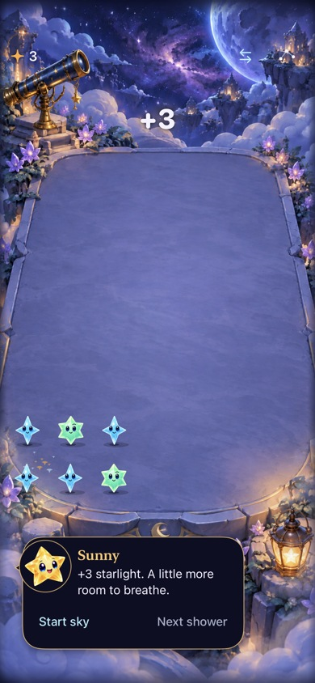
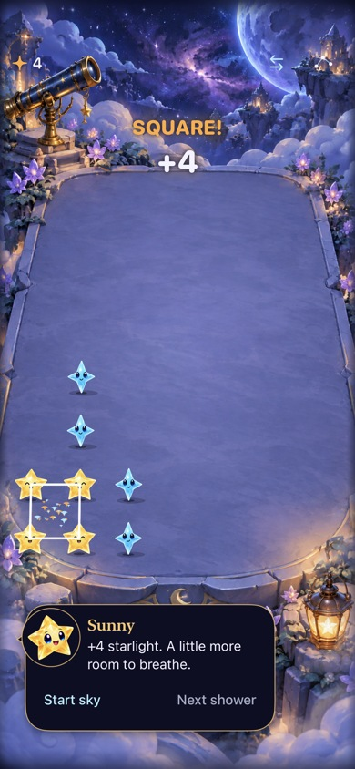
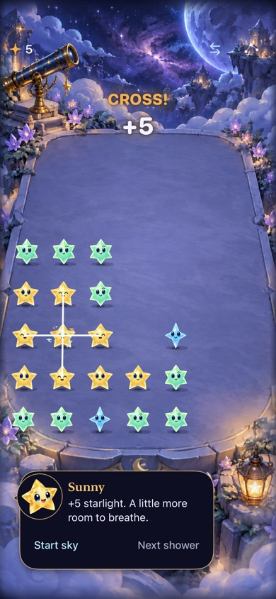
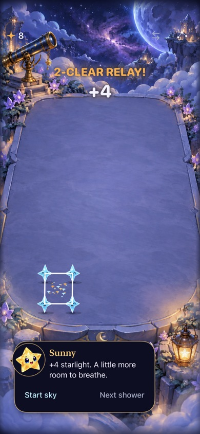
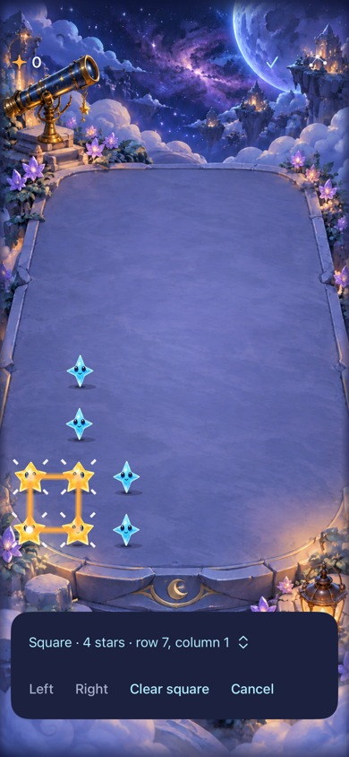
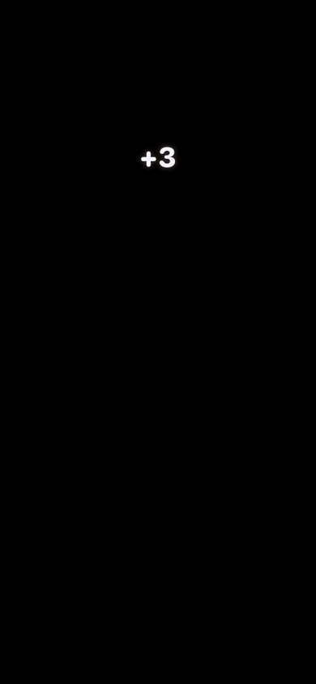

# Confirm visible awards and remove selection rings

**Result:** Verified sampled native appearance · **Owner:** current implementer · **Date:** October 18, 2026

Native captures of the complete game show ordinary `+3`, `SQUARE! +4`, `CROSS! +5`, `CONSTELLATION! +5` and `2-CLEAR RELAY! +4`, with the correct running totals. Selection now uses four open sparkle rays instead of a circle around each star. The expanding clear ring is removed, and burst particles start at varied distances to avoid a dotted ring.

**Next action:** publish the verified style correction and use the canonical updater for phone delivery. Physical sound/haptic preference and release-candidate accessibility remain separate acceptance.

## What this verifies

- The existing anchor correction is preserved. A full-game hosted check now requires additional award pixels in the sky region, exact committed rewards/categories and receipt expiry. It captures ordinary, trace, square, cross and causal-relay results from the real `FallingSkyView`, real store and SpriteKit presentation.
- The root view accepts a supplied store/flow for this check. Its ordinary zero-argument initializer retains the production factory and route. The UIKit hosting harness explicitly supplies an active scene phase because it is outside the app's SwiftUI scene; fixture stores/defaults remain isolated and non-saving. Native gesture checks use the normal app scene and existing fixture arguments.
- A separate native render check covers the exact award in normal and quiet presentation. It does not force system Reduce Motion to obtain a passing normal-motion result.
- The selection regression checks one contact and a four-star ready recipe: each mark has four open rays, no enclosing curve/closure and no fill, and cancellation removes the marks. Existing geometry, hit targets, identities, rule/save contracts, feedback ownership and particle budgets are retained.

No new rules, multiplier, progression, app target, asset or dependency is introduced. The circles were interaction decoration and a clear pulse; the star artwork itself was not replaced.

## Source and checks

Final runtime/render-test source is clean local commit `6ae0542`, built on main `46642c3`. Later merge `c7988d3` includes main `6f8155f`; all app, Core, hosted and selected technique-test inputs are identical to `6ae0542`. The later changes are calibration tools, documentation and unselected UI scenarios. Only documentation/capture files changed after the final checks. `visible-awards-source.json` records changed input hashes and selected capture provenance.

Xcode 27.1 (27A9275), Swift 6.4, arm64, Debug; dedicated iPhone 17e simulator `07A4D3FE-01D2-4A12-AB14-8D30399A71A3`, iOS 27.0 (24A434). Native technique fixtures request full effects; default-text captures use the normal motion path. Hosted full-game captures sample the live hierarchy over 1.4 seconds without production diagnostic hooks. Release uses generic arm64 iOS Simulator and separate DerivedData.

| Check | Result / boundary |
| --- | --- |
| Core | 149 pass on reconciled source; no Core changes. |
| Debug/Release | Debug app/hosted/UI compilation and Release simulator build pass. |
| Hosted | 35 input/store checks pass at `f6501cd`; 10 rendering/receipt/selection checks pass after the quiet-layout correction at `6ae0542`, zero skips. This includes all nine StarlightCelebrationTests and the open-ray selection check. |
| Native interaction | Six pass at `f6501cd`: square/relay, selected-five/short cancellation, cross choice, ordinary clear/Dusk removal, largest-text recipe actions and settings/background. Largest-text is rechecked after the quiet-frame correction and later main reconciliation: one pass, zero skips. |
| Appearance | Complete live UIKit/SwiftUI/SpriteKit captures show the values/titles above. The sky-region check excludes the total and clear-area particles, so receipt state or a changing counter alone cannot pass it. Selected final-source frames are embedded below; values/titles, visible totals, open marks and surrounding controls were inspected. |
| Motion | Timed native samples capture the normal effect at different instants. They establish sampled rendering, not frame-rate quality or human enjoyment. Raw simctl video was insufficient to confirm the brief award overlay and is not used as positive overlay evidence. |
| Interruption/save | Existing receipt tests cover rapid independent clears, zero-reward Dusk, settings, motion, restart, challenge, shower, layout and stale completions. Native settings/background is selected above. Core outcomes remain unchanged; native First Light endings are not rerun in this style batch. |
| Accessibility/device | Quiet award rendering and native largest-text actions are covered. Actual VoiceOver is deferred to RC. No physical sound/haptic preference review is claimed. Phone delivery uses the canonical updater only. |
| Hygiene | `python3 scripts/ci-hygiene.py`, `git diff --check` and selected local document/image links pass. |

Raw commands, logs, captures and result bundles live under ignored `artifacts/celebration-visible-check/`. The combined run is `main-reconciled.log`: 50/51 passed, with the quiet-layout failure below. Its six native and 35 unaffected input/store checks passed. After correction, `quiet-layout-fixed.log` reports all ten affected hosted checks passing; `quiet-frame-native.log` reports the final native largest-text pass. Core uses `main-core.log`; final Release uses `quiet-layout-release.log`.

## Inspected native captures

| Ordinary | Square | Cross |
| --- | --- | --- |
|  |  |  |

| Constellation | Causal relay | Selected recipe |
| --- | --- | --- |
|  |  |  |

**Native runtime evidence:** complete live game views, iPhone 17e / iOS 27.0 Simulator, default text, full effects. Award captures use `6ae0542`; selected-recipe capture uses `f6501cd` with matching selection/view/theme inputs. Exported as reduced JPEGs from retained XCTest PNGs; exact timestamps/hashes are in the manifest. These samples do not measure physical preference or smoothness.

The quiet check found a second real layout issue: omitting the Canvas let TimelineView center its smaller content, moving the same +3 down the screen. An explicit full-size frame now makes placement independent of the animation subtree. The original pixel assertion failed with zero bright pixels in the expected region; it passes after the frame correction without changing the region or threshold.

**Native component evidence:** isolated black-stage render of the production quiet overlay at the same board/header/score geometry. This is the component regression, separate from the full-game captures above. It preserves readable exact awards without Canvas effects.

## Attempts and limits

Before the final source, the merged anchor-fix build passed eight selected checks and four additional native interactions. Initial manual automation did not commit the recipe; native interaction tests did. A standalone native overlay capture showed `+3`; complete-game captures then showed the five award types. Temporary creation/layout/screenshot diagnostics were removed before the clean full-game rendering check.

The new harness initially caught two compile issues (actor-isolated default argument and a throwing boolean expression); these were corrected without suppressing diagnostics. Its foreground setup also needed the existing reset-only flow route and an explicit active scene phase. Assertions and expected rewards were retained. These harness corrections are not production gameplay fixes.

A shared-simulator attempt exited before test connections. A test-service recovery was mistakenly issued while another session had started using that device; possible interference was disclosed. Final checks use a dedicated simulator. No simulator erase or global CoreSimulator reset was performed, and no player data was reset.

The sampled default-text appearance is the acceptance established here. Dense-board/danger-chrome readability, physical audio/haptic weight and overall animation preference retain the [engineering follow-up](../../ENGINEERING.md#starlight-collection-acceptance--october-18-2026).
