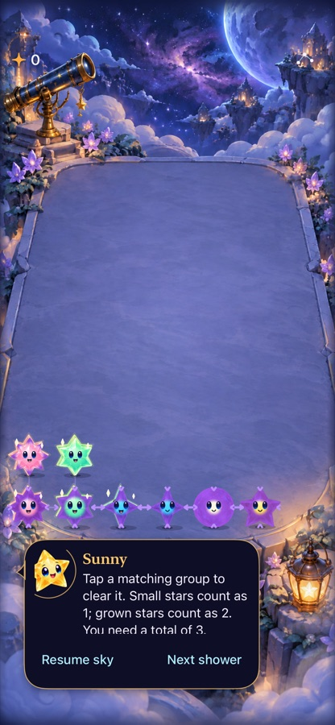

# Stars show their evolution without a facial dot

**Result:** Partially verified · **Owner:** current implementer · **Date:** October 18, 2026

The static black core is removed. Violet now advances inward from the outer facets as committed age increases; stage three adds inward chevrons. Faces, family silhouettes, original color at the heart and matching-value glints remain. This improves the visual distinction between growing, approaching collapse and the actual temporary black hole. Human recognition during dense automatic play remains unverified.

**Next action:** Observe an uncoached round with the user and husband; judge whether early growth and urgent compression are understood without consulting Help. Keep timing and rules steady during that comparison.

## Observed appearance

**Native SpriteKit export, source `d0e9dd3`, iPhone 17e / iOS 27.0 Simulator.** Columns: Sunny, Rose, Mint, Aqua, Nova, Opal. Rows: ages 0, 3, 6, 7, 8. Step 44, decorative motion off; this verifies static appearance, not animation. The first version's age-three edge was barely visible, so its threshold was strengthened before this capture. No extra static circle covers any face. Nova's color change is subtle; growth and chevrons supply additional cues.

**Native XCTest board capture, same runtime source, default text, normal system motion, Calm effects off.** Static screenshot only. Temporary wells during actual implosion are preserved by the unchanged shared collapse renderer.

## Acceptance and verification

Source: `d0e9dd3`; initial native run used identical runtime files from `96f44bc` before the shader threshold adjustment. Final source adds only the two numeric threshold changes. Xcode 27.1 (27A9275), arm64, Debug, iOS 27.0, dedicated simulator `7D94F0F5-486F-47E3-A2ED-9B35F61FCD66`. Later documentation changes do not affect runtime. Logs and xcresults remain disposable under `/tmp/starfall-evolution-*`.

| Check | Result / limits |
| --- | --- |
| Core | `swift test`: 160 passed. No core/rule/save files changed. |
| Focused hosted | Final `CriticalMassProductionTests`: five passed. Covers age-driven material input, preserved identity/value, no added core node, static cue with motion off, restart/restore/interruption and retained archive handling. |
| Native interaction | Final rescue scoring tap and warning/settings/background/restore tests: both passed. Native input mapping unchanged. |
| Largest text / Calm effects | `testLargestTextCalmKeepsWarningAndHelpUsable`: passed at `96f44bc`; shader threshold only changed afterward. Inspected controls remain reachable, warning readable. |
| Native visual | Final six-family sheet and warning board inspected; initial overly subtle early stage corrected. |
| Build | Debug simulator compile/link and native test build passed. Release not required: no routing, resource, membership or configuration changes. |
| Hygiene | `python3 scripts/ci-hygiene.py` and `git diff --check` passed. |
| Broader animation probe | The retained-Dusk full-motion probe failed once in the mixed run at its combined observation assertion, then passed in isolated diagnostic runs on unchanged main `dc0b3f2` (2.060 s) and this runtime `d0e9dd3` (2.059 s). Those passing runs observe a temporary well, neighbor infall, arrival and stale-completion rejection. The initial failure remains unexplained; it is not erased by the isolated passes. |
| Actual VoiceOver / physical device | Not run; RC and physical feel acceptance remain separate. Full win/loss and system Reduce Motion suites not repeated for this material-only refinement; prior source-bound evidence remains linked in the contract. |

Reproduce native checks with `xcodebuild -project Starfall.xcodeproj -scheme Starfall -configuration Debug -destination 'id=<dedicated-iPhone-17e>' -derivedDataPath /tmp/starfall-evolution-derived ARCHS=arm64 ONLY_ACTIVE_ARCH=YES test -only-testing:StarfallAppTests/CriticalMassProductionTests -only-testing:StarfallUITests/CriticalMassInteractionTests/testWarningSwallowRestoreAndSettings -only-testing:StarfallUITests/CriticalMassInteractionTests/testRescueRemainsARealScoringTap`. The largest-text test was a separate selection; the additional retained-Dusk animation probe was also explicitly selected.

## Animation probe investigation

The extra retained-Dusk probe was not required to render the new age material, but checks the shared collapse boundary. The first mixed run failed at `DuskProductionTests.swift:145`, which combines four assertions without messages. A clean export of unchanged main `dc0b3f2`, with only assertion labels added for diagnosis, passed; the feature test also passed alone without assertion changes. No app correction or blanket retry was used. The `hasCriticalMass` guard bypasses the changed material for this retained fixture, and the shared collapse renderer is byte-identical to main. This bounds the likely issue to test observation/context, but does not establish its cause. [Engineering follow-up](../../ENGINEERING.md#stellar-animation-observation) requires precise per-observation diagnostics and a mixed-run reproduction on the next touch of that test boundary.

## Boundaries and remaining uncertainty

The misleading dot belonged to `CriticalMassPresentation.configure`, separate from the temporary well in `StarCollapsePresentation.collapse`. Removing it leaves actual collapse intact. Inspected the shared collapse call, scene reconstruction of changed columns, and growth/quiet-motion ownership: age changes rebuild the material from committed values; no animation callback, local timer, save field or legal action changed. The visual remains bounded to one shader and one four-chevron path per warning star, with no per-frame drawing or new particles.

The material is still an authored shader treatment rather than new character artwork. Violet spreads progressively instead of replacing the entire material at once. New expressions, added motion or replacing the whole cast would need a separate visual judgment; they are not necessary to remove this ambiguity. See the [accepted contract](../../design/CRITICAL_MASS.md) and [original rule/motion evidence](../critical-mass-2026-10-18/README.md).
