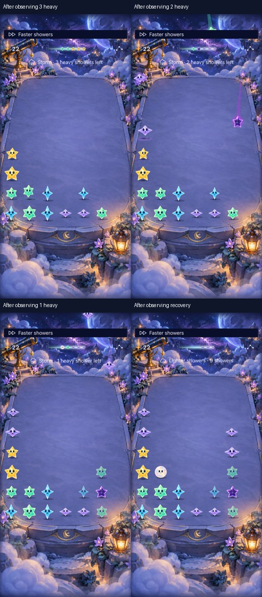

# Automatic storm presentation and its observation limits

**Result: Partially verified — automatic sequence passed; human response and animation smoothness remain unmeasured.** Owner: current implementer.

Acceptance before adding the check: start the existing seeded stormWarning fixture in the single normal app, resume automatic showers, observe all three heavy-count cues then recovery without calling a manual shower or clearing, and preserve the score. Keep bounded condition-based waits and retain captures. This verifies automatic presentation, not human urgency, choice or enjoyment. No rules, saves or runtime route changes.

A prior normal-effects recording used local a898957, whose complete tree equals merged f266ab9, before the trace-session correction in main ca68199. It reached the warning, heavy countdown, lighter showers and breathing cue. Raw video is 55.988 seconds at 1170×2532; the first 39 seconds are setup. A 16.988-second MP4 preview removes only that setup, at original speed, exported at 592×1280. Raw and preview remain under ignored artifacts/storm-motion-current.

The recorder requested 30 fps but did not sustain it: the active segment has 120 encoded samples from 39.275 to 55.988 seconds, median interval 0.040 seconds and 95th-percentile interval 0.743 seconds. This capture is useful for phase/art inspection, not smoothness or frame-rate acceptance. The manual interaction bridge missed activations and invalidated snapshot refs during separate touch-down/up calls; no reliable reaction-time result follows. The fixture was resumed without any clears after those setup attempts. Calm was false, system Reduce Motion and VoiceOver preferences were off. Do not infer the touch-session correction fixes the bridge symptoms.

Next action: verify the automatic sequence on ca68199 or newer with XCTest; inspect a small source-bound phase contact sheet; retain missing human, actual VoiceOver and physical-device evidence explicitly.

## Current-source native evidence

**Runtime captures:** main ca68199 plus only the new UI test/docs. Private iPhone 17e / iOS 27.0 (24A434), Xcode 27.1 (27A9275), Debug arm64 unsigned, scheme Starfall. The four screenshots are proportionally reduced and arranged with labels; original images remain in the result bundle. They show distinct heavy counts and nine-light-shower recovery, with Opal present, stars unobstructed and separate timing/density labels. The recovery screenshot still says Faster showers: those versioned clocks are independent, as designed. Do not infer that the density cue promises slower arrivals.

| Check | Result / limitation |
| --- | --- |
| Core | `swift test`: 91 passed, zero failures; `/tmp/starfall-storm-automatic-core.log`. No Core changes. |
| Automatic native test | One passed, zero failures/skips; `test_sim_2026-10-18T00-26-27-283Z_pid85535_4395ca9c.xcresult`. Actual automatic clock, no manual showers/clears, all four exact labels observed in order, score 22 before and afterward. Debug build passed in this run. |
| Initial native failure | `test_sim_2026-10-18T00-25-08-453Z_pid85535_9483e78d.xcresult` observed all three heavy counts but missed nine-light recovery. Logs showed redundant score waits plus captures between observations; by the next query the label was eight. Removed only per-phase score waits, kept every exact phase assertion, and checked score at the end. No retry, reduced-motion forcing or weakened phase assertion. |
| Visual | Four attached native captures inspected. Warning/heavy/recovery samples from the earlier video also inspected. They establish sampled appearance, not human readability during play. |
| Hygiene | `python3 scripts/ci-hygiene.py` and `git diff --check` passed. |
| Other acceptance | No app/resource/routing change, so Release was not repeated for this UI-test-only batch. Existing source-bound lifecycle/large-text/held-touch checks are linked in the [trace ownership evidence](../trace-ownership-2026-10-17/README.md) and [Opal planning evidence](../opal-native-planning-2026-10-17/README.md). No new actual VoiceOver, physical-device, human preference, pressure-choice or smooth-animation acceptance. |

Raw result bundles/logs are in the XcodeBuildMCP Starfall workspace. The current native test is source-bound separately from the earlier video; the latter predates main's touch ownership correction. Source/recording hashes and frame sampling metadata are in source.json. The video extractor's request at 60 seconds exceeded the 55.988-second recording and failed; valid frames below the duration were retained, with requested versus actual sample times recorded.

**Decision:** Keep current rules and cues. Use the [current regular-game protocol](../../PLAYTEST-FALLING-SKY.md#current-session-opal-planning-under-storm-pressure) to observe a participant's choices before coaching. The automated countdown and prepared planning example cannot answer whether storms are interesting or merely faster.
