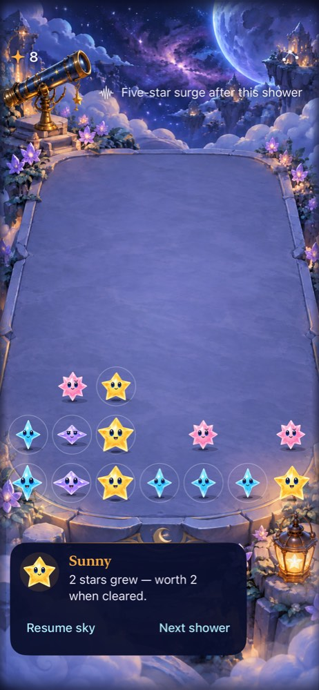
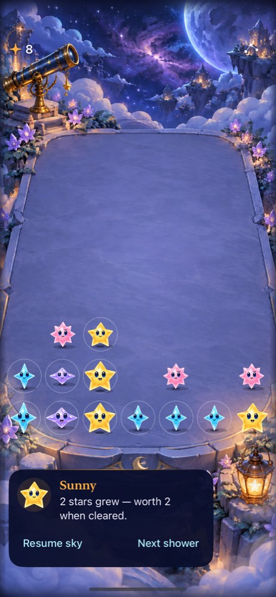

# Storm-phase choice follow-up

**Status: Completed bounded agent comparison; extend isolated trial before adoption · Owner: current implementer · Date: 2026-10-17.** Return to the user's question: do short storm phases create more interesting decisions? Prior seed-five, natural-first paused agent comparisons favored Surge but used familiar rules and exact accessibility values. They do not establish human enjoyment or real-time urgency.

## Bounded comparison

After completing the native VoiceOver round checks, export one current source into the existing natural-only and Surge Observatory apps. Keep the canonical candidate algorithms and cadence unchanged. Use ordinary launch with seed 17, no prepared phase fixture. Play Surge first, natural second, up to shower 24 or overflow, whichever comes first. Reversing the previous order and changing seed broadens the sample. Both change together, so this is not a controlled estimate of order effects, and it does not remove agent familiarity.

Before each action, record the intended clear/wait decision and its visible reason. Inspect screenshots before consulting accessibility values; use accessibility to locate controls and verify outcomes. Record which decisions depend on the phase warning, event, or recovery versus simply taking the largest available group. Compare repeated largest-group/clear-all behavior with deliberate holds or clear order. Report moments with no meaningful alternatives as counterevidence. No hidden forecast or source inspection by the simulated player.

Decision point: retain Surge only if the trace shows understandable phase-dependent decisions with a cost/tradeoff beyond more available stars; otherwise revise or remove it. Preserve human preference, cold learning and real-time feel as separate questions. Do not adopt rules from higher agent score or longer survival. No campaign, progression, new rule variant or production save change.

This follow-up uses the previously user-authorized simulated playtester. Native compatibility and source identity must be established before play. Human comparison remains required for enjoyment claims.

## Source and pre-play checks

The [source manifest](source.json) captures paired exports from `e7a933a` plus the verified VoiceOver source/test refinements later committed as `202aabb`. Installed executable/debug-dylib hashes match each Debug product. Canonical natural/Surge core hashes remain unchanged; this is a new play sample, not another tuning variant. Apps remain isolated bundles/suites on iPhone 17e MechanicsLab / iOS 27.0, Xcode 27.1, arm64.

Native checks passed: Surge `ObservatoryBurstPhaseTests/testPhaseBoundariesAndProjectedClearsSurviveMenuAndRestore` and `testLargestTextKeepsPhaseVisibleAtManualControls` (2), and natural `ObservatoryFeedbackTests/testPausedGrowthClearInterruptionAndQuietActivePlay` (1). An initial selector used the wrong test class and selected zero methods; that result establishes compilation only and is not counted as passing gameplay tests. Corrected selections actually executed all three methods.

Raw results under `~/Library/Developer/XcodeBuildMCP/workspaces/Starfall-27844ad883f3/result-bundles/`: Surge `test_sim_2026-10-17T18-52-50-049Z_pid85535_e8544ee2.xcresult`; natural `test_sim_2026-10-17T18-53-52-029Z_pid85535_f2e00b79.xcresult`. Same shared Starfall scheme and flags `CODE_SIGNING_ALLOWED=NO ARCHS=arm64 ONLY_ACTIVE_ARCH=YES -parallel-testing-enabled NO`. DerivedData `/tmp/starfall-storm-choice-{surge,natural}`. Re-export with `python3 tools/mechanics/prepare-observatory-labs.py --ref 202aabb` to reproduce runtime source; source-bound tests are identified in the manifest.

The playtester initially found no input response and completed no showers. Before restarting both runs, the existing explicit QA setup asserted actual VoiceOver disabled and actual Reduce Motion off on MechanicsLab (`test_sim_2026-10-17T18-56-50-223Z_pid85535_d4d94c28.xcresult`). Exclude that setup attempt from the gameplay trace; no rule inference follows from it.

## Independent reference policy

While the simulated player observes only the native interface, the implementer runs a separate deterministic reference: after each shower, repeatedly clear the largest ready group, using the first canonical group to break ties, until no clear remains. Cap at shower 24/overflow; validate every committed state. This contextualizes whether a deliberate hold/order is necessary, without treating bot score as enjoyment or revealing the reference to the player.

The standalone `greedy-reference.swift` compiles against each exported `Sources/StarfallCore/*.swift` using `swiftc -O` and emits JSON. It is evidence tooling only and has no app target membership. Final results and interpretation will be recorded with the completed trace; do not infer a preference from a partially completed run.

Reference follow-up question recorded before the extra run: does waiting for groups worth at least five buy extra starlight at a cost in crowding/overflow on the same seed? Compare only thresholds three and five under the same largest-first, clear-until-below-threshold policy through shower 24. This is an explicit local score/space tradeoff probe, not an extra rule candidate or evidence of enjoyment. Do not share its hidden future trace with the simulated player.

### Reference result: waiting has a concrete local cost

| Policy through shower 24 / overflow | Natural | Surge |
| --- | --- | --- |
| Clear every ready group, largest first | Alive at 24; score 63; 18 clears; 18 occupied | Alive at 24; score 85; 23 clears; 6 occupied |
| Wait for value five, then largest first | Alive at 24; score 33; 6 clears; 29 occupied | Overflow at 13; score 15; 3 clears; 23 occupied |

Threshold five collects more per clear (5.5 natural / 5.0 Surge versus 3.5 / 3.70), with fewer actions and more crowding. It does not earn more total starlight in this fixed window. The Surge threshold-five round still had seven ready groups at overflow; it was voluntarily holding them below the threshold. Only 23 cells were occupied, so a blocked landing column, not total board fill, ended the round. This supports a specific score-per-action versus local-space question. It does not prove the phase cue caused a better decision, optimal play, enjoyment or human reaction time.

References: [natural greedy](greedy-natural.json), [Surge greedy](greedy-surge.json), [natural hold-five](hold-five-natural.json), [Surge hold-five](hold-five-surge.json). `greedy-reference.swift` accepts only thresholds 3 and 5; compile separately against each source directory from the manifest, then invoke with that threshold. Every committed state passed `isValidSave`; all loops are bounded. Keep these results independent of the player's unrevealed decision trace.

### Input bridge fallback

Remote element-ref taps repeatedly reported success without changing the empty game, even after explicit normal-mode setup. The original native seed-17 reset/Next XCTest sanity check passed (`test_sim_2026-10-17T18-59-19-879Z_pid85535_41b23bc3.xcresult`). A temporary exported-lab XCTest driver therefore executes the simulated player's chosen accessibility IDs and captures a native screenshot/hierarchy after each action. No app/core bytes or app target membership change. Each test-run end terminates the app, so the next chosen action restores its committed lab save; this limits the comparison to paused decisions and observed outcomes, not continuous timing, animation feel or urgency.

The player's initial remote-tap attempt is excluded from gameplay evidence and retained in the player record. Each native-driver run must reset to seed17 before its actual trace. Driver source and completed scope will be retained with the final report; no permanent game route or production automation framework is introduced.

## Research lens: rhythm and strategic depth are different questions

Valve's [first-party Left 4 Dead AI presentation](https://cdn.fastly.steamstatic.com/apps/valve/2009/ai_systems_of_l4d_mike_booth.pdf), slides 77–80 and 91, describes alternating intensity and relief and distinguishes pacing from difficulty. This is a useful design precedent, not evidence that Starfall's fixed shower cadence is enjoyable; no adaptive director is proposed. For this trial, ask separately whether the cue helps anticipation, whether clear/hold tradeoffs change, and whether a person prefers the rhythm. A familiar paused agent can inform the first two questions and cannot settle the third.

## Completed comparison and decision

The [full player report](playtest.md) and [exact native actions](native-actions.json) complete both runs at shower 24: Surge score 57 / 13 clears, Natural score 37 / 10 clears and one invalid tap; neither overflowed. The player had substantial prior familiarity. Natural's prefix through 15/23 was replayed once on a dedicated iPhone 17e / iOS 27.0 simulator after another workstream foregrounded a different app on the shared simulator. Exclude relocation replay and failed/observation-only diagnostic calls from new choices. This is paused decision evidence with restore between actions, not continuous urgency or animation acceptance.

**Decision: do not adopt Surge.** Retain this exact pair as the baseline while testing one bounded strategy candidate separately. The warning changed cashout timing, but the clearest smaller-first/support tactics also occurred in Natural. Too many states offered obvious cleanup or no useful local repair. No new cadence variant is justified by these results alone. Revisit Surge after the exclusive-connector/native choice comparison or an uncoached human comparison identifies a concrete phase-related question; then adopt, revise with that hypothesis, or remove its temporary presentation.

At shower 8 the board, incoming preview and RNG were exactly equal in independent core replays, before the next choice. Surge's warning prompted an amber cashout; Natural held it for a later supporting clear. The retained native captures show that matched situation:

 

Independent replay of the final chosen commands reproduced both final scores, shower counts, clear counts and valid-save invariants. [Natural replay](player-replay-natural.json), [Surge replay](player-replay-surge.json), [probe](player-action-replay.swift). Compile the probe separately against each exported Core using `swiftc -O`. Its argument is a JSON string array: begin with `reset`, concatenate comma-separated actions from `native-actions.json` whose kind is `chosen-gameplay`; Natural includes run names `natural` and `natural-dedicated`, Surge includes `surge`. Exclude extra reset/observe commands and all relocation/diagnostic records. An initial implementer extraction omitted the dedicated continuation and reproduced only Natural15/23; the corrected filter above produced24/37. This was evidence-tool selection, not an app failure.

The Natural23 invalid tap reproduced connected value two and zero score delta. Do not recast it as a successful choice. The final Native driver adds bounded foreground/readiness assertions and captures; it changes only exported UITests, and both compiled app binaries retain the manifest hashes. No production source changed in this comparison. Actual VoiceOver round results remain in their [separate source-bound record](../voiceover-round-2026-10-17/README.md).
