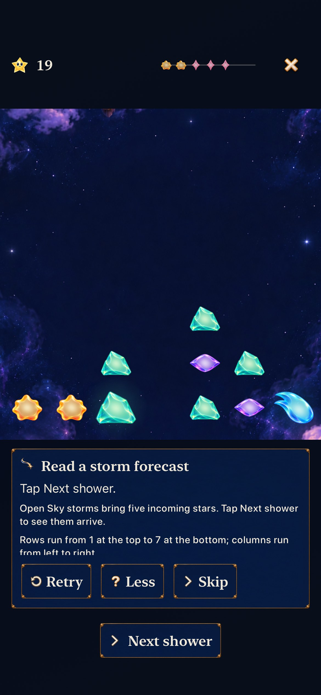

# Teach the storm action the player can actually perform

**Result:** Selected development acceptance passed · **Owner:** Factory coordinator · **Date:** October 22, 2026

[#233](https://github.com/lbeezr/starfall/issues/233) removes an impossible instruction from existing storm practice. The compact forecast shows ordered miniatures without their landing columns, while the lesson said to watch those columns. It now says: “Open Sky storms bring five incoming stars. Tap Next shower to see them arrive.” Forecast information, gameplay and the chapter's single authored action stay unchanged.

## Playable slice and disconfirming evidence

The player promise is a truthful observation and executable next action. The native journey retains an ordinary Story round, returns Home, opens storm practice, reads the whole instruction, calls its one shower, completes the chapter and returns to the exact saved Story state and selected destination. It checks the actual five-star forecast and five committed consequences.

Review rejected the initial suggestion to say “make room first”: `SkyTutorial.storm.actions` is exactly `[.shower]`, and an extra move would fail its existing teaching sequence. A temporary executable linked to unchanged production Core confirmed the authored state: shower 9, ten occupied cells and a five-star storm; afterward shower 10, thirteen occupied cells, two newly grown stars, score 19 and complete/no retry. Thus five arrivals produce three additional occupied cells plus two growths, not five additional cells. The real native test verifies that distinction.

## Source and checks

Base main `a46a0f4871056c02d7cf09982e83f78a04f6f221`, after [#232](https://github.com/lbeezr/starfall/pull/232). Snapshot `eb10a82d3ac4`; [exact hashes](source-inputs.json) bind the existing catalogue and `UITests/WorldJourneyInteractionTests.swift`. Only the shorter `practiceStormDetail` string affects the app. Core, HUD/forecast rendering, practice actions, save/clock/journey owners, artwork, routes and membership are unchanged. No new source/resource file or dependency is introduced.

| Check | Result |
| --- | --- |
| Core | 225 passed, zero failures/skips, including all-chapter action coverage. |
| Hosted dialogue/catalogue | 19 passed, zero failures/skips. |
| Native | One normal-input iPhone journey passed, zero failures/skips; bounded command 98.353 seconds. Exact five-arrival consequences, completion and retained Story/world state checked. |
| Debug / Release | Normal Debug native/hosted build passed; arm64 simulator Release passed, 1.625-second command. |
| Hygiene / diff / links / input hashes | Passed at acceptance. |

Xcode 27.1 (`27A9275`), arm64, iPhone 17e Simulator `4103C352-DFC2-493E-A224-DE4CE3D50889`, iOS 27.0, default text and normal motion. Raw commands, `storm-lesson.xcresult`, logs and bounded stage receipts live under `/private/tmp/starfall-factory-next-20261022/`. The selected native test passed on its first run. This slice does not claim a new largest-text/tablet, full-matrix, physical comprehension, minimum-iOS or actual VoiceOver pass. The layout is unchanged and the instruction is shorter; the broader Tutorial reading/preservation results retain their [preceding source-bound scope](../factory-tutorial-scope-2026-10-22/README.md). VoiceOver stays deferred. No physical installation occurs.

### Inspected instruction

**Native still: iPhone 17e Simulator, iOS 27.0, default text, normal motion, snapshot `eb10a82d3ac4`.** The complete instruction and Next shower action are visible. Inspected directly; the succeeding native action separately proves completion and preserved ordinary play. [Capture metadata](capture.json) binds the original PNG and JPEG export at unchanged dimensions. The still does not establish animation or human understanding.

Reproduce Core with `swift test --scratch-path /private/tmp/starfall-factory-next-20261022/CoreBuild`. Native uses `scripts/simulator-command.py`, scheme `Starfall`, Debug, the device above, temporary DerivedData, explicit `ARCHS=arm64 ONLY_ACTIVE_ARCH=YES CODE_SIGNING_ALLOWED=NO -parallel-testing-enabled NO`, and selectors `StarfallAppTests/SkyDialogueTests` plus `StarfallUITests/WorldJourneyInteractionTests/testStormLessonDescribesFiveArrivalsAndPreservesSavedStory`. Release uses the same wrapper and `-configuration Release -destination 'generic/platform=iOS Simulator'` with separate ReleaseDerivedData.

## Adoption and continuing queue

Adopted in the ordinary app; no comparison route remains. Revisit the lesson's learning value at #206's next uncoached session. This task drains the known forecast-instruction discovery from #223 without inventing a forecast redesign.

This continuing batch delivered three player-facing corrections (#228, #229, #233) and repaired the independently reported normal-input regression #226, using disjoint worker preparation and one integration/native owner. #228/#229/#226 issue completion was verified after their default-main merges. #228's issue-side Project Done was observed; #229 and #226 needed explicit single-card Done reconciliation after remaining In Progress. Those are manual repairs, not automation passes; #220 retains the tracking discrepancy. No routine human sign-off, new workflow or background scheduler was added. Overall throughput and player enjoyment remain unmeasured.

Bounded refill review found no further concrete product correction in entry/cancel/map/resume, pause, restart/restore, input admission, retained-round snapshots and journey persistence. Remaining gameplay leaves need the actual evidence stated in their packets: player/touch observations #206, sustained physical budgets #207, minimum-OS environment #208, physical readability #209 and conditional practice decision #210. VoiceOver #217 remains deferred; Project tooling #220 is separate. These dependencies stay open with concrete next checks, and are excluded from the actionable gameplay queue.
