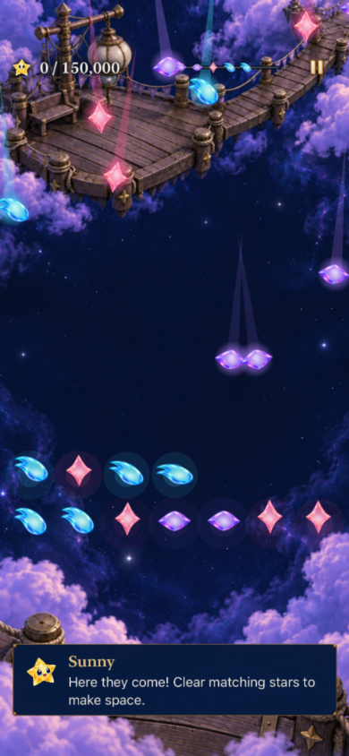
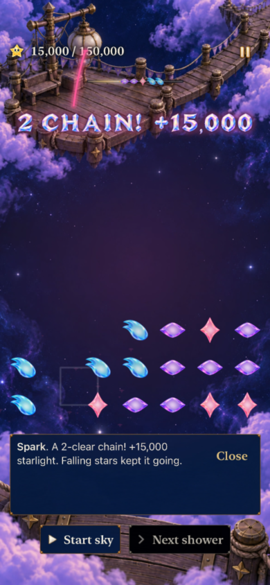

# Lantern and Ribbon automatic cascades

**Status: development verified; publication and phone delivery pending.** New Lantern and Ribbon visits use rapid half-full openings, automatic square/cross pops and causal combo awards. **213 Core tests, 203 distinct selected hosted tests and two native UI scenarios pass**, with Debug/Release builds and inspected normal-motion samples. This is a development subset; physical play, actual VoiceOver and minimum-OS acceptance remain open. Competitive grounding and its limits remain in [puzzle pacing research](../../design/PUZZLE_PACING_RESEARCH.md).

| Quick opening rain | A falling follow-up earns a chain |
| --- | --- |
|  |  |

**Inspected recording samples:** runtime input fingerprint `dev.181bb2c16e` (simulator label `dev.local`), Debug, iPhone 17e / iOS 27.0, normal motion, default text. [Capture provenance](captures.json) records exact samples; the largest-text quiet Ribbon result was also inspected in XCTest output. The callout stays above playable stars. These samples establish the observed sequence, not frame-rate or physical comfort.

## Observable acceptance

- New Lantern and Ribbon visits commit 24 and 25 stars respectively at zero score. The opening appears through one overlapping rain lasting about a second. Resume reveals the saved board; interrupted entry never adds stars or repeats rewards.
- Exact matching four-star squares and five-star crosses pop after an exchange, a successful arrival batch, or a manual clear. Falling survivors can trigger further phases. Ordinary tap groups are not automatically consumed.
- One opening swap demonstrates two clear phases in Lantern and three in Ribbon. Each phase has its own before/after board, falling presentation and receipt; points grow by causal depth, capped at a 5× multiplier.
- The entire transaction, final forecast and score are saved before animation. Pausing, replacement, quiet presentation and stale callbacks cannot award again or leave input locked.
- Historical revision-one and 18-light rounds retain their score, supply, replay and migration contracts. Later locations and multiplayer remain outside this change.
- Verification separates deterministic rules, hosted lifecycle/save checks, actual native input, inspected visuals/animation, and canonical phone installation. Passing builds do not establish enjoyment.

## Adoption decision

Adopt into the first pair for the requested phone playtest. Phone play is the next balance decision: assess useful choices, unwanted waiting, readable chains and recoverable Lantern mistakes before extending the rule set. The score objectives remain 150,000 and 220,000; there is no minimum-time lock. The 1×–5× multiplier is initial Starfall tuning, not a number asserted by the competitive research.

The [production Core policy comparison](balance.json) supports five mixed stars, three colors in Lantern and four in Ribbon. Informed policies win in 21–24 and 33–36 showers; these are model counts, not measured player duration. Tap-only policies lose both. Eager clearing can still thin the board, so the opening density is not a promise of sustained fullness. Keep the existing six-/four-second intervals for this first comparison rather than changing every pacing variable together.

## Verification

The [verification record](verification.json) binds working-tree checks to base `c31d890f` over main `5ae17f20`, exact runtime-input hashes, commands, environment and results. New Core files are compiled by the package in Debug and Release; the updated dialogue JSON is present in the Release app. No app source/resource membership or external dependency was added.

The first run exposed old tap-only win assumptions and revision/trace expectations. Tests now exercise real swaps, taps and one-swap setups, preserving terminal, save-before-animation, interruption and replay assertions. Historical score examples explicitly construct revision one. A broader consumer run found one additional retired tap-only win policy; its complete 24-test flow class and the Store win regression pass after correction. That failed run recorded its summaries but stalled during teardown; only its owned `xcodebuild` was terminated. Failures remain recorded rather than relabeled as passes.

Review also caught two entrance boundaries: a layout/motion interruption now rearms an eligible shower deadline, and a scene-level quiet completion emits one aggregate receipt when it supplies no phase callbacks. Dedicated tests cover both and stale callbacks. No animation awards points.

Raw logs, xcresults and the full recording are disposable under `/tmp`; selected frames and small summaries are retained here. Publication and canonical installation will be recorded separately. Continue/Replay preserve old rounds; select a new visit from the Story map to try revision two.
