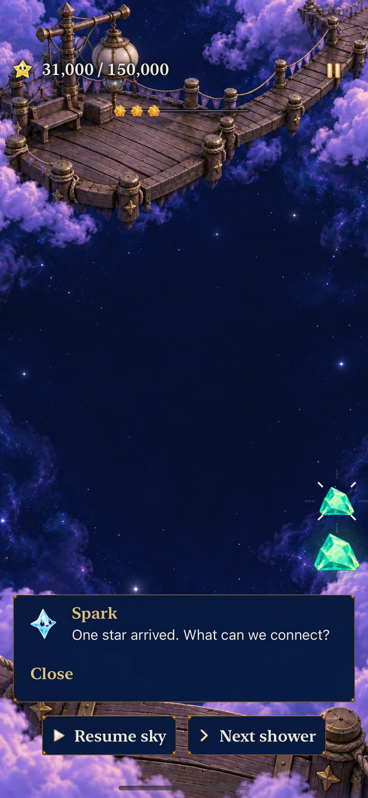
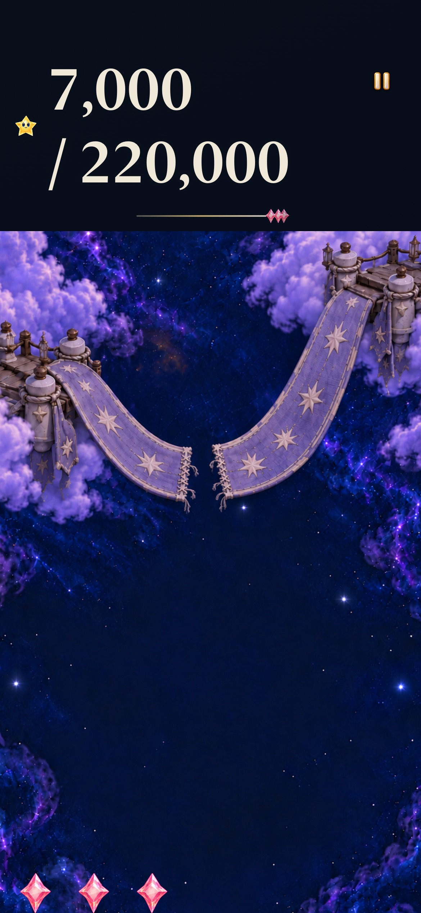
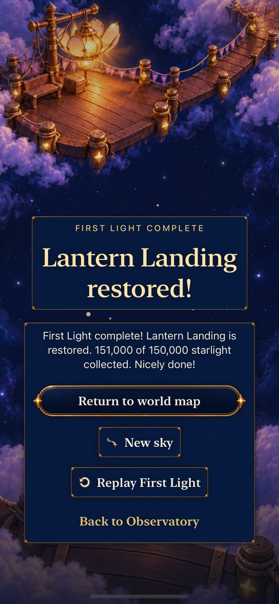
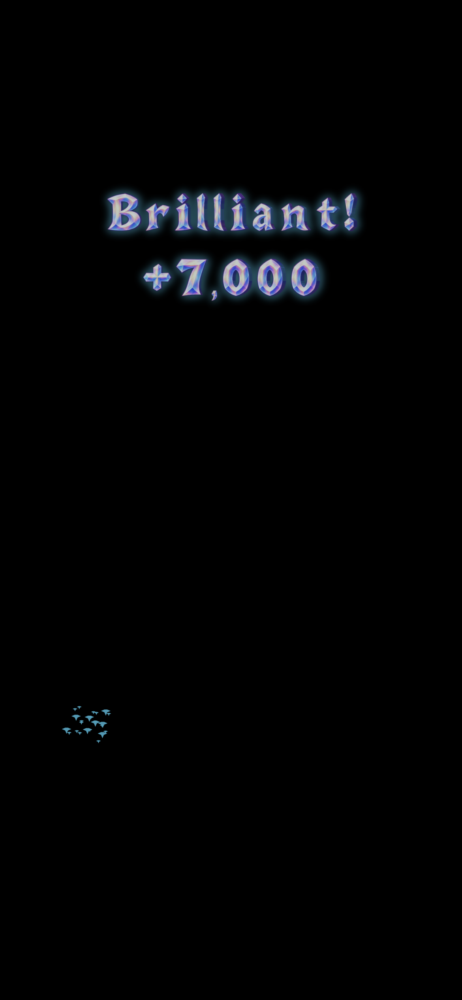
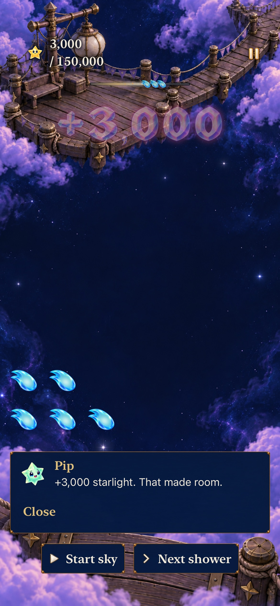
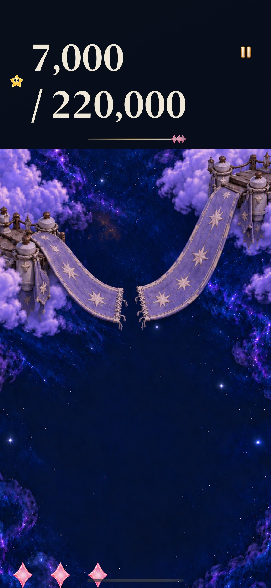

# Lantern Landing and Ribbon Crossing gameplay

**Status:** Development-verified first slice; human balance review remains open · **Date:** October 20, 2026

The first slice of the [Story Mode gameplay plan](../../STORY_MODE_GAMEPLAY_PLAN.md) gives new Lantern and Ribbon visits distinct authored openings, repeatable supply, six-figure objectives and earned clear bonuses. Pokémon Puzzle League informs the value of preparing larger clears; Starfall keeps its existing explicit tap, swap and trace rules. Multiplayer and optional mastery ratings remain deferred.

## Observable acceptance

- New visits use revision 1: Lantern 150,000 with six-second showers; Ribbon 220,000 with four-second showers. Later locations and retained historical rounds preserve their definitions.
- Lantern supports ordinary tap play and a visible choice between immediate clearing and keeping stars for growth. Ribbon offers a useful swap, a five-star trace spanning separate tap groups, and a recoverable ordinary route.
- Each small star contributes 1,000 points and each grown star 2,000. Each actual cleared star beyond three adds 1,000. Equivalent selected stars earn identical awards across input methods; splitting, swapping and replaying presentation cannot manufacture bonuses.
- Score, restoration, entry/result text, accessible previews and celebrations agree. The physical light ledger remains independent of display points.
- Historical saves, completed repairs, previews and same-round replay preserve their original outcomes and rules. A new explicit visit selects the revised definition.
- The normal app exposes these stages. No minimum-time lock, countdown, automatic cascade, networking or mastery gate is introduced.

## Verification context

Primary native source: `eba7d4a`, runtime `dev.22c1ff436d`, with newer main `d94903b` integrated. The runtime inputs are hashed in [checks.json](checks.json). Test-only follow-up `92830c6` changes four hosted test files; app, Core, resources and build settings remain byte-identical to the primary native source. Documentation-only follow-ups do not change this runtime. The final hosted suite includes expanded award rendering. Initial Core work passed 194 tests before integrating newer main artwork/location changes. An initial native build requested x86_64 app objects against the arm64 package and failed module resolution; the repository's existing local `ARCHS=arm64 ONLY_ACTIVE_ARCH=YES` invocation passed. This was a build invocation correction, with no project architecture change or warning suppression.

Environment: Xcode 27.1 (27A9275), Swift 6.4, macOS 27.0.1 (26A434), arm64 iPhone 17e Simulator running iOS 27.0 (24A434). Debug and Release use the shared Starfall scheme and deployment target iOS 17. Human enjoyment, physical touch comfort, actual VoiceOver, minimum-OS execution and measured first-clear duration remain separate from deterministic models and Simulator checks.

## Deterministic calibration

The disposable `/tmp/starfall-authored-pair-model.swift` was compiled against production Core with `xcrun swiftc -O -module-cache-path /tmp/starfall-story-clang Sources/StarfallCore/*.swift /tmp/starfall-authored-pair-model.swift -o /tmp/starfall-authored-pair-model` and run successfully. First, last, largest and smallest legal tap selection each complete Lantern at 151,000 with 56 showers and 49 taps, maximum column height two. Waiting for the first one or two showers also succeeds; collecting only every third shower succeeds at shower 57. Idle Lantern overflows at shower 14.

Ribbon's four immediate tap policies complete at 224,000 with 77 showers and 61 taps, maximum height three. Starting with the offered five-star trace or useful swap reaches 226,000 with maximum height two. Initial waits of one or two showers recover; continually waiting for three showers loses at shower 33 with 55,000. Idle Ribbon overflows at shower ten. These are reproducible model policies, not player measurements. Multiplying shower count by cadence gives 336 seconds for Lantern and 308 for Ribbon; gestures, clock holds, manual advances and human search make real duration different.

Lantern's opening illustrates a practical trade: collecting rose first and allowing aqua growth yields 13,000 in two clears. Collecting aqua first needs a third clear to harvest the same supplied light and score. Ribbon's three-star quick clear leaves split aqua and a rose obstruction; the five-star trace or swap clears that obstruction sooner. Later motifs mirror and rotate colors, but sustained depth and repetition still require full human sessions before expanding to other places.

## Failure and correction record

- The first native Lantern check selected a list-only map button while the painted map was active. It now uses the repository's shipping map/list helper; the gameplay assertions are unchanged.
- The first Ribbon native check completed its swap, then exposed a real HUD accessibility regression: the reflow wrapper was an `Other` element and its child lacked the score identifier. An explicit native Text accessibility representation now preserves the single exact grouped score in both layouts. Existing StaticText assertions remain intact.
- A negative Core save test reproduced fabricated Dusk accounting in an authored round without Dusk. Revision validation now rejects nonzero dark-star clears. The corrected post-merge Core suite passes 197 tests, zero failures/skips.

## Results and inspected appearance

| Evidence | Result |
| --- | --- |
| Core | 197 tests pass, zero failures/skips; deterministic replay, bonus conservation and historical-save boundaries included. |
| Hosted | All 357 tests pass, zero failures/skips at `92830c6`; complete suite after the test-only corrections below. |
| Selected native UI | Five tests pass, zero failures/skips at `eba7d4a`: historical Lantern win/restore/replay; historical Ribbon largest text with system Reduce Motion; revised Lantern full win/replay/overflow/relaunch; revised Lantern 3,000-point persistence; revised Ribbon native swap/7,000 clear, largest text and settings dismissal. |
| Build / membership | Debug test build and Release simulator build pass. `StoryChallenge.swift` belongs to the existing local Swift package; updated dialogue remains in the existing app resource target. |
| Visual | Seven retained captures inspected; exact 7,000/10,000 award renderings also inspected in both normal and quiet presentation. |
| Hygiene | Tracked-file hygiene, whitespace and local-document targets checked. Commands and exact source differences are in [checks.json](checks.json). |

The [capture index](captures.json) binds every retained image to its source and hashes. Default-text Lantern shows complete `31,000 / 150,000` progress, an unobstructed sparse board, and readable pause/manual controls. Its entry shows the full objective and Begin action; the native win shows `151,000 of 150,000` and all result actions. Ribbon's largest-text HUD reflows `7,000 / 220,000` onto two lines. Its long entry scrolls through the guidance to a visible Begin button; the scrolled sample intentionally excludes earlier text. No countdown or minimum-time wait was needed to finish.

| Default-text play | Largest-text score | Native completed round |
| --- | --- | --- |
|  |  |  |

**Native Debug stills, `eba7d4a`, `dev.22c1ff436d`, iPhone 17e / iOS 27.0 Simulator.** Full animations were exercised by the normal-motion native cases; these stills do not certify motion quality or physical play.

| Earned five-star clear | Earned grown-star clear |
| --- | --- |
|  |  |

**Hosted overlay captures on black, test source `92830c6`, same runtime.** Both grouped numbers and the separate Brilliant title are legible. These isolate the production overlay using actual committed Lantern clears; they are not complete game-screen captures. The pixel test proves presence, while this inspection checks the digits. The full suite separately exercises overlay expiry, input, restore and winning handoff.

## Final hosted corrections and remaining limits

The initial combined run completed 362 cases: all five UI cases passed; three hosted cases failed with four assertions. Two expectations still described an empty, four-second First Light opening. Their tests now require the authored legal exchange, reject stale tickets/empty cells, and require no shower at four seconds followed by exactly one at six. Historical timing and replay assertions remain intact.

The third failure missed the short initial well in the historical Dusk/material-sheet animation test; infall, arrival, completion and cancellation still passed, and the immediately following standalone test passed. A test-only bounded first-frame prerequisite now establishes that the new SpriteKit host is rendering before the five-second observation window begins. Both sequences pass in the final full suite with all original phase assertions, normal motion and polling intact. This corrects a missing test prerequisite; the precise scheduling cause of the initial missed sample was not measured. If it recurs, capture frame/phase timestamps before changing any assertion or animation.

Human full-round repetition, decision frequency and completion duration remain the next balance check, before redesigning later locations. Actual VoiceOver, physical-device play, minimum-iOS execution, the complete UI matrix and human motion review remain outside this bounded development batch. No phone installation was performed during that verification batch.

## Integrated source for phone delivery

Clean source `9a7e749`, runtime `dev.d82bb700e8`, incorporates main `c6e3a35` and its LivingLight artwork without changing the authored rules or save migration. All 197 Core, 359 hosted and two selected native UI tests pass with zero failures/skips; Debug test and Release simulator builds pass. The two UI cases repeat Lantern score persistence and Ribbon native swap/7,000 clear at the largest text size. Commands, source and environment are recorded in the integration entry of [checks.json](checks.json). No build-affecting paths were dirty.

| Integrated Lantern | Integrated Ribbon |
| --- | --- |
|  |  |

**Inspected native stills, `9a7e749`, iPhone 17e / iOS 27.0 Simulator.** Earlier captures above retain their score/outcome evidence with historical material appearance. These new stills confirm integrated digits and pieces; physical frame pacing and human balance remain unmeasured. The user authorized publication and canonical phone delivery. The published PR will record the updater's verified installation receipt; Simulator success alone is not installation evidence.
