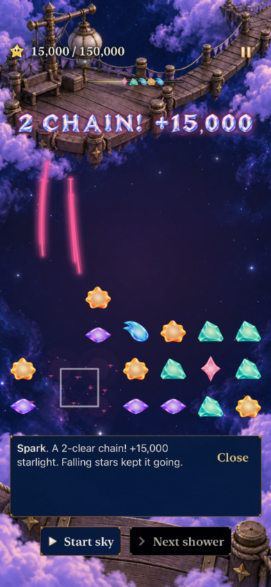

# Arrange patterns in Lantern and Ribbon

**Verified development subset; publication and delivery pending.** The player rejected revision 2's readily tappable boards and confirmed automatic patterns only for these two locations. Revision 3 removes tap/trace activation and adds full seven-star rows and columns to the existing four-star square and five-star cross. All five ordinary families now use bounded shuffled supply. The 150,000/220,000 objectives remain reachable through arrangements; human difficulty remains open.

## What failed and what must improve

On revision 2's untouched openings, 19/24 Lantern stars (79.2%) and 19/25 Ribbon stars (76%) belong to legal tap groups. The previous reachability model demonstrated that rounds could finish, but did not measure how often an arbitrary tap worked or establish meaningful choices. The physical feedback supersedes that balance assumption.

Revision 3 must make completed arrangements the sole source of clears. A tap or drawn path cannot spend stars, award points or advance the forecast. Seven-star lines count actual occupied cells, including when some stars are grown; six grown stars do not qualify. Squares, crosses and lines resolve simultaneously with overlap counted once, then fallen survivors can form another causal phase. Separate moves begin a new chain.

## Bounded acceptance

- Lantern and Ribbon retain rapid half-full entrances. Their openings have no completed recipes, several rewarding exchanges and an understandable cascade.
- Supply uses the ordinary families with useful incomplete arrangements. Compare an informed arrangement policy with indiscriminate swaps, recording ingredient availability and setup work rather than assuming random colors create depth.
- Objective reachability, conserved light, score receipts, announced forecasts and round-trip replay must pass through production Core rules.
- Native input, guide/help, accessibility actions and celebrations must describe automatic patterns. Test a real non-clearing tap followed by an exchange and save/restore.
- Archive v12 reads retained v11 and earlier rounds without changing their rules or bytes. A new visit selects revision 3; resuming or replaying an older round preserves its original definition.

## Results and limits

[Exact commands, hashes and failures](verification.json) bind working-tree runtime `dev.23ebbb8d8f` to main baseline `7a582d459feb9680351eaa647ca85d94e1410df1`. All **225 Core**, **254 affected hosted** and **two native UI** checks pass, with zero skips. Debug and Release builds pass. The native flows perform a non-clearing tap, score the intended exchange, retain the committed result across relaunch, and cover largest text plus quiet presentation. Hosted checks include complete arrangement-only wins, clock cancellation, normal phased presentation, held swipes, save migration and retained controls.

The first native run passed 172 hosted checks but both UI flows crashed at Begin: the new summary template received an unused `groups` argument. The fix supplies exact per-mode arguments through one shared formatter used by the board and menu. A focused regression and the same two UI flows pass; the failure remains in the record.

[Balance evidence](balance.json) separates production results from temporary variants. The chosen generator delivers two of each family per ten arrivals, caps equal-family runs at two and balances each column to five arrivals per seven showers. It does not inspect the board or rewrite forecasts. Three rewarding opening exchanges exist in each location; the featured exchange yields a 15,000-point two-phase Lantern chain or 30,000-point three-phase Ribbon chain.

With at most four actual swaps between showers, the model wins Lantern in 22 showers/86 swaps and Ribbon in 32/118. Twenty indiscriminate-swap runs per location all lose. These are action counts, not measured play times. The winning paths average over two setup swaps per scoring move, mostly clear one phase at a time, and do not use full lines. They establish reachability and a planning advantage, not gentle difficulty or frequent human-made cascades. Extra spatial pair placement showed no consistent improvement and was removed.

Native iPhone 17e Simulator, iOS 27.0, Debug working tree `dev.23ebbb8d8f`; sampled normal motion, with the app's generic `dev.local` label. [Capture index](captures.json) also retains the opening rain and largest-text quiet Ribbon result. This is visual/animation inspection, not frame-rate measurement or physical acceptance.

The next phone session must assess comprehension, decision time, recoverability and practical line/cascade opportunities before extending this design. Actual VoiceOver, minimum iOS, physical-device performance and full RC remain separate gates. Canonical installation is recorded separately once completed.
