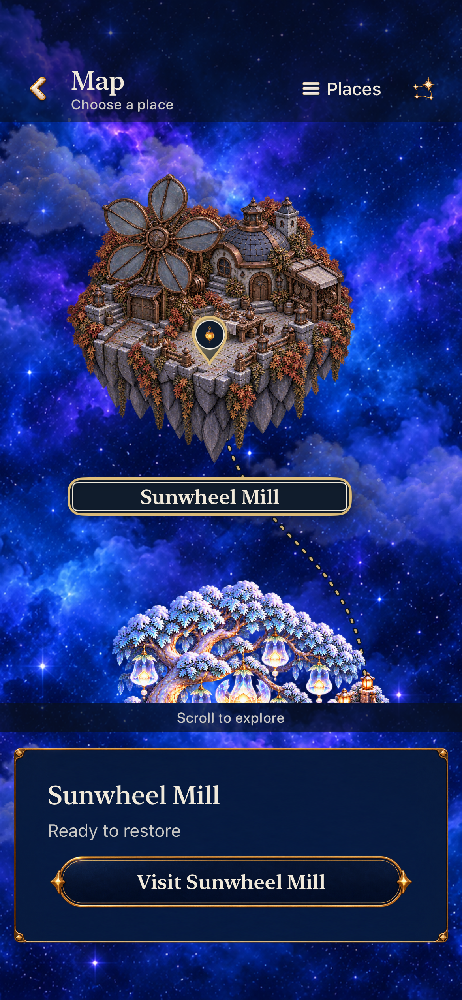
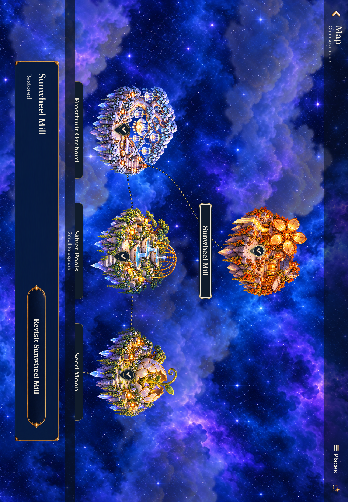

# Sunwheel Mill — current map integration

**Result: Development verified, merged and installed on the original phone** · **Date:** October 20, 2026

Sunwheel Mill is the seventh playable restoration, reached after a committed Frostfruit Orchard repair. Its fifteen paintings cover five milestones in bespoke iPhone, iPad portrait and iPad landscape layouts. The current modular map also has two independent transparent Sunwheel sprites: damaged until its own committed repair, restored afterward. The seventh island retains the existing island scale and native button behavior; the map scrolls to accommodate the extra row.

The [verification record](map-integration-verification.json) binds this integration to **`49d54fcab24984c73262849b853e23e8ecd93e3e`**, runtime-input fingerprint **`dev.6fa54c5e65`**, including main **`f4144ec2159416dbf479f6294cc5e561bfa0070b`**. The actual Simulator label is `dev.local`, version 0.1.0/build 1. A [clean Git archive comparison](map-source-equivalence.json) matches all runtime inputs and all 76 test-source files; the tests ran in the recorded checkout, not again in that export.

## Checked behavior

| Check | Result | Scope |
| --- | --- | --- |
| Core | 199 passed, zero failed/skipped | Deterministic rules and retained-save compatibility |
| Hosted app | 386 passed, zero failed/skipped | Complete hosted selection, including seven-island geometry, image registration, repair state and map fixtures |
| Phone board | 3 passed, 12 captures | Five states, dense rapid input, settings/background, committed win, relaunch and replay |
| iPad board | 1 passed, 16 captures | Both orientations, all five states, native clears and result actions |
| Phone routing | 2 passed, 3 captures | Frostfruit unlock, physical map target, relaunch, selection and explicit Begin |
| Compact map | 2 passed, 11 selected captures | Seven review states, retained round, recovery reading and largest text |
| iPad map | 2 passed, 11 selected captures | Seven review states and physical selection; mixed and fully repaired maps in both orientations |
| Release simulator build | Succeeded in 21.405 seconds | No compiler warnings/errors; one benign metadata-extraction warning because AppIntents is not linked |
| Tooling | 15 passed | Existing selection and platform helpers |
| Design kit | 14 matching owner hashes, six layouts, 294 cells | Compiled geometry; PNG/SVG guides and dimensions unchanged |

All ten selected native integration tests passed with zero failures and skips. The 53 selected original screenshots were inspected and hash-checked without blocking findings. The [phone/routing review](map-phone-visual-review.json), [tablet board review](map-tablet-visual-review.json), and [compact/tablet map review](map-compact-tablet-visual-review.json) distinguish native assertions from visible appearance. Exact selections, commands, simulator identities, timing receipts, source snapshots and capture hashes are retained in the JSON.

Native execution used Xcode 27.1 (27A9275), macOS 27.0.1 (26A434), arm64 and iOS Simulator 27.0 (24A434), shared scheme `Starfall`. Models were iPhone 17e, iPhone SE (3rd generation), and iPad Air 11-inch (M3). Tests used Debug unless specified above.

The compact native run passed both tests, but the temporary exporter expected the conditional Places attachment while the actual layout used the map. A file-only correction indexed the existing map screenshot under its exact name. The original export failure and all PNG bytes are retained; no test was rerun and no assertion changed. One additional scrolling-text frame was inspected beyond the 53 selected captures.

## Retained native map appearance

These are original Debug Simulator PNGs from `49d54fc`, retained without resizing, recompression or pixel changes. [Capture metadata](map-captures.json) records hashes and original export details. The landscape image retains EXIF orientation 8; its stored pixel dimensions do not describe its displayed orientation.

## What this integration preserves

The [code and membership review](map-code-membership-review.json) confirms that the current map rendering, input, tutorial, dialogue reader and living-light owners remain intact. The project adds Sunwheel's UI test file once and preserves upstream target membership. The new map sprites use existing `WorldMapContent` registration and repair state; no second renderer or progression owner is introduced. Bell Choir is the first unbuilt destination and remains available only as an unavailable selection in Places.

The save contract stays archive v10 with its existing v3–v9 readers and world envelope v1. New Lantern/Ribbon visits retain their authored 150,000/220,000-point goals; historical rounds remain supported. Sunwheel retains the existing seed-42 eighteen-light objective and 0/5/9/14/18 restoration thresholds. The original-five legacy allowance is unchanged.

All fifteen gameplay paintings are byte-identical to the complete [original board validation at `d057696`](README.md#tested-source-and-scope): 199 Core, 361 hosted, 14 native tests, 67 inspected captures and sampled normal-motion completion. That record remains historical evidence at `dev.a15832d0fd`; it has not been relabeled as a new run. The current bounded integration additionally checks all five board states and affected map/entry behavior after the upstream UI changes. Earlier dense-49 tablet, compact board and largest-text board coverage retains its original source.

The [map source/provenance record](../../design/sunwheel-mill-07/map-island/README.md) separates the two-state map pair from the five-state playable boards. Both 1254×1254 transparent PNGs retain their generated bytes. The pair adds 12.00 MiB of RGBA8 source pixels; that accounting does not measure resident memory or frame pacing. No center-clearing mask or walking scenery characters are added.

## Evidence boundaries

Native stills and assertions establish the recorded appearance and interactions. They do not establish continuous motion quality, measured performance, physical play, measured contrast or actual VoiceOver. The previous sampled board-completion video retains its original `d057696` source. Full RC and minimum-iOS-17 rendering remain separate gates in [ENGINEERING](../../ENGINEERING.md).

The [static board reviewer](../../design/sunwheel-mill-07/board.html) uses authored piece shells rather than the native living-light shader. Native captures establish the integrated game appearance. The earlier incomplete full-occupancy master gate remains recorded as a process deviation; successful final checks do not rewrite that history.

Merged in [PR #194](https://github.com/lbeezr/starfall/pull/194). The [canonical delivery receipt](delivery.json) verifies `dev.6fa54c5e65` installed on the original iPhone from main `ec1d5d14b3cc803ceeebaf45079339a93af7eec2`, with Core tests and signature checks passed and actual installed identity verified. Player data was preserved; the updater did not launch the game. Main CI was pending at installation; physical play and actual VoiceOver remain separate.
