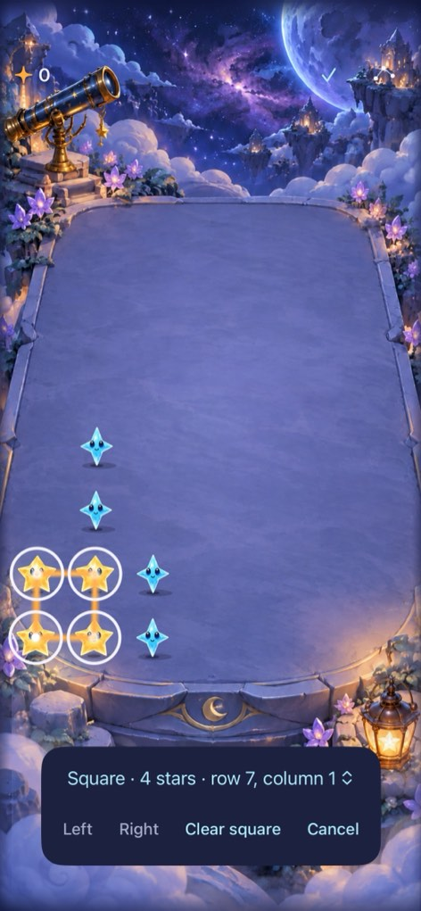
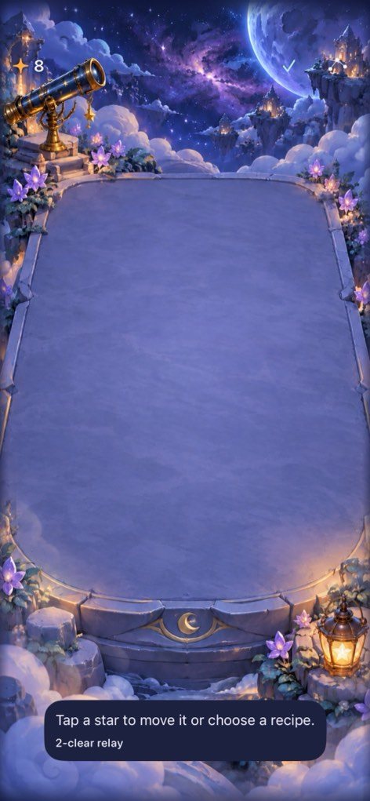
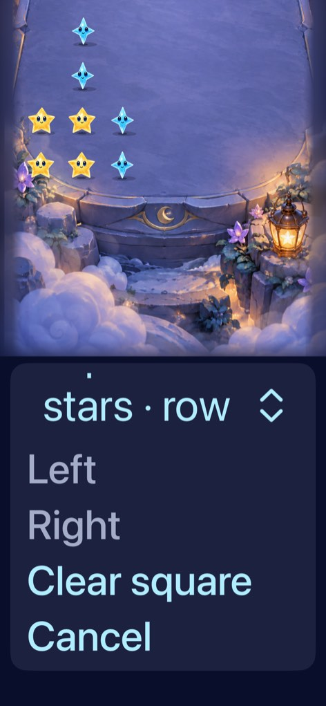
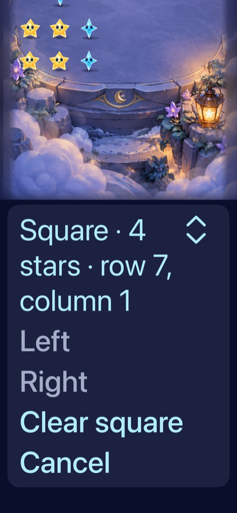

# Recipes and exchanges on current main

**Result:** Verified development integration and guarded phone installation · **Owner:** current implementer · **Date:** October 18, 2026

Restore the retained techniques on main `4281f29`, preserving newer Dusk feeding/collapse, Opal matching, gravity retirement, grown-star visuals, dialogue, flow, responsive columns and v6 saves. The original stale feature checkout is not a delivery source. Core, hosted, native, inspected layout and Debug/Release checks pass across the source-bound batches below. PR #74 merged as `b074345`; the original phone now has `dev.5a4f8d2bed`, installed only through the guarded updater. Saved bytes are unchanged. Next: observe human play and complete release-candidate accessibility acceptance.

## What changes

- In survival, swipe one horizontal cell, dwell 350 ms for the preview, then lift to exchange. Empty destinations allow a slide followed by ordinary falling. Leaving an armed target cancels the contact permanently.
- Arrange provides tap/accessibility equivalents and a choice among exact four-star squares and five-star crosses. Opal joins a colored family; surrounding stars remain. Existing five-star selected traces remain.
- Falling survivors can form another recipe. Clear it deliberately for causal relay feedback; there is no multiplier or automatic cascade. [Technique roster and contract](../../design/STAR_TECHNIQUES.md).
- First Light keeps its existing matching/tracing rules. No new save schema, cadence/RNG change, progression, separate app, runtime pilot flag, network feature or SDK. Reset-only authored examples do not save or run automatic showers. Help distinguishes survival techniques and removes stale gravity instructions.

## Verification and source

Xcode 27.1 / Swift 6.4; native tests use iPhone 17e, iOS 27.0 runtime 24A434, simulator `D65C5E40-734F-42BF-8F91-97E980ED19C2`. Debug and Release arm64 builds use one build job, no signing and no parallel test workers. Working-tree differences during final native checks are documentation/evidence only; runtime inputs match the named source.

| Check | Result and tested source |
| --- | --- |
| Core | 147 pass, `7763cfd`, after Dusk reconciliation. Includes exact ingredients, overlapping choices, Opal, drained rewards, nudge/drop, current/legacy seeded save continuation and forecast/RNG preservation. |
| All hosted app tests | 202 pass, zero skips, `e6ee27f`. Current v6/legacy save adoption, deadlines, stale callbacks, interruption, disjoint-column ownership, materials, native input windows, full/quiet exchange motion, Dusk collapse and independent animation ownership. |
| Initial native technique acceptance | Eight pass, build `dev.08c276876b`, base `7763cfd` plus the accessibility-action compilation fix. [Canonical runtime-input hashes](runtime-08c276876b.json). Exact selection/relay, overlap choice, rescue, tap/swipe movement, direct hold/empty fall, chosen-five tracing, multi-touch, settings/background and largest text. |
| Dusk native regression | Three pass on `c2fe908`: early release/zero-reward clear, three feeds/collapse/restore, largest text with system Reduce Motion. |
| Integrated native regression | Ten pass on `e6ee27f`, build `dev.14aaea5e22` ([inputs](runtime-e6ee27f.json)). Opening clear between animated waves, system Reduce Motion, ordinary drift, trace recovery, welcome/entry/background and win/replay/full-sky/restore pass. Includes final largest-text controls, tap/swipe nudges, direct hold/empty fall and selected-five tracing; the fixed full/quiet motion test also passes afterward. |
| Help clarification batch | `73d9cc3`, build `dev.99c0d5e7a0` ([inputs](runtime-73d9cc3.json)). Only help copy differs from that native runtime; no rule/input/render change. Release simulator build and final Debug/full-motion check pass. |
| Final scroll and menu polish | `e822899`: largest-text quiet scrolling, settings/background cancellation and nine hosted technique tests pass. `ff4f392`, build `dev.5a4f8d2bed` ([inputs](runtime-ff4f392.json)): native largest-text menu and overlapping cross choice, nine hosted tests and Release build pass. A clean Git export has the identical canonical runtime fingerprint. |
| Hygiene | `python3 scripts/ci-hygiene.py` and `git diff --check` pass; explicit App/hosted/UI memberships compile. Relative documentation links checked; rendered Markdown not checked. |

Commands use `swift test --jobs 1`, plus `xcodebuild -project Starfall.xcodeproj -scheme Starfall -configuration Debug -destination 'platform=iOS Simulator,id=D65C5E40-734F-42BF-8F91-97E980ED19C2' -derivedDataPath /tmp/starfall-current-techniques -jobs 1 ARCHS=arm64 ONLY_ACTIVE_ARCH=YES CODE_SIGNING_ALLOWED=NO -parallel-testing-enabled NO test`, selecting the table's suites. Release uses `-configuration Release -destination 'generic/platform=iOS Simulator' build` and separate DerivedData. Native recovered runs disable verbose failure diagnostics and bound per-test execution; existing flow-specific allowances remain. Raw logs/attachments are ignored under `artifacts/technique-current`; xcresults remain under `/tmp/starfall-current-techniques/Logs/Test`.

## Animation ownership regression

The shared survivor animation loop visited committed survivors outside its turn's reserved columns. A second disjoint exchange could therefore replace the first falling star's and ground shadow's movement. The same loop serves ordinary clears, so the correction filters by the committed column reservation at the scene boundary. Both node types share exchange timing from `StarfallMotion`.

The full-motion regression verifies sideways movement before falling, the committed endpoint, quiet-mode equivalence and two simultaneous exchanges. Removing only the column filter causes exactly the two star/shadow action-identity assertions to fail (`column-negative-confirm.log`). The fixed complete hosted suite passes. This examines the shared settling loop and representative disjoint exchanges; it does not establish every possible animation interleaving.

## Inspected native visuals

| Exact selection | Deliberate relay |
| --- | --- |
|  |  |

**Native XCTest captures, build `dev.08c276876b`, iPhone 17e / iOS 27.0 Simulator, default text, Calm effects off.** Full-size originals and retained compressed half-width copies inspected. The board remains dominant and controls sit below the stars. Selection/feedback appearance is sampled here; motion is separately tested. Later column ownership and shared-timing corrections do not change these resting states. The final menu comparison below was also inspected.

### Largest-text correction

| Historical failure | Verified wrapping menu |
| --- | --- |
|  |  |

**Native captures, iPhone 17e / iOS 27.0 Simulator, Accessibility XXXL, Calm effects off.** Before: `e822899` / `dev.ec121d95f2`. After: `ff4f392` / `dev.5a4f8d2bed`. Captured after scrolling to the actions; portions of the board are outside the viewport by design. Full originals and retained half-width copies inspected. The compact native picker clipped its selected value despite passing hittability checks. A native Menu with a wrapping custom label fixes that boundary while retaining exact choice labels, selection tokens and accessible value. Native cross choice and largest-text clearing pass.

The same visual review exposed a false “Touch interrupted” message on legitimate vertical scrolling. The capture recognizer now records when it yields to scrolling; the surface still cancels the physical hold, but gives no failure warning for that cause. A native assertion verifies quiet scrolling preserves recipe selection. Real interruption cancellation remains; the settings/background scenario passes after test-service recovery.

## Failed attempts and recovery

The initial task-owned simulator would not boot. Tests instead used an already-booted idle QA simulator without shutting down other QA devices. One native compilation failed on an accessibility-action argument label and was corrected before execution. The first motion test's exact coordinate comparison differed by 0.0000031 points because SpriteKit rounds through Float; endpoint checks now use 0.001-point accuracy, retaining all motion/outcome assertions.

A standalone MCP screenshot and automatic failure-diagnostic collection stalled; only their task-owned commands were stopped. XCTest attachments exported successfully afterward. Later, Settings launch and hosted startup stalled before assertions; a process sample located XCTest waiting in `_prepareTestConfigurationAndIDESession`. Two attempted negative controls reached no test and were cancelled. Restarting only this simulator's test-manager daemon restored the session. The complete 202-test hosted suite and subsequent opening, Reduce Motion and flow cases pass. A final interruption rerun also failed at app launch while XCTest could not acquire its OS background assertion; no gameplay assertion ran. Restarting the same selected test-manager daemon restored it, and that exact scenario plus all nine technique hosted checks pass (`scroll-interruption-recovered.log`). No assertions were weakened or blanket retries added. No other QA simulator or physical phone was restarted, erased or reset.

## Delivery and remaining limits

[PR #74](https://github.com/lbeezr/starfall/pull/74) published remote commit `512d24181b054ff7b2cfc97fa3a70e1f148b32f6`, tree `c3267ea41a96985f555f3af574b34d36e4f86b82`, byte-for-byte equal to the verified local tree. Main was re-fetched immediately before merge and remained `4281f29`; merge `b074345485fcc52bf3eab83b5f0bf035e782bc9f` has that same tree and includes the previously installed main. The local delivery checkout switched to that merged main.

The canonical installed service ran against its own clean main archive, targeting the configured physical iPhone 16 Pro Max / iOS 26.6.2 (23G90). A read-only app-inventory request re-established the idle paired-phone connection; no install bypass was used. The updater passed its own 147 Core tests, verified the signed Debug device product, rechecked main/source inputs and verified the actual installation. At install, remote main CI was pending under the existing policy; no failure was waived. Receipt source: `b074345485fcc52bf3eab83b5f0bf035e782bc9f`; build: `dev.5a4f8d2bed`; bundle: `com.starfall.prototype`. A separate post-install OS app inventory matches the updater's new installation URL and bundle version.

Before/after preference copies are **byte-for-byte identical**, SHA-256 `59860e8a31266cbf10205f3f61fce5471755227b836bca6b9daa707070da8faa`. This includes saved v3/v4/v5 accumulation data, legacy ranking/session bytes and sound/haptic preferences. No v6 save existed before or immediately after installation; normal activation owns migration. Private copies and verification JSON remain in `/tmp/starfall-technique-phone-preserve`, not Git. The app was not launched, reset, uninstalled or restored during delivery. Physical-device evidence establishes signed installation and preservation, not gesture/animation acceptance on the phone.

Actual VoiceOver acceptance is deferred to release candidates. Physical gesture feel, human enjoyment, uncoached recipe recognition, storm-time technique execution and free-exchange balance remain unverified. Observe those at the next human playtest; automated authored boards cannot establish them.
