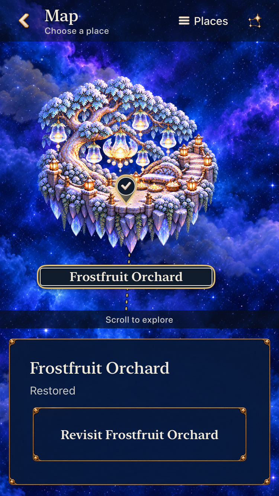
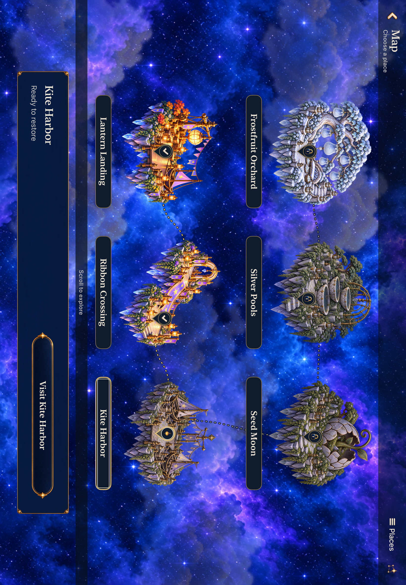

# Interactive Story map production

**Status:** Adopted for development on `9472691` / runtime fingerprint `dev.d4ba8a7698`, including current-main integration and constrained-dialogue corrections. Whole-map prototype rejected. **Date:** October 20, 2026.

The user's review rejected taking the approved composition directly into two whole-map paintings. The replacement separates sky, clouds, independent islands, native routes and controls. A read-only presentation snapshot and declarative artwork catalogue feed the normal renderer. The [production workflow](../../design/UI_PRODUCTION.md), repository skill and [asset contract](../../design/world-01/production/layered-2026-10-20/README.md) make the missing native-slice step explicit.

Each illustrated island and its name form one native destination button, with a smaller decorative teardrop. The map retains locked-place inspection, the shared selected card and all twelve Places identities. The compact world scrolls while the selection card stays available. Selection only inspects; Visit stages Entry, Begin commits, and Entry Back returns to the originating map. Map Back returns to its original Home/result/paused sky. The completed batch covered five island families; the subsequent current-main integration adds Frostfruit Orchard as the sixth ready destination.

The seven-state Debug harness seeds isolated review saves through the real committed-round/world readers. It exercises fresh, two/all repairs, locked, unbuilt, retained-game and recovery states using the same map. Review fixture preparation cannot reset ordinary player defaults; mixed review arguments are covered by a regression. There is no separate app or player-facing preview route.

## Acceptance and limits

The [baseline audit](README.md) remains the source of M1–M3 and the Entry origin issue. This implementation addresses those boundaries and the map card/row migration. Tutorial T1–T5 and shared settings/result/utility-icon work belong to the separate Observatory batch. No rules, save schema, unlock conditions or Core outcomes change here.

The modular checks cover actual destination-coordinate taps, locked/unavailable inspection, mixed repair states, retained-round Continue/restart, Entry cancellation, large text, background/resume and tablet rotation within the recorded source bounds below. Fresh combined-source checks and the final dialogue follow-up are recorded first; earlier failed matrices remain failed, with diagnosed corrections and focused reruns kept separately. Prototype navigation results do not establish acceptance of replacement geometry, art or motion. Observe an uncoached player at the next map playtest. Actual VoiceOver, minimum-OS validation and physical-device performance remain separate acceptance; no phone installation is part of this batch.

## Source and verification

Initial base: `d0dfcc1062eb8c109ceded861d9d80110ebf7824`, branch `codex/full-page-story-map`, development working tree. The existing `implementation-source.json` describes the discarded prototype, before the modular replacement and review harness. Later sections identify the shared-HUD integration, retained map captures and [completed five-island source](accepted-source-7c28dd232c.json), subsequently preserved in commit `1319347`. The six-ready integration merges `d94903b` and is preserved in `ebaf157`; its [runtime export matches the tested source](map-merge-identity.json). Later trace-input and Tutorial changes have separate completed development checks below.

### Current-main integration and final dialogue correction — adopted

Main `b811b85` adds living-light materials and versioned authored Lantern/Ribbon gameplay, including 150,000/220,000-point objectives and archive v10. Merge `6f24b68` / `dev.c8ef40bcdc` preserves them. Review repairs remain actual committed historical wins; Entry cancellation preserves those bytes and Begin selects the current definition. [Exact integration commands and results](current-main-validation.json) record **197 Core, 142 hosted, four phone native and two tablet native passes**, zero failures/skips, plus Debug/Release and membership. The seven-state harness and physical marker checks cover both tablet orientations. Seven phone and ten tablet stills were inspected; [six selected captures](current-main-captures.json) preserve their source.

Visual review caught a compact message panel containing only Pip and Close, despite passing existence assertions. The heading consumed its constrained reader, and the accessibility representation covered the entire introduction. `SkyDialogueBubble` now puts inline speaker/message text first, beside pinned actions at normal text sizes and above pinned actions at accessibility sizes. Its accessibility frame follows the body. The native regression checks visible body area and unchanged controls.

The [dialogue follow-up](dialogue-fit-validation.json) preserves both intermediate failures: the first run passed 12 hosted and three of four native cases, but the Studio scroll helper failed without inspecting its last allowed pan. Checking that result with the same visibility predicate and gesture budget exposed a real 26.5-point reader: duplicate Studio insets wrapped Continue. Removing those redundant insets lets the shared preview use its host's measured viewport. Final default/largest-text script flows pass **2/2 on phone**; tablet body/control verification passes **1/1**, all zero-skip. Largest-text paragraphs are read through to their end while full-size controls remain fixed. Core **197/197** and Release also pass on the final source. [Seven dialogue captures](dialogue-fit-captures.json) retain the failures and corrected appearance.

Final source `9472691` / **`dev.d4ba8a7698`** displays `dev.local` in manually built simulator apps. The [clean export identity](publication-commit-identity.json) matches all 55 incoming/changed runtime and test inputs; tests ran in the recorded working tree, not a separate clean-export native run. [Final Release inspection](dialogue-studio-release-membership.json) confirms all 14 map images, no retired plates or Debug fixture/Studio implementation, and 271 unique project objects. The final Studio change affects only Debug preview layout; the map and corrected gameplay bubble retain their separately inspected bytes. These selected checks establish development adoption, not an aggregate full-matrix or RC pass.

### Rejected prototype evidence

- Core: 184 tests passed, zero failures. The sandboxed invocation could not write the compiler cache; the normal local invocation passed.
- Release: arm64 simulator build passed. Source/resource membership uses the normal shared scheme and existing asset catalog.
- First hosted run: 51/52 tests passed. Seven assertions in one new case found that closing an empty path made an unbuilt repair mask nonempty. Returning an empty path before closure corrects that boundary. Xcode's optional Simulator diagnostic collector was stopped after assertions completed; this failed run remains failed.
- Corrected compact run: 58/58 passed, zero failures/skips; 52 hosted and six native interactions. Result: `/tmp/starfall-map-20261020/compact-map.xcresult`.
- Tablet: two native tests passed, zero failures/skips, including actual marker taps and Entry/Back in both orientations. Result: `/tmp/starfall-map-20261020/tablet-map.xcresult`.
- These tests verified prototype interactions. The user rejected its fixed-image composition; its passing tests do not justify adopting it. No assertion was weakened and no quiet-motion override was added to gain a pass.

### Modular replacement

The intermediate runs below used the development working tree on the base above. Source manifests are `/tmp/starfall-map-20261020/modular-slice-source.json` and `modular-slice-3-source.json`; each records its dirty build inputs. Only the Lantern family existed for these slices. The four intentionally absent families were not visually accepted.

| Run | Result | Boundary and correction |
| --- | --- | --- |
| Initial slice | Build failed; no tests ran | Swift rejected a layout initializer capturing stored properties before all fields were initialized. Layout calculations now remain local until initialization completes. |
| Slice 2 | 13 selected: 11 hosted passed, one hosted and one native failed; zero skips | Route endpoints differed after Float32 path storage. Component comparisons now use `0.001`-point accuracy. The native helper dragged at normalized `x = 0.98`, catching the scrollbar; it now drags inside the content at `x = 0.12`, retaining its bounded attempts and full-frame visibility requirement. |
| Slice 3 | **14/14 passed**, zero failures/skips | Nine geometry checks, four isolated-fixture checks and `testLanternLayerKeepsNativeTargetAcrossRepairStates`. |
| Tablet Lantern slice | **1/1 passed**, zero failures/skips | The same native Lantern test on iPad. This is not the complete tablet state/rotation matrix. |
| Core | **184 passed**, zero failures | `swift test`; log `/tmp/starfall-map-modular-swift-test.log`. |

The first native composition was rejected during visual inspection: the small island was dominated by its pin and nameplate. The revised slice makes the whole island and name one native button, enlarges the art, reduces the decorative pin and puts the full-size name below it. Slice 3 establishes that bounded slice's geometry and interaction; it does not establish acceptance of the complete asset family, sustained motion or player enjoyment.

Native environment: Xcode 27.1 (`27A9275`), macOS 27.0.1, Debug arm64, iOS 27.0 Simulator (`24A434`). Phone: iPhone SE (3rd generation), `02B7AF2E-1F1C-40F6-AA83-C67EA962B656`. Tablet: iPad Air 11-inch (M3), `377B8820-20E2-413E-B64F-D9E4CEB86AF4`. Results are `/tmp/starfall-map-20261020/modular-slice{,-2,-3,-tablet}.xcresult`; exact invocations and output are `/tmp/starfall-map-modular-slice{,-2,-3,-tablet}.log`.

Slice 2/3 commands used `xcodebuild -project Starfall.xcodeproj -scheme Starfall -configuration Debug`, the phone destination above, `-parallel-testing-enabled NO -collect-test-diagnostics never ARCHS=arm64 ONLY_ACTIVE_ARCH=YES test`, and selected `StarfallAppTests/WorldMapLayoutTests`, `StarfallAppTests/WorldMapReviewFixtureTests` and `StarfallUITests/WorldMapReviewInteractionTests/testLanternLayerKeepsNativeTargetAcrossRepairStates`. The tablet command selected only that native method and used `test-without-building` with the same derived data.

**Superseded complete-family attempt:** `/tmp/starfall-map-20261020/modular-family-source.json` records the complete modular family, seven-state harness, covered-map accessibility boundary, wide card and adaptive tablet rows before shared-HUD integration. Its phone run, `/tmp/starfall-map-20261020/modular-family-phone.xcresult` with `/tmp/starfall-map-modular-family-phone.log`, was canceled with SIGINT before completion when shared-HUD commit `386b2f8fad44d1f9c8379a00b03af6b10ca9861c` became available. This superseded run has no passing result. It selected the map layout, official artwork, fixture, journey and flow hosted suites plus both map review and world journey native suites. Subsequent combined runs and complete-family captures are recorded below; they do not turn this canceled attempt into a pass.

### First integrated matrix — failures retained

The map was integrated onto shared-HUD base `386b2f8fad44d1f9c8379a00b03af6b10ca9861c`. `/tmp/starfall-map-20261020/integrated-source.json` records its dirty build inputs; the recorded build fingerprint is `7c6927192a73`. The toolchain, Debug arm64 configuration and phone/tablet simulators are those listed above.

| Run | Result | Scope |
| --- | --- | --- |
| Integrated phone | **57/61 passed; four failed, zero skips** | All 47 hosted checks passed. Ten of fourteen native checks passed; the four failures are listed below. |
| Integrated tablet | **4/5 passed; one failed, zero skips** | Seven-state inspection with rotation, retained/recovery review, Lantern states and physical marker taps passed. Covered-map accessibility failed. |

Phone native failures:

- `testExtraLargeTextRetainedMapKeepsMarkersAndActionsReachable`: bounded scrolling did not fully expose the destination. The trace shows eight drags moving the target from `y = -1307` to `55`, while the viewport starts at `57`. The last drag lost clearance to native pan recognition, and the helper did not evaluate success after that final gesture. The correction increases clearance from 8 to 16 points and checks after the final drag; it retains the eight-gesture bound, full-frame containment and minimum target assertions.
- `testLargestTextMapAndPracticeSurviveBackground`: the helper addressed the correct Tutorial scroll view `(0, 157.5, 375, 509.5)` while trying to reveal its first chapter. In both this run and the later candidate, the attempted 81-point pans through blank padding at `x = 45` did not move the content. The initial attribution to a covered Places scroll view was incorrect; this is separate from the actual covered-map accessibility defect below.
- `testRetainedAndRecoveryReviewsReflowWithoutChangingTheRound`: the selected destination failed the initial full-frame visibility assertion. The `recovery-framing.xcresult` diagnostic also failed and identified a target `(69.5, 56, 272, 293.5)` inside canvas `(0, 56, 375, 293.5)`: the control used the entire viewport height, leaving no edge clearance. The first correction set `WorldMapLayout.targetViewportInset = 2`, passing `viewport height - 4` as the maximum node height, and strengthened the hosted sizing assertion. The native full-frame requirement was unchanged; the candidate follow-up below exposed a second clearance issue.
- `testTutorialHidesCoveredMapAndPreservesSelectionAndRetainedRound`: `world.*` elements remained exposed beneath Tutorial on both phone and tablet. Conditional parent accessibility hiding/ignoring was insufficient. `WorldMapView` now withdraws the interactive subtree while retaining its outer selection/list state, measured layout and backdrop; return restores the selected destination. The zero-element assertion remains, with an added failure attachment identifying leaked elements.

Visual inspection also prompted stronger route contrast and a scroll-overflow cue derived from measured content and viewport height. Their subsequent inspected map captures are linked in the final verification section below; the earlier passing interaction cases did not certify their appearance.

Result bundles are `/tmp/starfall-map-20261020/integrated-phone.xcresult` and `integrated-tablet.xcresult`, with exact commands in `/tmp/starfall-map-integrated-phone.log` and `/tmp/starfall-map-integrated-tablet.log`. Exported captures and failure diagnostics are in the corresponding `integrated-*-attachments` folders. The phone command selected the five map/artwork/fixture/journey/flow hosted suites, both world native suites and three existing Entry/help/cancellation cases. Tablet used `test-without-building` for the map review class plus the physical-marker case.

### Corrected tablet and candidate follow-up

The corrected tablet run completed **51/51 checks passed, zero failures/skips: 47 hosted and four native**. It uses `/tmp/starfall-map-20261020/corrected-source.json`, `corrected-tablet.xcresult` and `/tmp/starfall-map-corrected-tablet.log`. Its native scope covers seven-state inspection/rotation, retained/recovery reflow, physical marker taps and Tutorial accessibility withdrawal with retained selection/round. This passes the previously failing tablet covered-map case. This source precedes the subsequent two-point viewport-clearance correction described above.

`/tmp/starfall-map-20261020/accepted-candidate-source.json` records the next source with the two-point clearance correction and stronger hosted assertion. Results and exact commands are in `/tmp/starfall-map-20261020/accepted-candidate-{phone,tablet}.xcresult` and `/tmp/starfall-map-accepted-candidate-{phone,tablet}.log`.

| Run | Result | Scope and remaining failures |
| --- | --- | --- |
| Candidate phone | **52/54 passed; two failed, zero skips** | All 47 hosted and five of seven native checks passed. Extra-large retained targets, covered-map withdrawal, initial recovery framing, seven-state inspection and Entry cancellation passed their respective boundaries. Largest-text Tutorial scrolling and a later Silver Pools reveal in the retained/recovery case failed. |
| Candidate tablet | **3/3 native passed**, zero failures/skips | Physical markers, retained/recovery reflow and seven-state inspection with rotation. |

The recovery case now initially centered its selection, then failed while scrolling to Silver Pools. Its trace records a 289.5-point target in a 291.5-point inset viewport: target `y` alternated `17.5 → 63 → 41` across the viewport's `57`-point top edge. The two-point margin made full-target settling too tight. The renderer now reserves **12 points per edge**; the existing measured-font layout, 220-point canvas floor and full-frame native assertions remain.

The first Tutorial correction declared a full rectangular content shape and stacked the accessibility-size title and Done action, correcting the observed `Don` / `e` wrap. The content shape alone did not fix blank-padding pan admission; the focused diagnosis below preserves that failed attempt.

### Completed five-island map checks

[Retained source](modular-source-03eaf4e14d.json) records runtime **`dev.03eaf4e14d`** with the twelve-point map clearance and initial Tutorial scroll/header corrections. The same snapshot remains at `/tmp/starfall-map-20261020/final-source.json`. The tablet run completed **50/50 passed, zero failures/skips: 47 hosted and three native**. Phone completed **4/6 passed, two failed, zero skips**. Results are in `/tmp/starfall-map-20261020/final-{phone,tablet}.xcresult`, with exact invocations in `/tmp/starfall-map-final-{phone,tablet}.log`. Its two remaining failures were the recovery prose helper and Tutorial blank-padding pan.

The phone recovery case passed initial map framing and the Silver Pools, Lantern Landing and Ribbon Crossing physical taps. It later failed because the test asked the full-control visibility helper to fit the entire largest-text recovery paragraph into one viewport. That requirement is inappropriate for scrollable prose. A test-only correction now verifies the paragraph's beginning and width, keeps its measured dimensions unchanged, reads through at most eight physical pans of 45% viewport height, rejects jumps over half a viewport or gaps in visible overlap, and verifies the final lines enter the viewport. Each step retains a screenshot for visible-line inspection. Visit/Back, selected status and retained-save assertions remain unchanged.

The focused Tutorial diagnostic confirmed left/right padding pans made no progress while a center pan moved content by 170 points. A content shape alone was insufficient. `SkyTutorialView` now gives the ScrollView viewport an actual `skyTop` background surface. This is the only app-source change after `dev.03eaf4e14d`; the map captures and motion below retain their source scope. The corrected diagnostic passed **1/1**, zero failures/skips, in `/tmp/starfall-map-20261020/tutorial-pan-surface.xcresult`; its command/output is `/tmp/starfall-map-tutorial-pan-surface.log`. `/tmp/starfall-map-20261020/tutorial-surface-source.json` records the later source and test inputs.

The [accepted source inputs](accepted-source-7c28dd232c.json) bind runtime **`dev.7c28dd232c`** to the final Tutorial viewport correction and bounded recovery-reading regression on shared-HUD base `386b2f8`. The app-source difference from the retained `dev.03eaf4e14d` map captures is Tutorial's viewport background; the map renderer and artwork are unchanged between those two snapshots.

| Final five-island verification | Result | Source and scope |
| --- | --- | --- |
| Three final native flows | **3/3 passed**, zero failures/skips | `/tmp/starfall-map-20261020/accepted-flows.xcresult`; `/tmp/starfall-map-accepted-flows.log`. Largest-text map/practice, retained/recovery read-through and covered-map withdrawal on iPhone SE3. |
| Final-source Release | **Build passed** | `/tmp/starfall-map-accepted-release.log`; Release arm64, generic iOS Simulator, normal shared scheme. Xcode reports its no-AppIntents metadata-extraction warning; no AppIntents dependency was added. |
| Source preservation | **Committed as `1319347`** | The completed five-island batch is preserved before merging current main. Its passing checks remain source-bound and do not establish six-island integration, RC or installation acceptance. |

The native command uses `test-without-building`, the phone destination and toolchain above, `-parallel-testing-enabled NO -collect-test-diagnostics never ARCHS=arm64 ONLY_ACTIVE_ARCH=YES`, and selects exactly the three methods listed in the run log. The Release command uses `xcodebuild -project Starfall.xcodeproj -scheme Starfall -configuration Release -destination 'generic/platform=iOS Simulator' -derivedDataPath /tmp/starfall-map-20261020/ReleaseDerivedData ARCHS=arm64 ONLY_ACTIVE_ARCH=YES build`. These targeted reruns close the two remaining phone failures and recheck covered-map return after the Tutorial fix; earlier failed results remain failed.

### Six-ready integration checks

After preserving the completed batch in `1319347`, integration with current main `d94903b` brings Frostfruit Orchard, its existing progression contract and the faceless gameplay-piece work into the map source. Six destinations are now ready and six remain unavailable. The Debug harness retains seven states: `allReady` commits every registered challenge, locked inspection selects Frostfruit Orchard, and unavailable inspection selects Sunwheel Mill. Fixture admission and isolated saves retain their existing boundaries.

Runtime **`dev.e9657b05ce`** is recorded by [the expanded source manifest](expanded-source-e9657b05ce.json), with the same toolchain and phone/tablet simulators described above. Its snapshot records `1319347` plus the merged and modified build inputs. [Commit identity](map-merge-identity.json) verifies that the runtime export at **`ebaf1575a224bd547dbf529eedbf6e596e33b670`** matches those tested inputs. This source match does not convert the working-tree test runs into a clean-checkout rerun or establish publication/installation acceptance.

| Combined-source check | Result | Evidence and scope |
| --- | --- | --- |
| Core | **185 passed**, zero failures | `swift test`; `/tmp/starfall-map-current-main-core.log`. |
| Release | **Build passed** | `/tmp/starfall-map-expanded-release.log`; Release arm64 iOS Simulator, normal shared scheme. |
| Release membership | **Passed** | [Fourteen map assets](expanded-release-membership.json), including damaged/restored Frostfruit; retired whole-map assets and Debug review strings absent. Source-input hashes still match. |
| Tablet hosted/native matrix | **54/54 passed**, zero failures/skips | [Summary](expanded-tablet-summary.json): 50 hosted and four native checks, including six-destination geometry/artwork, seven review states, rotation and map/Places flows. |
| Original phone hosted/native matrix | **59/63 passed; four failed, zero skips** | [Failed summary](expanded-phone-summary.json). The four cases and subsequent scoped checks are detailed below; this run remains failed. |
| Corrected traversal check | **3/3 passed**, zero failures/skips | [Summary](expanded-traversal-phone-summary.json), [test-only source change](expanded-traversal-source-e9657b05ce.json). Same app runtime; temporary iPhone SE3 Simulator `29E78EAC-E600-4B9D-BAFD-047E6DC23A36`. Extra-large retained targets, locked marker traversal and retained/recovery read-through. |
| Serial isolated phone check | **3/3 passed**, zero failures/skips | [Summary](expanded-isolated-phone-summary.json), [observation helper snapshot](expanded-observation-source-e9657b05ce.json). Original phone Simulator: Tutorial with the unchanged 400 ms hold, Lantern repair-state target/Entry Back and retained/recovery flows. |

The original four phone failures remain explicit:

- **Extra-large retained traversal:** the fixed eight-gesture budget could not cross the expanded six-island world. The helper now calculates its budget once from initial measured distance and expected per-gesture travel, capped at 24. It still scrolls only `world.canvas`, observes after the last gesture and requires complete target containment, hittability and a minimum 44-point target. This is a test traversal correction, not a renderer change or an unbounded retry.
- **Lantern repair-state initial visibility** and **retained/recovery initial visibility:** the failing diagnostics showed frames within the viewport; repeated accessibility property reads inside each poll could delay observation. The helper now measures each frame and hittability once per poll and retains its five-second wait and full containment assertion. Both pass in the serial isolated run. That narrower result does not prove the original failures could never recur under another host load.
- **Tutorial real tap/swap/trace/Retry/exit:** the original run failed. The serial isolated run passes with the original 400 ms hold, without extending the gesture to obtain a pass. Later trace timestamp and Tutorial cover corrections are outside this runtime and are verified separately below.

The expanded runs use Debug arm64, Xcode 27.1 (`27A9275`), iOS 27.0 Simulator (`24A434`) and the phone/tablet models listed above. Exact command/output and result bundles remain under `/tmp/starfall-map-expanded-{phone,tablet,traversal-phone,isolated-phone}.log` and `/tmp/starfall-map-20261020/expanded-{phone,tablet,traversal-phone,isolated-phone}.xcresult`; the retained summaries bind counts and device identities. The focused reruns do not form a new aggregate full passing phone matrix.

### Input and Tutorial boundary — adopted before current-main integration

The [final source manifest](final-input-source.json) binds three production files and two test files after `ebaf157` to runtime fingerprint **`dev.96f4131f5d`**. The displayed CF build marker is **`dev.local`**; use the source fingerprint and hashes to identify this run. A later [test-only roster correction](final-flow-source.json) adds Orchard to the existing Entry Back loop; app inputs remain identical. The [clean commit export](final-commit-identity.json) at `a6122816af7018aa1ee1b0b28498bf364d4693aa` matches the runtime fingerprint and every changed test-source hash. Tests ran in the recorded working tree; the export comparison establishes exact source identity. [Exact commands, environment, counts and limits](final-validation.json) retain the selected checks.

The prior input adapter discarded `UITouch.timestamp` and let a scheduled task own hold classification. A delayed task could classify a physically held stroke as an exchange. The adapter now uses ordered event timestamps, including final-only/coalesced samples, while the timer stages stationary feedback. Earlier queued movement can withdraw a staged trace without releasing the existing contact ticket. Four deterministic hosted regressions withhold timer execution and cover threshold, excursion, stale/invalid sample, one-action and exactly-five boundaries. The original failed native run recorded a real 400 ms hold; its exact callback ordering was not captured, so task delay is a demonstrated code defect rather than a proven reconstruction of that run.

Practice also exposed the covered chapter index to accessibility queries. `SkyTutorialView` retains its presentation owner while withdrawing that interactive subtree, then restores the practiced chapter—including Next/Skip changes—when exiting. The native checks require no covered chapter/Done controls and a fully visible returned chapter before any test scrolling.

| Final-source check | Result and scope |
| --- | --- |
| Core | **185/185 passed**. The first sandboxed command could not write the compiler cache; the authorized invocation ran all tests without source changes. |
| Phone hosted/native | **91/91 passed**, zero failures/skips: 82 hosted and nine native. [Summary](final-input-phone-summary.json). Hosted: input polish 28, responsive input 17, technique store 25, map layout 12. Native: real Tutorial tap/swap/unchanged 400 ms trace/Retry/exit, largest-text practice/background and padding pans, covered Map/Places with retained round, stationary hold, short/outside cancellation, quick same-color swap then held-five, incomplete hold, and actual system Reduce Motion sibling. |
| Tablet native | **2/2 passed**, zero failures/skips. [Summary](final-input-tablet-summary.json). Same built app; real Tutorial actions/return and largest-text practice/background. |
| Final Entry Back roster | **24/24 hosted passed**, zero failures/skips. [Summary](final-flow-hosted-summary.json). Adds Frostfruit to the existing stale/cancel/origin loop; production source unchanged. |
| Debug / Release / membership | **Passed**. [Release record](final-input-release.json) confirms fourteen map assets, retired whole-map plates and Debug review strings absent. Five new source/test files each belong to one sources phase; 269 unique project objects. |
| Inspected appearance | Three phone and three tablet practice/index captures inspected. Default completion shows five collected with the sixth star remaining; the returned chapter is visible in the bounded menu panel. [Three retained captures](final-input-captures.json). Largest-text practice remains scrollable; its phone capture does not show all prose/actions simultaneously. The six-island map stills below remain source-bound and unchanged by these three app-file fixes. |

The final input adapter and map ownership/geometry/fixture/navigation boundaries received independent read-only review, with no actionable production defects. Development adoption closed for `a612281` / `dev.96f4131f5d`; the subsequent `b811b85` integration and dialogue corrections have separate evidence above. These selected runs do not replace the original failed matrices or establish full RC, actual VoiceOver, minimum-OS, uncoached-player or physical-device acceptance. No phone installation was performed.

### Inspected six-island appearance and bounded motion

Review inspected **14 tablet and 22 phone map/Places stills** across the expanded and corrected traversal runs, with no material visual defect found in those samples. Frostfruit's dormant/restored art keeps its silhouette and terrain marker registered; the selected outline, status glyphs, routes, native nameplates and cards remain readable. The compact world intentionally shows one destination at a time, and nonselected islands or labels may extend beyond the viewport with a visible scroll cue. Extra-large recovery fits its selected island and card; largest-text phone prose is read across overlapping scroll captures rather than forced into one viewport.

[Seven retained native captures](expanded-captures.json) identify runtime `dev.e9657b05ce`, source inputs, device, test and hashes:

| Selected capture | What it establishes |
| --- | --- |
| [Compact fresh journey](dev-e9657b05ce__map-fresh__iphone-se3__default.png) | Selected Lantern island, name, scroll cue and Visit card. |
| [Restored Frostfruit](dev-e9657b05ce__map-orchard-restored__iphone-se3__default.png) | Open luminous fruit, completed glyph and readable revisit action. |
| [Locked Frostfruit](dev-e9657b05ce__map-orchard-locked__iphone-se3__default.png) | Dormant frosted fruit, selected lock marker and Silver Pools prerequisite. |
| [Extra-large phone recovery](dev-e9657b05ce__map-recovery__iphone-se3__extra-large.png) | Complete selected Ribbon island and recovery text/action card. |
| [All six restored on tablet](dev-e9657b05ce__map-all-restored__ipad-air11m3__portrait.png) | Independent restored artwork and selected Frostfruit; lower nonselected labels require scrolling. |
| [Mixed repairs in landscape](dev-e9657b05ce__map-two-repairs__ipad-air11m3__landscape.png) | Six-island composition, readable routes and horizontal selected-place card. |
| [Largest-text tablet Places](dev-e9657b05ce__map-recovery-places__ipad-air11m3__largest-text.png) | Full recovery paragraph and wrapped Visit action in the reading layout. |

*Inspected Debug Simulator captures, iPhone SE3 and iPad Air 11-inch (M3), iOS 27.0; [source manifest](expanded-source-e9657b05ce.json) and [commit export match](map-merge-identity.json). These sampled appearances predate the `b811b85` merge and do not certify that integration, every text size, later input/cover changes or physical-device rendering.*

The six-island `twoRepairs` state also has [bounded normal/Calm frame comparison](expanded-motion-comparison.json): normal frames at one and eleven seconds differ; Calm frames are pixel-identical. [Process samples](expanded-motion-resources.json) record normal RSS **292,816–359,424 KiB** and quiet RSS **245,696–359,568 KiB** over twelve seconds. These are Simulator observations, not leak analysis, GPU memory, sustained frame pacing or physical-device performance acceptance. Actual VoiceOver, minimum-OS and uncoached-player acceptance remain separate.

**Historical five-island evidence:** [Earlier seven captures](modular-captures.json), [normal/Calm comparison](map-motion-frame-comparison.json) and [process samples](map-motion-resources.json) retain runtime `dev.03eaf4e14d`. Its two 14-second recordings showed cloud motion with fixed island controls and pixel-identical quiet frames at one and eleven seconds; normal RSS was 291,056–393,968 KiB and quiet RSS 393,600–394,160 KiB. These records explain the earlier implementation and do not establish six-island acceptance.
