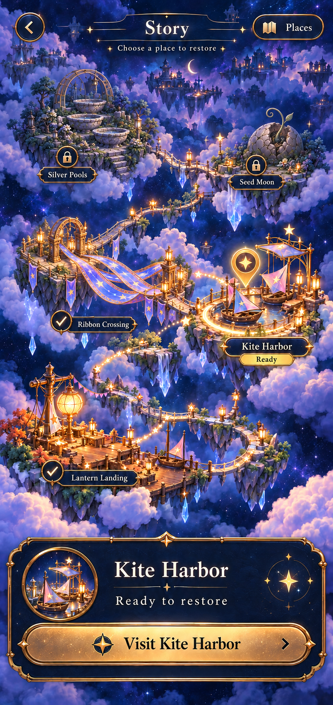
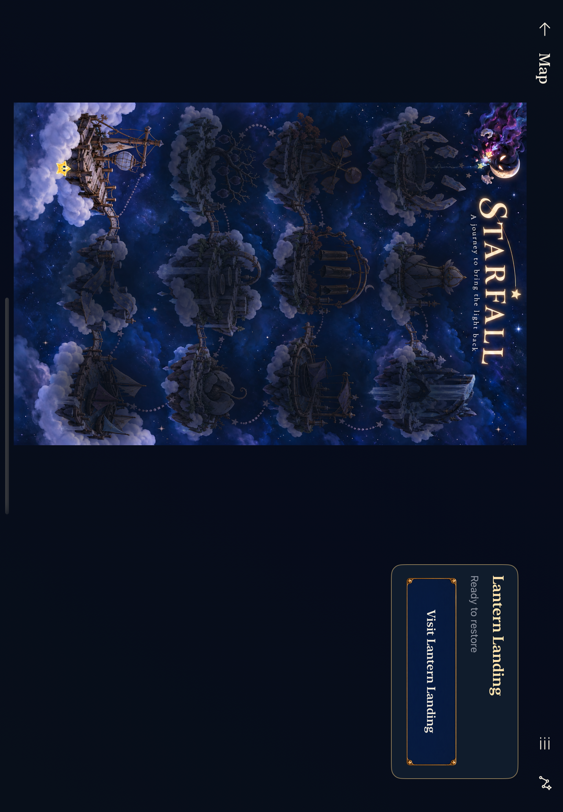

# Full-page Story map

**Status:** Modular native replacement adopted for development; whole-map-plate implementation rejected. **Date:** October 20, 2026.

The production map separates background, clouds, independently placed islands, routes, native markers and a selected-place card. The equivalent Places view retains all twelve destinations. Local journey state remains authoritative. The user's review identified the missing production step: the approved composition became another fixed painting before we proved reusable components and responsive composition. Follow the [UI production workflow](../../design/UI_PRODUCTION.md) and [modular map contract](../../design/world-01/production/layered-2026-10-20/README.md). Prove one native island slice before expanding the asset set.

*Generated concept approved by the user on October 20, not app footage or a production asset. Two repairs are shown and Kite Harbor is selected. Native labels, exact damage states, safe areas and device variants still need implementation review. A still does not demonstrate gentle motion.*

[Exact prompts, reference hashes and retained attempts](concept-provenance.json) preserve the original concept provenance. The first attempt incorrectly made Ribbon Crossing another pool and showed locked locations restored; the approved second attempt corrects those identities. Ready Kite Harbor's concept terrain remains illustrative rather than a verified 0% state. The distant islands do not replace the seven accepted future identities. The [text-free whole-map pair](../../design/world-01/production/interactive-2026-10-20/README.md) is retained as rejected prototype provenance.

## What the original review found

The reviewed app fitted a 2:3 poster into space above/beside the detail card. Its large baked brand/slogan consumed map area; its native destination buttons were invisible. Most places were veiled on first launch. The traveler moved only for enterable selections, with no independent selection mark. Existing animations reacted to completion/selection, so simply opening the page had no living-world response.

*Inspected historical native capture: `dev.f0badc738c`, iPad Air 11-inch M3 / iOS 27.0 Simulator. This illustrates the previous composition; it does not show the new implementation.*

## Interaction contract

| State | Map / Places feedback | Selected card |
| --- | --- | --- |
| Ready | Name and arrival/lantern symbol | Visit the named place |
| Selected | Immediate press response and fixed selection treatment, including locked places | Always describes this selection |
| Retained active round | Selected destination retains its access/repair marker | Continue first; restart separate |
| Restored | Check mark and restored artwork | Revisit |
| Locked but built | Lock/name; recognizable landmark | Explain the preceding repair; no entry action |
| Unbuilt | Named Places row with unavailable status; no foreground marker | Not yet available; never imply one more repair unlocks it |

“Choose a place” explains the selection action. A labeled Places utility offers the equivalent native list. The toggle is omitted when text size or viewport space makes Places mandatory. Selection has a fixed native outline and accessibility trait for locked destinations as well as ready ones.

Selection only inspects. Visit stages Entry; Begin commits. Entry Back returns to the selected map place; Map Back returns to its original Home/result/suspended round. Animation never grants access or repair.

## Composition and assets

Six built locations each use independent transparent island artwork with dormant/restored variants. Sky and cloud layers are separate. Native connectors derive from island ports, so reflow does not stretch a painted bridge. All six future identities remain in Places.

The compact world scrolls to preserve useful island and target sizes; tablet composition uses the available width. Selection stays in a separate card. Artwork bounds, marker anchors, route ports and native touch targets have explicit contracts and one layout owner. Selection, access, saved repair and ambient motion are independent inputs.

The teardrop remains a native shape using existing Observatory glyphs. Native names, buttons and reading-panel skins are reusable components. No separate bitmap is required for every selected, pressed or locked combination. Gameplay `LandingGeometry` and stars remain unchanged.

## Motion

The replacement uses bounded cloud drift and decorative light in an isolated ambient subtree. Native hit targets remain still. Quiet modes retain the same selection and repaired artwork; backgrounding and disappearance stop decoration. Selection and repair derive from committed state, never animation callbacks. [Bounded native observation](IMPLEMENTATION.md#inspected-six-island-appearance-and-bounded-motion) shows cloud motion in normal mode and pixel-identical sampled Calm frames; sustained physical performance remains separate.

## Bounded trial and adoption

**Hypothesis:** Visible named states, immediate selection feedback and a world occupying the page make Story explorable and entry understandable without coaching.

**Scope:** Normal-app map presentation and Entry return context. Shared choice/row styling is separate. No progression/save/rule/travel-gameplay changes.

**Development adoption complete:** The seven-state Debug harness uses the normal screen and isolated saves. [Source-bound evidence](IMPLEMENTATION.md) records compact/tablet mixed repairs, retained play, locked/unbuilt selection, recovery, large text and motion checks, including diagnosed failures and their corrections. Observe a first-time player finding and entering a ready location without coaching at the next player session; this discovery hypothesis and physical/actual VoiceOver acceptance remain open.

**Revisit/removal:** The native Lantern slice preceded family expansion; rejected whole-map runtime plates are removed. Recheck anchors, scale, mixed states, layout and device resource budgets when adding destinations or after player feedback. Revise the responsible component if markers obscure landmarks, alpha edges show halos or controls become unreachable. No player-facing comparison route or feature flag remains.
