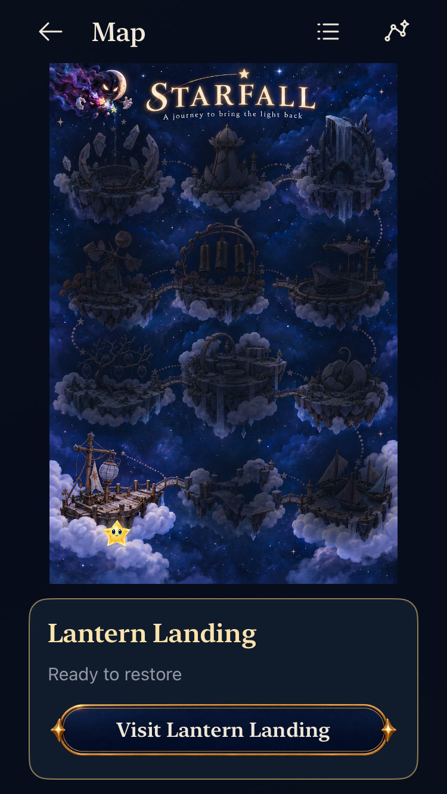
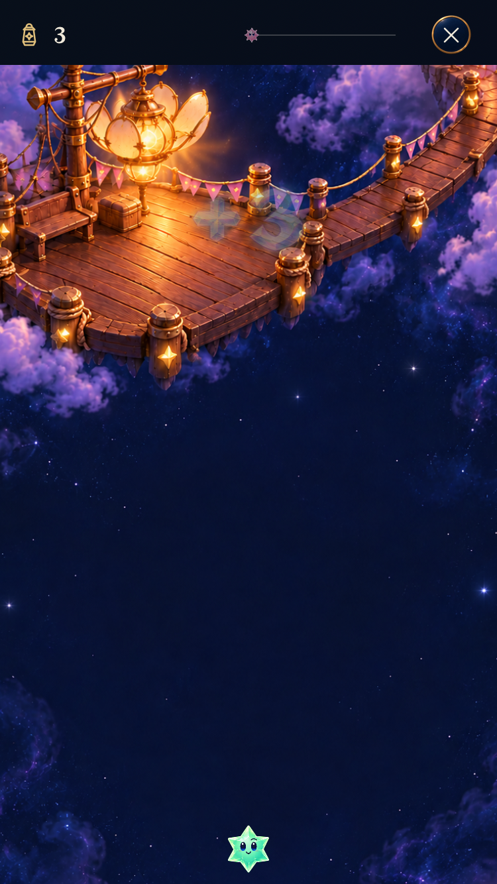

# Adversarial screen, state and flow review

**Result:** Baseline review complete; modular map, trace-input/Tutorial and constrained-dialogue corrections adopted for development at `9472691` / `dev.d4ba8a7698`, including current main. **Date:** October 20, 2026. **Owner:** Current implementer.

The Observatory family is present across the main screens, but adoption did not finish every control or state. The most consequential findings are tutorial contradictions and weak map selection feedback. A new painting alone would not resolve those interaction problems.

The user selected a **full-page illustrated world with visible destination markers, gentle motion and a selected-place card**. [The approved map direction](MAP_DIRECTION.md) is now implemented in a follow-on batch. [Implementation evidence](IMPLEMENTATION.md) records its source and checks. The baseline audit below used unchanged app inputs and remains historical defect evidence.

**Correction status:** T1–T5 and shared controls are addressed by merged `386b2f8`; the [Observatory parity report](../observatory-ui-parity-2026-10-20/README.md) owns their bounded verification. M1–M3, the destination card/Places changes and Entry Back are implemented. [Current-main verification](current-main-validation.json) records 197 Core, 142 hosted and six selected phone/tablet native passes with Release membership. Screenshot review then exposed clipped compact dialogue; the [final correction and follow-up](dialogue-fit-validation.json) retain the failed checks, corrected visible-body/preview layout and passing native results on `9472691`. All fifteen release surface families below were source-reviewed; native coverage remains a selected subset. Original evidence below remains historical. Actual VoiceOver, physical play and minimum-OS acceptance remain separate.

**Next action:** Observe uncoached destination selection and scrolling at the next player session, and profile physical-device motion/resources before expanding the map roster. The production renderer and harness are adopted; the baseline findings and original source references below remain historical evidence.

## Findings in priority order

| ID | Priority | Finding and reproduction | Responsible boundary / correction |
| --- | --- | --- | --- |
| T1 | P2 | **Tutorial coordinates disagree with the board's accessibility labels.** Match asks for row 1, column 1 for Core cell `(0,0)`; that actual star is announced as row 7, column 1. Swap and trace instructions share the reversal. | [Tutorial instruction formatting](../../../App/SkyTutorialView.swift), lines 63–70, uses `row + 1`; [board labels](../../../App/FallingSkyView.swift), line 476, use `7 - row`. Share the existing top-down presentation convention and update the coordinate explanation. Compare instructions with actual native labels, not only implementation IDs. |
| T2 | P2 | **Unrelated tutorial chapters expose Start sky, which fails the lesson.** In Match, Start sky observes `.resume` while the expected action is `.tap`, requiring Retry. The clock cannot run in Match anyway. | [Guide controls](../../../App/FallingSkyView.swift), lines 260–268; [pause owner](../../../App/FallingSkyStore.swift), lines 640–644; [tutorial admission](../../../Sources/StarfallCore/SkyTutorial.swift), lines 159–164. Derive available controls from lesson capabilities/current action; inspect Next shower as the sibling path. |
| T3 | P2 | **Square practice rejects a method its hint advertises.** After making the square, follow “You can also hold and draw around the four stars.” The canonical lesson expects a tap; method checking rejects a trace even if it commits the expected board. | [Square copy](../../../App/DialogueScripts/observatory-dialogue.json), line 819, versus [actions/admission](../../../Sources/StarfallCore/SkyTutorial.swift), lines 90–96 and 164. Correct the lesson's promise, or explicitly cover equivalent recipe methods while preserving strict trace lessons. |
| T5 | P2 | **Compact practice hides its instructions and completion controls below the board.** The fresh Match viewport shows no instruction; after the correct clear, its native capture shows the board/score with no Chapter complete, Retry or Next. The tests pass because helpers scroll to those controls later. | [Reading layout](../../../App/FallingSkyView.swift), lines 122–158, forces every tutorial into a scroll view with a minimum 900-point canvas before the guide. Keep lesson instruction/completion and progression discoverable at the viewport edge, or provide deliberate focus/scroll behavior without changing star/hit geometry. |
| M1 | P2 | **The painting does not communicate destination selection.** Twelve buttons render `Color.clear`; no visible names, state markers, press feedback or selection outline identify the controls. A small traveler indicates one enterable place. | [WorldMapPainting](../../../App/WorldMapPainting.swift), lines 102–116. Add named destination controls over the same registered geometry; distinguish ready/restored/locked/unavailable states through symbols and text. |
| M2 | P2 | **Locked/unavailable selection leaves the only marker elsewhere.** Tap Ribbon Crossing on a fresh map: the card changes, but the traveler remains at Lantern Landing with no visible selected-state counterpart to the accessibility trait. | [Selection observer](../../../App/WorldMapView.swift), lines 78–80, moves the traveler only for `canEnter`. Separate retained/current location from selection; mark every inspected location, including locked ones. |
| M3 | P2 | **Largest text exposes a view toggle that cannot change views.** Accessibility text forces Places; its active toggle still promises Map. | [Forced-list branch/toggle](../../../App/WorldMapView.swift), lines 52 and 95–100. Hide the toggle when the list is mandatory, or support an actual accessible map choice. |
| T4 | P3 | **Hint/Less disagrees with detail visibility at step zero.** Detail starts visible while the button says Hint; toggling Hint → Less never collapses it. | [Tutorial disclosure](../../../App/SkyTutorialView.swift), lines 199–214. Derive visibility and action label from one state; preserve intentional initial expansion without overriding user input. |

P2 denotes normal-priority functional/usability corrections. No crash, data loss or release-blocking P1 is established. These are source-confirmed contradictions; native reproductions and actual VoiceOver are separate evidence.

*Inspected native captures from clean `d0dfcc1`, Debug, iPhone SE3 / iOS 27.0 Simulator, default text. Left: M1/card migration evidence. Right: T5 after a successful real tap. The guide is reachable by scrolling; it is not missing from the view tree. [Capture provenance](captures.json).*

## UI migration and navigation follow-ups

| Surface | Current evidence | Recommendation |
| --- | --- | --- |
| Map destination card | `WorldMapView.destination` uses plain `starfallPanel` and local `.title2`/`.subheadline` typography around the new button. | Shared Observatory reading surface and theme type roles; one contextual destination action. |
| Sky settings | Pace and retained-history dark-frequency triggers use `.pickerStyle(.menu).labelsHidden()` without authored choice-row treatment. | Keep native menu semantics; share a labeled choice trigger with current value, disclosure and full target. |
| Preparing fallback | `FallingSkyView` builds a plain rounded rectangle for delayed handoff. | Reuse the reading surface; preserve Home escape and readiness ownership. Fault-path native appearance still needs inspection. |
| Places/tutorial index | `.plain` rows use theme glyphs/type but no explicit shared material press response. | Add one reusable row treatment; avoid heavy frames on every item. |
| Story Entry Back | The back-chevron invokes `.home`; `SkyFlowState.stage` clears `mapOrigin`. Map → Visit → Back goes Home. Existing tests expect this. | Preserve Entry origin and selection so Back returns to the map. Treat as a navigation adjustment with cancellation/retained-round regressions. |
| Free Play ending | Shared results promote Return to Map even for Free Play. | Prefer Replay/New sky for Free Play and Map for restoration. This is a hierarchy recommendation, not a broken action. |

Native save alerts, the static launch screen, compact gameplay notices and accessibility fallback text are appropriate exceptions to painted chrome. Compact tutorial `starfallPanel` is explicitly allowed; its presence alone is not a migration defect. Debug puzzle/studio/fixtures are outside release scope.

## Complete surface inventory

All fifteen release surface families were source-reviewed. This is broader than the native sample, and does not certify every device/text/save/motion combination.

| Family | States/flows examined | Finding or limit |
| --- | --- | --- |
| Launch | Static launch, opaque root, no delay | Separate system ownership; no new discrepancy found. |
| Home | Fresh, retained active/ended round, three modes, Settings | Observatory adoption present; one retained round. |
| Map / Places | Ready/restored/locked/unbuilt, selection, list, maximum text, recovered progress | M1–M3; map proposal pending. |
| Destination detail | Visit/revisit, retained Continue/restart, locked explanation | Older card/type roles; selection needs explicit feedback. |
| Entry | Free Play, five challenges, replay, settings, Begin/cancel | New chrome present; Back loses map context. Begin remains commit boundary. |
| Gameplay | Running/paused, reserved/held input, score/objective, forecast, awards, historical Dusk | Shared edge HUD present. Dense/physical motion acceptance remains separate. |
| Game menu | Resume/pause/manual shower, map/tutorial, restart/new/preferences | Shared controls present; menu suspension differs from paused showers. |
| Pre-play Settings | Home/Entry, toggles, Help, dismiss | Shared surface/switches present. |
| Sky settings | Pace/reset, historical dark frequency, disabled default reset | Choice trigger migration remains. |
| How to Play | Current/staged challenge context, manual explanations | Existing context owner; no new source discrepancy found. |
| Tutorial index | All 21 chapters, scrolling, exit | Shared glyphs/type; row feedback follow-up. |
| Practice | Initial/intermediate/wrong/complete, Retry/Hint/Less/Skip/Next/Finish; 21 action definitions | T1–T5. Existing native coverage exercises 7/21 chapters; hosted coverage follows all canonical sequences. |
| Restored result | Five identities, overshoot, final presentation, restore, replay/map/Home | Shared ceremony; preserve committed repair and final-turn boundary. |
| Full-sky result | Fresh/restored Free Play, replay/new/map/Home | Shared ceremony; mode-specific hierarchy recommended. |
| Exceptional overlays | Preparing, invalid save/save failure, recovered journey, timed/reopened/scripted dialogue | Preparing style gap; native alerts deliberate. Fault-path appearance incomplete. |

Cross-cutting source review covered background/resume, cancellation, restored pause, quiet motion, accessibility text, native labels and scene readiness. There is no claim of a full current-source VoiceOver session, all-device visual acceptance, sustained animation quality or physical play.

## Verification context

**Runtime source:** clean `d0dfcc1062eb8c109ceded861d9d80110ebf7824`. App/Core/build inputs remain unchanged. Dirty paths in this batch are documentation, review evidence and proposed imagery.

**Native environment:** Xcode 27.1 (`27A9275`), Debug, iPhone SE (3rd generation), iOS 27.0 Simulator, `02B7AF2E-1F1C-40F6-AA83-C67EA962B656`; isolated reset/review defaults. No phone installation or launch.

**Native result: 6 selected tests passed, 0 failed, 0 skipped.** [Exact command, selection, environment and initial failure](native-checks.json) · [xcresult summary](native-summary.json) · [three retained inspected captures](captures.json). All raw logs, 16 exported screenshots and result bundles remain disposable under `/tmp/starfall-ui-audit-20261020`.

The selected cases exercise Home → Entry → play/background/restore, pre-play/game preference persistence, staged First Light Help, fresh/locked/unavailable map and Entry cancellation, largest-text map/practice/background, and real tutorial tap/swap/trace/retry/exit with retained-round preservation.

The first invocation failed before tests: app x86_64 conflicted with package arm64. The corrected command explicitly sets `ARCHS=arm64 ONLY_ACTIVE_ARCH=YES`; no source or assertions changed. This is command setup correction, not a retried failed assertion.

| Evidence class | Result |
| --- | --- |
| Build / interaction | Debug simulator build and six selected existing UI cases pass; no runtime changes. |
| Visual | Native reviewer inspected 11/16 exported frames; primary reviewer independently inspected the three retained frames and the earlier tablet map. Confirms old map card/hidden destinations, largest-text density and offscreen tutorial guide. |
| Targeted accessibility metadata | A fresh native Match snapshot identifies `experiment.cell.0.0` as “Aqua four-point star, Spark, row 7, column 1.” Source instruction is row 1. This is T1 metadata confirmation, not actual VoiceOver speech. |
| Exploratory probes | An initial MCP tap did not navigate until Simulator's frontend opened; not treated as a product defect. Start sky and largest-text toggle were not separately activated; T2/M3 remain source-confirmed. |
| Animation | Existing normal-motion lifecycle test passed. No new continuous-motion inspection, frame-pacing measurement or proposed map animation acceptance. |
| Core / hosted / Release | Not rerun: this batch edits only review documentation/concepts, with no runtime or membership changes. Existing test coverage was inspected, not claimed as newly executed. |
| Hygiene / documents | `python3 scripts/ci-hygiene.py`, `git diff --check`, and local-link/provenance checks pass. New evidence files were also inspected explicitly because hygiene's tracked-file scan excludes untracked paths. |
| Actual VoiceOver / physical device | Not run. No phone installation. No full-matrix/RC claim. |

**Ownership during the baseline audit:** The separate Observatory implementation chat uses `/Users/lbeezr/.codex/worktrees/fc16/Starfall` for shared theme/artwork, HUD/menu/view/preferences/dialogue/ceremony work and their tests. This review edits documentation/concept evidence only. Its native build/captures use temporary storage and the compact simulator identified above; the other chat was informed by its own coordination message to use a separate simulator. No coordination reply was sent from this chat.

## Acceptance for corrections

1. Tap/swap/trace instructions identify actual accessible targets. Match offers only relevant lesson controls. Square's promises match admitted actions. Hint/Less changes what is visible. Compact players can see the current instruction and find completion/Next without guessing that the whole game scrolls.
2. A first-time player identifies and selects a ready map destination without guessing. All markers select their corresponding detail; locked/unbuilt places explain access and cannot start.
3. Continue/restart/revisit and Entry/Map Back retain distinct meanings. Browsing/practice/cancel never overwrite a round or award progression.
4. Compact phone, largest text, iPad orientations and normal/quiet motion retain reachable, non-overlapping targets. No visible control promises an unavailable view.
5. Record Core/build, native interaction, inspected stills, normal animation, actual VoiceOver and physical play separately. Add assertions for these defects rather than only existence checks or canonical-action scripts.
