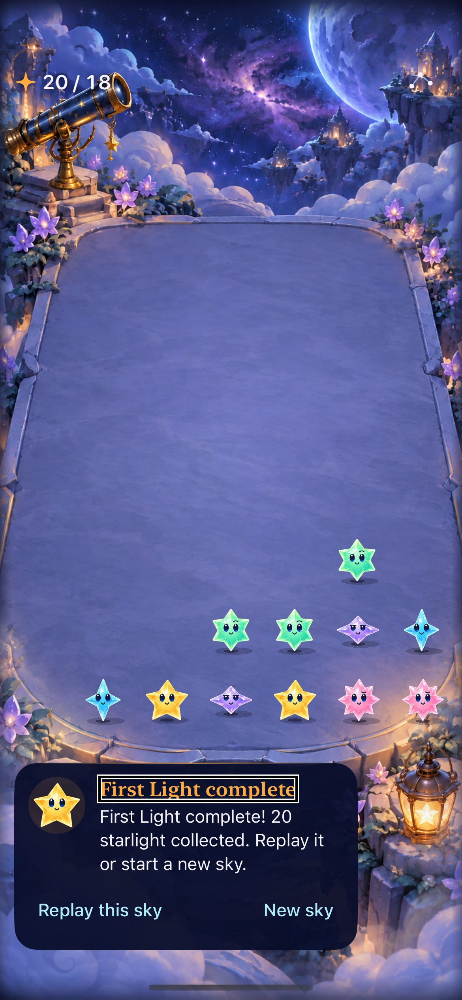
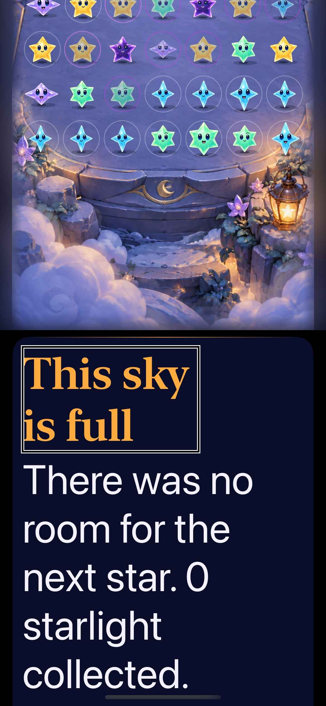

# VoiceOver gameplay focus and speech

**Result: Partially verified · Owner: current implementer · Date: 2026-10-17.** Individual stars now retain their spoken identity during touch exploration. Automatic nonterminal showers no longer interrupt exploration or menu speech; deliberate actions and terminal results still request spoken feedback. The described simulator flows pass; physical-device and actual custom-rotor acceptance remain open. Rules, clocks, RNG, saves, projection and resources are unchanged.

Acceptance recorded before implementation: explore without clearing, activate exactly the spoken group, inspect sibling/empty/dark/grown stars, use props and manual showers, hide the board under settings and return focus, preserve interrupted/restored state, and complete/replay a round with actual VoiceOver. The extended matrix adds automatic-rain speech contention and maximum-text overflow/replay. Physical-device and custom-rotor acceptance remain separate.

## Cause and correction

The labeled terrace container supplied its label in place of the touched star's identity. On unchanged main, touching Sunny spoke “Starfall terrace…” and the connected value five. Removing the parent label fixes this demonstrated case while retaining grouping, summary value, rotor registration and stable native cells. Terrace context now lives in the score's hint. Independent [two-phone evidence](../voiceover-round-2026-10-17/README.md) preserves the same correction and strict leaf/prop/menu/navigation checks on 17e and SE3.

A broader automatic-play check then read an arrival announcement while attempting to read Sky menu. Every automatic shower posted speech, allowing repeated background events to compete with deliberate exploration. The store now distinguishes explicit showers from automatic ones before presentation: automatic nonterminal messages remain in state without unsolicited speech; explicit inputs and terminal outcomes retain feedback. Announcement requests use the existing injected feedback owner, which already owns VoiceOver gating and sound interruption. No speech queue or new timer is introduced; the existing generation guard rejects stale completion speech.

Examined related paths: cell labels, connected values and hints; board summary/grouping and Matching groups registration; props; paused/terminal guide; settings hiding/focus return; invalid taps, clears, manual and automatic showers; terminal outcomes; suspension, restore and generation-guarded completion. This addresses the observed label and speech contention mechanisms, not every VoiceOver/device behavior.

## Keep app and test causes distinct

The original app-center double tap failed to activate the selected star in the harness; a gesture at the explored control succeeded. Tests now activate at that control and do not claim to verify arbitrary-position double taps. Touching an already-focused control need not repeat its label. Repeated selections therefore use actual backward/forward navigation, preserving exact speech and committed-outcome assertions and allowing VoiceOver to reveal scrolled controls.

The test driver also had to retain identifier values rather than query removed sheet elements, and reset its cached focus across app relaunch. Those were test lifecycle defects. Shared `NativeVoiceOverFocus` makes one exploration touch and observes asynchronous speech for up to five seconds; it does not repeat touches or retry failed tests. [Reproduction excerpts](reproductions.txt) retain app, speech-observation and test-driver failures. Earlier failed mixed runs remain failures, not green acceptance.

## Outcomes against acceptance

| Criterion | Observed result |
| --- | --- |
| Leaf exploration and activation | Exact Sunny identity/value, dark/empty/grown labels, adjacent forward/backward navigation and score-five clear; independent two-phone checks plus current 17e matrix. |
| Props and settings | Telescope/lantern activation, board hiding and Done-to-Sky-menu focus return. |
| Manual feedback | Three actual shower activations and focused growth/value-two speech pass. |
| Automatic play and interruptions | Actual Start sky, automatic arrival, spoken menu selection, Pause and background/resume preserve the paused board. |
| Maximum text | Actual sequential navigation reveals the offscreen guide; repeated showers reach overflow; outcome/replay and renewed manual control pass. |
| Complete First Light and restore | Actual win, terminal speech, background/restore, process relaunch, replay and new sky pass after correcting test-cache ownership. |
| Feedback ownership | Store regression verifies quiet automatic nonterminal rain, explicit invalid/manual/clear feedback, terminal speech and stale-completion rejection. |

## Native appearance and speech

| Ordinary-size win | Maximum-text overflow |
| --- | --- |
|  |  |

Inspected native iPhone 17e/iOS 27.0 captures: win from `d1b4ee3`, overflow from `1461f0c`. Focus outlines show the selected headings; native interaction tests establish replay, not these stills. Maximum text was deliberately selected for low-vision layout coverage. Its oversized decorative headings are a separate typography-polish opportunity, not the ordinary presentation. Markdown rendering was not separately reviewed.

Speech: [leaf/props/menu](leaf-and-menu.txt), [growth](growth.txt), [automatic play](automatic.txt), [largest-text overflow/replay](largest-text.txt), [complete First Light/restore/replay](complete-round.txt).

## Verification context

Xcode 27.1 (27A9275), arm64 Debug, iPhone 17e “Starfall Crystal Glow QA”, iOS 27.0, simulator `D65C5E40-734F-42BF-8F91-97E980ED19C2`. Tests explicitly reset seed-five state on this disposable QA simulator; normal device saves were not touched. No project/resource membership or signing changes are included.

[Source receipt](source.json) identifies clean source `1461f0c` for the broad matrix. Published app/store/feedback/test-host bytes match that source and `1c1234d`; subsequent changes reset test-only focus after relaunch and add evidence. The separate independent phone exports retain their own manifests; their raw results are not relabeled as testing this later speech policy.

| Check | Source / result / raw artifact |
| --- | --- |
| Core | 61 passed; `/tmp/starfall-voiceover-final-core.log`. |
| Broad native matrix | Source `1461f0c`: 28 passed, one failed, zero skips. All 18 store and six geometry checks plus growth, automatic play, largest-text overflow/replay and leaf/prop/menu flows pass. The retained failure is test-cache ownership across relaunch. `/tmp/starfall-voiceover-final-acceptance.xcresult`. |
| Corrected restore/replay and ordinary touch | Source `d1b4ee3`: all three passed, zero failures/skips—full First Light restore/replay, ordinary sparse/dense taps and maximum-text board/props/controls. `/tmp/starfall-voiceover-restore-acceptance.xcresult`. |
| Release | Passed with app bytes matching final source; `/tmp/starfall-voiceover-policy-release.log`. |
| Hygiene / diff | `python3 scripts/ci-hygiene.py`; `git diff --check`; passed. |

Reproduce using `xcodebuild -project Starfall.xcodeproj -scheme Starfall -configuration Debug -destination 'platform=iOS Simulator,arch=arm64,id=LOCAL_SIMULATOR_ID' -derivedDataPath /tmp/starfall-voiceover-policy ARCHS=arm64 ONLY_ACTIVE_ARCH=YES CODE_SIGN_IDENTITY=- CODE_SIGNING_ALLOWED=YES DEVELOPMENT_TEAM= CODE_SIGN_STYLE=Manual -parallel-testing-enabled NO -collect-test-diagnostics never test`. Select `StarfallAppTests/FallingSkyStoreTests`, `StarfallAppTests/ObservatoryGeometryTests`, the four `ObservatoryInteractionTests/testVoiceOver…` methods, and `FallingSkyInteractionTests/testVoiceOverReadsPausedGrowthFeedback` under `StarfallUITests`. The normal-input methods are `ObservatoryInteractionTests/testActualCastSparseDenseAndProjectedCornerTaps` and `testLargestTextKeepsPropsAndPausedControlsReachable`; run them after screen-reader teardown. Release uses `-configuration Release -destination 'generic/platform=iOS Simulator' CODE_SIGNING_ALLOWED=NO build`.

## Limits and next action

Actual screen-reader service output, committed game state and native captures are separate evidence. Speech entries can be truncated by the service. These tests do not establish speaker audibility, arbitrary-position double taps, actual custom-rotor gestures, full-motion feel, physical-device use, tablet/landscape or minimum-OS coverage. Automatic ordinary announcements are intentionally absent; terminal/manual requests are verified at the feedback boundary rather than claimed as an auditory listening study. Adopt the bounded correction. Retain those broader acceptance tasks in ENGINEERING.md; refine decorative heading scale separately while preserving readable primary text.
