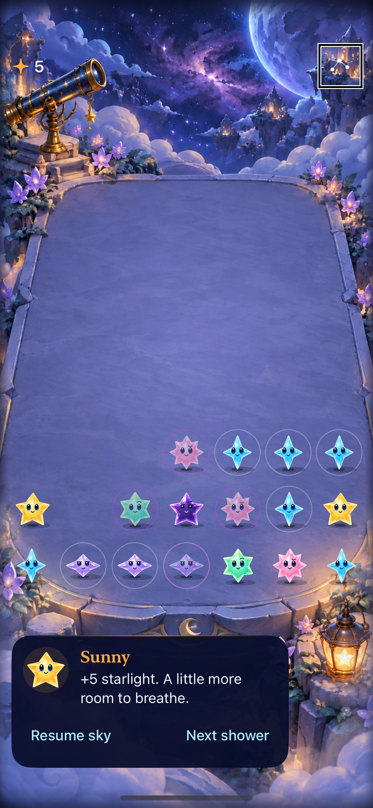

# Native VoiceOver round checks

**Result: Partially verified · Owner: current implementer · Date: 2026-10-17.** The actual VoiceOver round and focused-growth checks now pass on iPhone 17e and SE3. Removing the terrace container's label lets touch exploration reach the cell buttons. Grouping, summary value, individual names/positions/values and Matching groups rotor registration remain. The correction changes accessibility presentation only; rules, hit geometry and saves are unchanged.

**Next action:** return to the [bounded storm-choice follow-up](../storm-choice-followup-2026-10-17/README.md). Actual custom-rotor use, automatic announcement overlap, physical-device accessibility and broad VoiceOver round scenarios remain separate acceptance work; these focused simulator checks do not prove them.

## Acceptance and observed outcomes

Recorded before implementing: strict real screen-reader exploration and activation; sequential navigation; both props; menu hiding/focus return; focused growth guidance; state restoration. Keep test and app causes distinct and do not retry failed assertions blindly.

| Criterion | Observed result |
| --- | --- |
| Explore front-left star | Both phones speak Sunny, row 7, column 1 and connected value 5; exploration leaves score zero. |
| Sequential cell navigation | Actual service moveForward speaks row 7, column 2; moveBackward returns to Sunny at column 1. Score remains zero. |
| Activate a group | Double-tap at the focused star scores exactly 5. |
| Props | Telescope and lantern speak their identities and enter Responding after activation. |
| Menu | Board cells disappear from the exposed hierarchy while settings are shown; Done returns focused speech to Sky menu. |
| Growth | Three actual Next shower activations advance exactly once each; focused guide speaks growth and value two. |
| Cleanup | XCTest teardown restores and asserts the prior VoiceOver service state. Transcript attachment is also teardown-owned. |
| Normal touch / motion | Separate explicit normal-mode setup and selected checks are recorded below; no reduced-motion override added to obtain passes. |

Inspected native iPhone 17e / iOS 27.0 capture from the final export. It confirms visible menu focus and committed clear state, not falling animation or unsolicited announcement audio. Markdown rendering was not separately reviewed.

## Cause and related paths

The original test reproduced terrace-first speech on `0007e33`. Waiting for the exact expected star identity still failed, which rules out a merely immediate-read explanation for that failure. Removing only the parent accessibility label allowed the same strict exploration/clear/menu flow to pass. The observed issue is this labeled projected container's touch exploration on the tested native OS; do not generalize it to every SwiftUI container. [Apple's contain contract](https://developer.apple.com/documentation/swiftui/accessibilitychildbehavior/contain) describes the parent/child grouping retained here.

A separate SE3 focused-growth failure threw “No speech available” immediately after one exploration touch. Both native tests now share a helper that makes one touch and waits up to five seconds for expected focused speech; this is observation, not a repeated input or test retry. Activation stays at the focused control. Exact identity, connected value, score and state assertions remain. Actual round tests add adjacent forward/backward navigation and both props. App termination, service restoration and transcript attachment are registered with XCTest teardown before risky actions.

Examined sibling paths: cell labels/values/hints, summary container, rotor registration, projected native mapping, prop targets, guide focus, menu hiding/return and the focused-growth test. The retained rotor is not claimed as actually navigated. `currentSpeech()` reports focused-element speech, not the delivery or overlap of automatic announcements. No rule/store/scene/schema or resource changes.

## Source and environment

Final immutable export `starfall-production-guide-hyaldq5z` archives `e7a933af5ff02ed36959b489f8d9282510b09129` and overlays the three changed App/UI-test files. [Source manifest](source.json) records all file hashes and excluded dirty status. The App/Core/UI-test bytes were verified against the isolated worktree. A concurrent main refresh discarded earlier shared-checkout edits; the final work continued in managed worktree `voiceover-storm-review`, branch `codex/voiceover-storm-review`. No unrelated branding/project edits are included.

Bundle `com.starfall.validation.guide` isolates reset tests from normal app saves. Xcode 27.1, arm64, Debug native tests, iOS 27.0: MechanicsLab iPhone 17e `A84C81F5-AE41-496A-97AE-E17C63E18D29` and SE3 QA `E90550D2-AE94-4695-8E6F-707BD527C12F`. Shared scheme Starfall; flags `CODE_SIGNING_ALLOWED=NO ARCHS=arm64 ONLY_ACTIVE_ARCH=YES -parallel-testing-enabled NO`; DerivedData `/tmp/starfall-voiceover-review`.

| Check | Result | Raw xcresult/log identifier |
| --- | --- | --- |
| Original test | Failed: terrace-first speech | `test_sim_2026-10-17T18-39-04-524Z_pid85535_a9d4d488.xcresult` |
| Bounded focus observation, unchanged app | Same failure | `test_sim_2026-10-17T18-40-00-046Z_pid85535_5f1e1fc2.xcresult` |
| Label removal, original focused round scope | 1 passed on 17e | `test_sim_2026-10-17T18-40-45-852Z_pid85535_48bee632.xcresult` |
| SE3 runner startup | Terminal infrastructure failure before test connection; explicitly booted QA simulator before new run | `test_sim_2026-10-17T18-42-07-294Z_pid85535_5918634c.xcresult` |
| SE3 mixed matrix | Round and first-shower passed; immediate growth speech and normal-mode largest-text clear failed | `test_sim_2026-10-17T18-42-32-208Z_pid85535_30f24e0f.xcresult` |
| Final 17e actual VoiceOver | Both tests passed | `test_sim_2026-10-17T18-46-44-646Z_pid85535_c3297329.xcresult` |
| Final SE3 actual VoiceOver | Both tests passed | `test_sim_2026-10-17T18-48-44-965Z_pid85535_e27e65b4.xcresult` |
| Explicit SE3 normal-mode setup | Passed: service disabled and actual system Reduce Motion off | `test_sim_2026-10-17T18-50-36-816Z_pid85535_e9b17eeb.xcresult` |
| Separate normal touch after explicit setup | First-shower rapid input and maximum-text board/props/controls passed | `test_sim_2026-10-17T18-50-57-431Z_pid85535_579b1b88.xcresult` |
| Release simulator build | Passed, no reported warnings | `build_sim_2026-10-17T18-51-35-865Z_pid85535_f46afeb4.log` |
| Hygiene | Passed | `python3 scripts/ci-hygiene.py`; `git diff --check` |
| Core | 61 passed | `/tmp/starfall-vo-isolated-core.log` |

The mixed normal-mode failure is retained rather than silently counted green. Its root cause is not established by a successful isolated matrix. Final transcripts: [17e round](round-17e.txt), [SE3 round](round-se3.txt), [17e growth](growth-17e.txt), [SE3 growth](growth-se3.txt). The speech service truncates some strings; tests assert the actual supplied identity/value prefixes, not an invented full transcript.

Raw bundles/logs are under `~/Library/Developer/XcodeBuildMCP/workspaces/Starfall-27844ad883f3/{result-bundles,logs}/`; final attachments are in `/tmp/starfall-vo-final{17,se}-captures`. To reproduce from the committed change, run the existing [isolated exporter](../paused-guide-adoption-2026-10-17/export-validation.py), then `xcodebuild` against its project/scheme with the flags above and a local simulator destination. Select `StarfallUITests/ObservatoryInteractionTests/testVoiceOverSpeechActivationPropsClearAndMenuFocus` and `StarfallUITests/FallingSkyInteractionTests/testVoiceOverReadsPausedGrowthFeedback`. Run normal setup separately before normal-touch selections; do not mix evidence categories.
