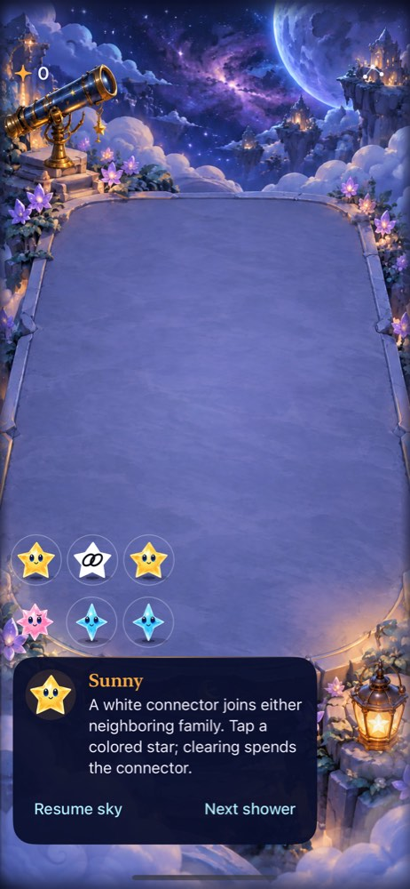
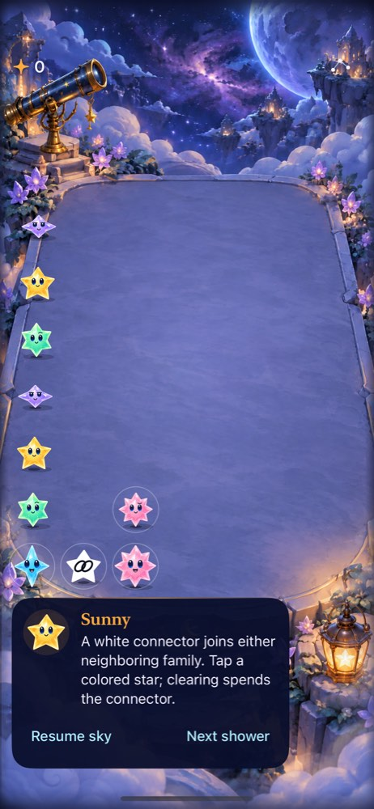
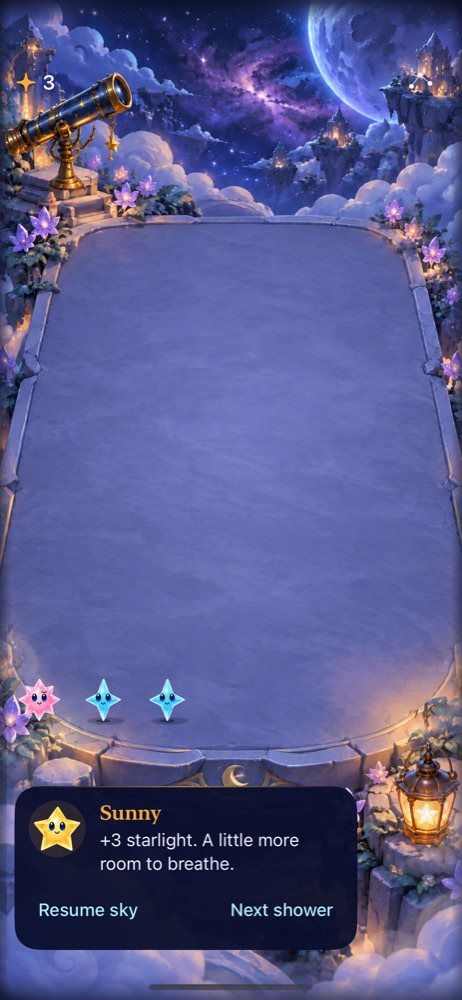
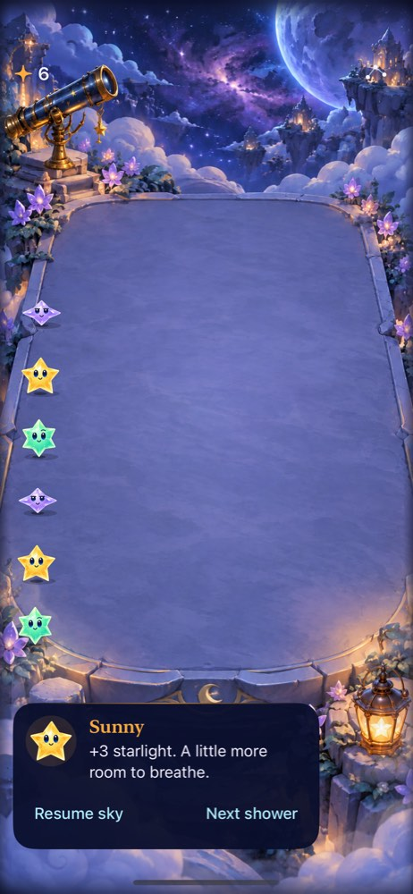
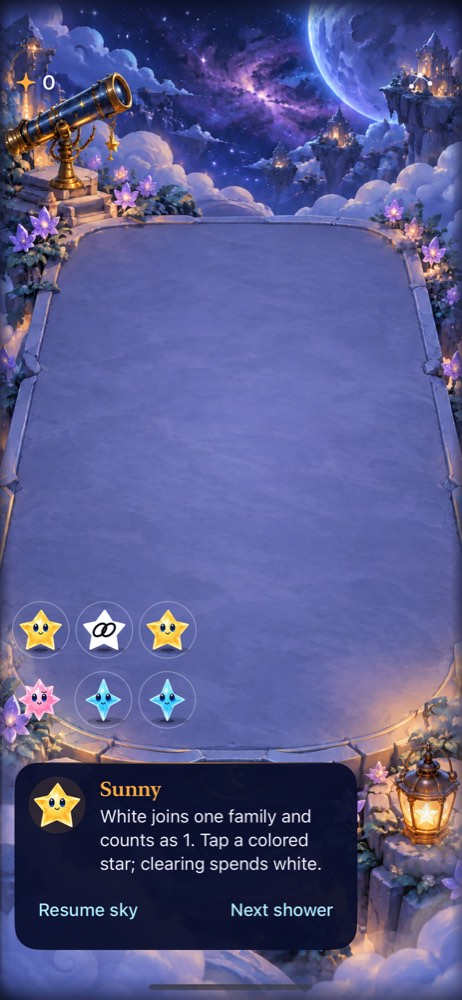

**Current decision after main review (October 17):** the bounded fixture study is closed and white is parked. Current main selects tracing five or more chosen stars while retaining ordinary taps; this trial tested the ordinary-only sky. Assess choices in that selected mechanic before adapting or removing white. Historical results and the earlier recommendation below remain source-bound. No extra phone installation or production adoption.

# White connector native fixture trial

[Pre-implementation acceptance](../../design/WHITE_CONNECTOR_TRIAL.md) defines two authored examples and separates rule consequences from player comprehension/preference. This app is a separate bundle, defaults suite and versioned save key. It has no natural white spawning and changes no shipping app/core/save. Constellations and storms are independent candidates.

The examples are built by scripted single-star previews committed through `letStarsFall`, validating every step. No JSON or save counters are forged. The connection example rewards holding through one authored amber arrival (four light versus three); the pressure example rewards a smaller clear that frees the full column (three survives, four overflows). Exact future landing places remain hidden in the UI; those deterministic branches do not establish player foresight under ordinary random showers.

## Verification

71 package tests pass: 61 existing, nine white-rule checks and one native-fixture check covering both branches, valid-save restore and exclusive families. The package run's Core bytes match the final native runtime. Eight focused native tests passed (four hosted, four UI), including actual VoiceOver. The Debug test build and separate Release simulator build passed. A build alone cannot establish gameplay quality.

## Failures retained and refinements

- The first native invocation selected nonexistent target `StarfallTests`; it ran no tests. Correct selection is `StarfallAppTests`.
- The first interruption test wrongly invoked the still-live clock callback after a motion change. The existing clock contract preserves that deadline. The corrected test checks that the old presentation completion is stale, the deadline remains live for motion, and background/pause/example/restart callbacks are rejected. No production clock change was made.
- Largest-text readiness initially required the offscreen Next control to be hittable before any scrolling. The board remains viewport-sized and the guide is below it. The corrected test checks the visible board cell's enabled/hittable state for its actual board tap; ordinary Next checks remain strict.
- Screenshots revealed that SpriteKit white multiplication and a deferred UIImage tint still displayed a yellow body. The final material rasterizes the existing body alpha into white once, retains the shared geometry/material factory, and adds two dark linked rings. A focused hosted pixel check plus native screenshots verify the neutral silhouette across expressions. This is prototype identity, not approved character art.
- VoiceOver service readbacks truncated long label/value utterances, also visible in baseline transcripts. One follow-up also waited for the wrong character name (“Ripple” rather than Spark). The final label retains color/shape/location and puts a short `3 light, spends white` value within the readback. It names white explicitly, tests its invalid activation guidance, then activates the colored group. The assertion still requires both value and spending consequence. Teardown retains the transcript and restores the prior actual VoiceOver setting.
- A test-only escaping teardown closure initially omitted `self.add`; compilation caught it before tests. It was corrected, with no app source impact.

Raw results are retained under the XcodeBuildMCP workspace and exact source/tool hashes are in [source.json](source.json). Final artifacts and acceptance gaps are recorded below when verified.

## Result and next decision

The separate app now demonstrates the two choices through native taps. Save/relaunch preserves the consumed connector and score; rapid store input cannot spend it twice. Hosted checks cover replacement/restart/background/pause/motion and stale presentation callbacks. UI checks cover invalid white taps, both pressure outcomes, held growth, menu example selection/dismissal, background/resume, and a largest-text board tap. A pixel check verifies the white silhouette across idle/landing/clearing expressions. [Actual VoiceOver readback](voiceover.txt) names white and reports `3 light, spends white` before activation commits three. This is one focused iPhone 17e / iOS27 path, not a complete assistive-technology round.

 

[Largest-text capture](largest-text.jpg) preserves the full terrace and places the guide below it; the actual board tap scored three. Final images were inspected, including the distinct white silhouette and dark links. Normal full-animation quality, explicit system Reduce Motion, small-phone/device play, broad automatic play, and human comprehension/preference remain **unverified** for this candidate. First Light/win UI is inapplicable to these survival fixtures; existing Core challenge tests pass, and no white is spawned in First Light.

**Decision: retain the isolated fixture app for one prediction-before-tap simulated comparison, then an uncoached human comparison if understandable. Do not adopt white or tune its spawning yet.** Ask what either clear consumes and what alternative it removes before acting; distinguish that visible consequence from guessing the hidden next landing. Keep the material explicitly provisional. No storm/constellation combination is justified yet.

Reproduce with `python3 tools/mechanics/prepare-white-connector-lab.py`; launch the printed project with `--starfalls-reset --white-fixture=connection` or `--white-fixture=pressure`, or select an example in Sky menu. Runtime/fixture/material fragments are appended to existing target-member files, so no shipping target membership changes. The manifest records the tracked snapshot and explicit untracked tool inputs; all tested runtime bytes are hashed. Retained installed Debug binaries match the tested products. Release was compiled without installation.

## Prediction-before-tap comparison and copy refinement

The [familiar simulated player](predictions.md) predicted the two chosen family clears from screenshots before native input, then selected one further action in each example. Parent executed exactly those choices through the [temporary exported-test bridge](WhiteChoiceNativeDriver.swift). [Four native calls](prediction-actions.json) passed. Reset/prefix replay restored examples between calls and is excluded from new decisions; no hidden landing information was given to the player. Connection ended at shower7/score3; Pressure ended at shower12/score6 after aqua then rose.

The useful result is specific: amber-first in Connection spends white and removes aqua readiness. Aqua-first in Pressure lowers the full column while leaving an independent rose clear; that rose clear then earns another three. Thus the latter is a **move-order benefit**, not mutually exclusive aqua-versus-rose rewards. Separate deterministic/native regression checks already cover the larger rose-first path ending in overflow on the authored arrival; the agent's two-decision observation did not test that counterfactual. Neither sequence established human enjoyment or a visible guaranteed reason to hold.

 

**Decision: retain for a bounded uncoached human comparison, clarify value before that test, and keep natural spawning unimplemented.** The original guide did not explain white's threshold contribution. One shared guide now says “White joins one family and counts as 1. Tap a colored star; clearing spends white.” The familiar-agent report applies to the prior copy and does not accept this refinement. [Refined native source](guide-refinement-source.json): 71 package tests, two affected native identity/restore/menu/largest-text checks and Release simulator build pass. A focused ordering regression now explicitly collects three plus three before the authored arrival. Rule patch, schema, arrivals and geometry are unchanged. Actual VoiceOver was not repeated for this copy-only refinement; retain the prior source-bound result and the current development/RC cadence.

Main advanced to constellation tracing, development bundle identities and optional rankings during this comparison. The white exporter now archives committed source `10346f4` rather than inheriting unrelated current-tree changes. This keeps the comparison offline and preserves its exact UI/rules boundary; it does not assert current-main presentation parity. A deliberate rebase or removal follows the named human comparison, rather than accumulating a permanent old-interface variant. No new network behavior was added by this work.

## Updated direction after integrating main

Main `2b936ec` contains the accepted selected-tracing direction and one stable phone lab. That changes the comparison boundary: this white app contains no tracing and its familiar-agent result does not establish added value alongside selected subsets. Close the authored-fixture study and park the candidate instead of scheduling an immediate old-rule human comparison. Keep the exporter/source only for reproducing its measured consumption/order findings. Next trigger is a selected-tracing choice baseline; decide explicitly whether to adapt the connector to a compatible bounded trial or remove it. Do not infer that adding both mechanics improves replayability.

[Integration check](integration.json): clean committed source `78c07fe` preserves upstream main `06143f8` runtime bytes exactly, passes 61 production Core tests and a Release simulator compile. No current-main interaction acceptance is claimed from that build. The closed white app was removed only from this task's private simulator; source/tooling/evidence remain reproducible. No phone or normal save was touched.
